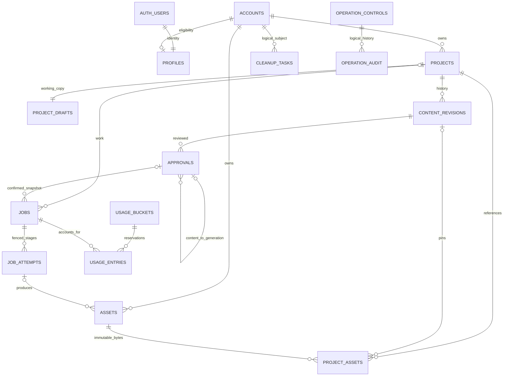

# AI Video Creator V1 — Database Design

## 1. Status, authority and scope

Version **0.1 — Technical design / Pending owner review**, 22 October 2026, Asia/Colombo. Companion: [API_DESIGN.md](API_DESIGN.md). Sources: [PRD v2.5](PRD.md), [System Architecture v1.2](SYSTEM_ARCHITECTURE.md), [UI/UX v0.2](UI_UX_DESIGN.md), [roadmap](ROADMAP.md), [M1 plan](M1_IMPLEMENTATION_PLAN.md), [progress](PROGRESS.md), [README](../README.md) and [AGENTS](../AGENTS.md). Requirements alignment is owner-authorized; revised source documents retain their recorded review status. This document proposes implementation contracts without applying SQL, migrations or configuration.

M0 remains **Completed / Owner Approved**; M1 **Not Started / Planning Prepared**; M2–M6 **Not Started**. Full V1 design does not authorize implementing all entities in M1. No billing/subscription/team/organization/social tables, consent ledger, post-V1 customization or music entities are proposed.

The five UI steps are Video Details → Script & Storyboard → Voice & Subtitles → Generate Video → Preview & Download. They are navigation, not five database job states. Relational records hold ownership, revisions, eligibility and transactional work; private Storage holds large bytes. Versioned application registries hold templates, characters and three configured English voice presets, avoiding editable catalog tables until a genuine requirement justifies them.

## 2. Shared conventions and integrity rules

All tables below are proposed application tables except managed `auth.users`. `app` is a proposed application schema for safe user-context access; `private` is not exposed through the Data API. Schema exposure and grants must be verified in M1. Routes never return raw table rows. RPC names in §8 are contracts, not implemented functions.

- `R` means NOT NULL; `N` nullable. `—` means no default: caller must supply a validated value. Common **I** fields: `id uuid R DEFAULT gen_random_uuid()` PK; `created_at timestamptz R DEFAULT now()`. Common **T** adds `updated_at timestamptz R DEFAULT now()` maintained by trusted mutations. All timestamps are UTC; clients localize display. Each table explicitly declares I/T below.
- Unless an explicit DEFAULT is written, required fields have no default and nullable fields default NULL. Fields marked required cannot be omitted merely because a JSON payload supplies a partial draft; the trusted mutation constructs the complete row. Common fields and all constraints apply in addition to each table's field list.
- Owner tables use `owner_id uuid R` referencing `private.accounts(user_id)`, default **—**, set from verified identity. It cannot be changed. Each has `UNIQUE(owner_id,id)` to support composite foreign keys (FKs). Cross-project references additionally use `UNIQUE(owner_id,project_id,id)` where needed. Referenced candidate keys must exist before creating a composite FK.
- Unless specified otherwise, FKs use `ON DELETE RESTRICT`, not cascades. Cleanup deletes in dependency order and verifies Storage before removing the only manifest. No workspace cascade from Auth. `profiles` is the one direct Auth reference; cleanup removes it before Auth deletion.
- All JSONB is bounded, schema-versioned domain data validated with shared Zod and semantic validators at server/worker boundaries. JSON cannot carry executable code, arbitrary paths/URLs, unknown templates/actions or foreign assets. SQL checks enforce type/range/basic shape; trusted transactions enforce full semantic relationships. A hash is not authorization.
- Hashes use `text` constrained to 64 lowercase hex characters; hash input uses a versioned canonical serialization and explicitly defined Unicode convention. M0 hashes remain unchanged; future SaaS serialization must not reinterpret historical approvals. Internal text spans use documented UTF-16 code-unit offsets with explicit provider conversion, verified on surrogate pairs, normalization, numbers and repeated words in M2/M3.
- Domain codes are constrained `text`, enabling reviewed additive migrations rather than accidental PostgreSQL enum expansion. API uses the same codes. Presentation labels are mapped separately.
- Defaults below are proposed technical choices unless already required by the PRD. Product size/count/timing limits retain PRD §6.3's **proposed** status; limits are versioned backend configuration, not undocumented hard guarantees.

### 2.1 Domain values

| Domain | Exact design values / rule |
| --- | --- |
| Video type | `product`, `educational`, `project_explainer` |
| Presentation style | `animated_explainer`, `cartoon_teacher`, `cartoon_presenter` |
| Compatibility | Product: animated/presenter; education: all three; project: animated/presenter. SQL pair CHECK plus shared validator; seven valid, two invalid pairs. Defaults animated/teacher/animated respectively. |
| Target | `smallint`, integer 62–90 inclusive; default 75. Actual permitted window: intersection of hard 62–90 and requested target ±3 seconds under PRD §17.3; no silent script changes. |
| Account | `active`, `generation_restricted`, `deletion_in_progress`, `deletion_failed`, `deleted`; internal underscore serialization of the architecture lifecycle, not new product states |
| Project dashboard | `Draft`, `Generating`, `Ready`, `Needs Attention`, derived by §7; not copied from the current UI step |
| Job | `queued`, `validating`, `synthesizing`, `composing`, `rendering`, `finalizing`, `retry_wait`, `succeeded`, `needs_attention`, `failed`, `cancelled`, `held` |
| Job kind | `source_intake`, `planning`, `voice_sample`, `video_generation`; cleanup uses independent `cleanup_tasks` |
| Approval kind | `content` (Step 2), `generation` (Step 4) |
| Resume step | `smallint` 1–5, navigation hint only; current approvals/assets/jobs still gate actions |

## 3. Entity relationships

Diagram edges marked logical (`accounts`→cleanup and controls→audit) deliberately have **no cascading FK**; cleanup/audit must survive deletion. Assets can be reused by multiple projects of the **same** owner. Source identity is owner-wide; a project link and revision pin establish authorized use. No cross-user content deduplication. A previous successful MP4 is another validated asset attached to its original job/approval, not an overwrite of `final.mp4`.

## 4. Table catalog

Each entry specifies purpose, fields, keys, indexes, access, requirements and milestone. Fields listed as JSONB group genuinely cohesive bounded data; no separately normalized scene/word/caption rows are needed for V1. RLS and privilege classes in §6 apply to every entry.

### 4.1 Managed `auth.users`

Supabase owns identity UUID PK, email, encrypted credentials, sessions and recovery. Do not migrate this provider table or copy password/reset/session fields into application records. Email in settings is fetched from authenticated Auth, read-only in the application. No email-based ownership joins. Provider indexes/defaults remain provider-managed; ordinary users have no application SQL access to `auth.users`. M1; F01; AC01–AC06. Name metadata at signup is untrusted initial profile input only, never authorization. No permanent confirmation-password column.

### 4.2 `private.accounts` — authoritative current lifecycle

Fields: `user_id uuid R PK` (verified Auth subject at provisioning; **no FK to Auth**, no default); T without I's id; `state text R DEFAULT 'active'`; `state_version bigint R DEFAULT 1`; `restriction_reason text N DEFAULT NULL` (allowlisted safe code); `deletion_requested_at timestamptz N DEFAULT NULL`; `deleted_at timestamptz N DEFAULT NULL`; `retain_until timestamptz N DEFAULT NULL`.

CHECK valid lifecycle, positive version; deleted requires deletion timestamps/retention; deletion states cannot transition back to active/restricted. Index `(state,updated_at)` for reconciliation and partial `(retain_until)` for completed tombstone expiry. Relationship root for owned records. No browser reads/writes; narrow own-state RPC returns safe capabilities. Only trusted provisioning/control/deletion transactions mutate it. Provision only verified **live Auth identities** with no deletion marker, never a JWT alone or a missing-profile upsert. M1 guard foundation; M4 full lifecycle; F01/F23/F24; AC06, AC48–AC58.

### 4.3 `app.profiles` — limited editable name

Fields: `user_id uuid R PK` FK to both accounts and `auth.users(id)` (RESTRICT); T without id; `full_name text R` no default; `save_version bigint R DEFAULT 1`. Proposed name validation: trim, 1–100 Unicode code points, no control characters; no human-name regex. No email copy, role, quota, billing, photo or legal consent fields. No passwords or confirmation values.

PK serves own lookup; no extra name index. RLS own safe read while readable; mutation only narrow versioned name RPC, not broad UPDATE grants. Authenticated password change stays in Auth. M1; F01; AC01/AC05/AC06 plus PRD §23.3 proposed own-name coverage (not a new AC).

### 4.4 `app.projects` — stable owned workspace

Fields: I+T; owner; `title text R` (proposed 1–160 code points); `creation_key text R`; `creation_request_hash text R`; `current_revision_id uuid N`; `latest_success_asset_id uuid N`; `deleted_at timestamptz N`; defaults NULL for nullable pointers. UNIQUE `(owner_id,creation_key)` supports create/duplicate replay; request hash binds exact operation/input. Ownership candidates as §2; current revision pointer has a same-owner/same-project composite FK. Output pointer has a same-owner composite FK to assets; its same-project association is additionally verified through its committed job (assets may be owner-wide reusable files). Cyclic pointers are added after base tables and remain nullable at initial creation. `deleted_at` makes the project unavailable immediately; it is not a new dashboard status.

Indexes `(owner_id,updated_at DESC,id DESC)` and `(owner_id,deleted_at)`; use bounded escaped title search initially, no search service or speculative GIN index. Authenticated own readable SELECT; all create/title/pointer/delete mutations via narrow transactions. Title and safe draft edits permitted for restricted accounts; deletion state denies ordinary reads. M1 basic creation/list; M4 duplicate/delete/history. F02/F13–F18; AC06/AC34–AC38/AC43/AC63.

### 4.5 `app.project_drafts` — acknowledged mutable working state

Fields: `project_id uuid R PK`, owner composite FK `(owner_id,project_id)`→projects; T without id; `save_version bigint R DEFAULT 1`; `video_type text R`, `presentation_style text R` (supplied with matching defaults via create); `target_seconds smallint R DEFAULT 75`; `resume_step smallint R DEFAULT 1`; `details jsonb R DEFAULT '{}'`; `voice_preset_id text N DEFAULT NULL`; `voice_registry_version text N DEFAULT NULL`; `subtitles_enabled boolean R DEFAULT true`; `selected_content_approval_id uuid N DEFAULT NULL` same-owner/project FK to approvals.

Details schema includes description, source text, category-specific confirmed facts, audience/objectives, product primary source, project status Concept/Prototype/Available, selected idea and source limitations. Required-for-planning fields may be absent in an incomplete draft; they must pass before planning/approval. No voice may be silently substituted. Enforce §2.1 pair/target/step checks, positive save version; registry/settings semantic validation server-side. PK and `(owner_id,project_id)` unique index suffice. Safe own SELECT; conditional RPC saves use expected version, mutate only approved fields and atomically invalidate affected current decisions. M1 fields/draft safety; M2 full content validation; M3 voice choices; M4 integrated resume. F03/F04/F14/F19; AC07/AC08/AC14/AC15/AC23/AC34/AC63.

### 4.6 `app.content_revisions` — immutable saved script/storyboard

Fields: I; owner; `project_id uuid R`; `revision_no integer R`; `parent_revision_id uuid N DEFAULT NULL`; `origin text R` (`generated`,`edited`,`restored`,`duplicated`); `schema_version text R`; `content jsonb R`; `content_hash text R`; `source_manifest_hash text R`; `registry_versions jsonb R`; `based_on_save_version bigint R`. Required fields have no defaults. Content contains understanding, source citations/warnings, narration, ordered scenes/actions/spans and **estimated** timing, plus exact type/style/character/target facts. Raw original provider replies are private assets if necessary, not routine logs.

Composite FKs to owned project and same-project parent. UNIQUE `(project_id,revision_no)`, `(owner_id,project_id,id)`; index `(owner_id,project_id,created_at DESC)`. Do not unique content hash: an intentional restore may have identical content but a new history identity. Immutable after insert except deletion cleanup. Own read; approved insert only by validated save/planning commit. A planning result whose base save/revision changed is saved as a historical candidate, not promoted over newer work. Restore creates a new unapproved revision. M1 only nullable project pointer/schema provision if needed; M2 actual revisions/approval. F06–F08/F14; AC14/AC18–AC20/AC22/AC34/AC39/AC63.

### 4.7 `app.approvals` — two explicit immutable decisions

Fields: I; owner; `project_id uuid R`; `revision_id uuid R`; `kind text R`; `content_approval_id uuid N DEFAULT NULL`; `snapshot jsonb R`; `snapshot_hash text R`; `confirmed_save_version bigint R`; `approved_by uuid R` equal owner; `approved_at timestamptz R DEFAULT now()`.

Composite same-owner/project FKs to revision and optional parent content approval. Content kind requires no parent, snapshot exactly the validated content/source/registry identity. Generation kind requires a same-revision `content` parent and complete configuration: content approval/hash, sources/checksums, narration/scenes, type/style/character versions, voice preset/provider model/settings/registry version, subtitles, duration and render/timing build versions. Generation-kind shape/kind-parent semantics are enforced in the transaction as well as simple SQL CHECKs. UNIQUE `(owner_id,project_id,id)` and `(owner_id,project_id,kind,snapshot_hash)`; index `(project_id,revision_id,kind)`. An exact repeated decision may return the existing row only after current eligibility/revision revalidation.

No mutable `approved=true` or global stale flag. Historical approvals remain evidence; **current validity** is matching current revision/dependencies/save configuration, not merely existence. Voice/subtitle edits may retain content approval but require a new final decision; spoken/type/style/semantic-source changes require affected content reapproval. Old jobs retain their pinned snapshots, never mutable draft references. Own safe read; insert only explicit approval transaction. M2 content; M3 final snapshot/admission; M4 full UX. F07/F08/F16; AC14/AC19/AC22/AC23/AC36/AC63.

### 4.8 `private.assets` — owned private byte manifest and checkpoints

Fields: I+T; owner; `kind text R`; `status text R DEFAULT 'allocated'`; `bucket text R`; `object_key text R`; `allocation_project_id uuid N`; `parent_asset_id uuid N`; `job_id uuid N`; `attempt_id uuid N`; `sha256 text N`; `mime_type text R`; `expected_bytes bigint N`; `actual_bytes bigint N`; `metadata jsonb R DEFAULT '{}'`; `validation jsonb R DEFAULT '{}'`; `dependency_hash text N`; `expires_at timestamptz N`; `finalized_at timestamptz N`; nullable defaults NULL.

Kinds: source, extracted_text, image_derivative, narration, alignment, timeline, cues, voice_sample, render_intermediate, video, thumbnail. Status: allocated/uploaded/validating/valid/invalid/deleting. Required final checks depend on kind; valid requires verified checksum/byte count and validation evidence. Metadata holds width/height/pages/duration/codecs/fps/frame count and pinned dependency versions as applicable. Expected bytes reserve capacity; actual bytes are measured. Composite same-owner FKs to allocation project, parent asset, job/attempt; job owns project association for generated outputs. `attempt_id` requires `job_id` and same-job composite FK. Allocation source cannot change ownership/project/key after issuance.

UNIQUE `(bucket,object_key)`; candidate `(owner_id,id)`; indexes `(owner_id,kind,status)`, `(job_id,kind)`, partial `(expires_at)` and `(owner_id,dependency_hash)` for reusable checkpoints. A hash index is not global deduplication. Retry artifacts use new attempt-specific keys; completed objects immutable, no client overwrite/upsert. Private table has no ordinary grants; safe metadata comes through checked routes/RPC projection. M1 staging/source metadata; M2 extraction; M3 media/checkpoints; M4 retrieval/cleanup. F04/F09/F11/F17/F18; AC06/AC15/AC27/AC29/AC31/AC35–AC39/AC50/AC63.

Storage ownership is validated against the asset manifest, not Storage's uploader field alone: server-created outputs may have no ordinary uploader identity. Cleanup discovers owned bytes from manifests plus the server-controlled owner prefix, including late/orphan writes, with bounded pagination; it must not leave outputs behind simply because they were uploaded with a privileged credential.

### 4.9 `app.project_assets` — live source links and immutable revision pins

Fields: I; owner; `project_id uuid R`; `asset_id uuid R`; `revision_id uuid N DEFAULT NULL`; `role text R` (source/primary/derived/output); `position smallint R DEFAULT 0`. Composite same-owner FKs to project/asset and same-project revision. For draft links (`revision_id IS NULL`) unique partial index `(project_id,asset_id,role)`; for pins unique partial index `(revision_id,asset_id,role)`. Index `(owner_id,asset_id)` supports safe reference checks; `(project_id,revision_id,position)` supports display.

A revision pin cannot be edited. A draft link change advances save version and invalidates affected approvals. Attach only validated owned sources; pending allocations have metadata but are not usable plan references. Cleanup also checks approvals/jobs/assets' parent references, not this join alone. Duplicate creates new draft links to same-owner immutable assets, no approvals/jobs/Ready state. Own safe SELECT; narrow transactional mutations only. M1 draft links; M2 revision pins; M4 duplication/reference-safe cleanup. F04/F14/F15/F18; AC06/AC14/AC35/AC37/AC39/AC63.

### 4.10 `private.jobs` — durable accepted work and submission identity

Fields: I+T; owner; `project_id uuid N`; `revision_id uuid N`; `approval_id uuid N`; `kind text R`; `state text R DEFAULT 'queued'`; `stage text R DEFAULT 'admission'`; `status_version bigint R DEFAULT 1`; `input_snapshot jsonb R`; `input_hash text R`; `idempotency_key text R`; `request_hash text R`; `base_save_version bigint N`; `lease_epoch bigint R DEFAULT 0`; `lease_holder text N`; `lease_expires_at timestamptz N`; `heartbeat_at timestamptz N`; `available_at timestamptz R DEFAULT now()`; `attempt_budget jsonb R`; `hold_reason text N`; `cancel_requested_at timestamptz N`; `last_error_code text N`; `result jsonb N`; `finished_at timestamptz N`; other nullable defaults NULL. Increment status_version on every externally relevant state/attempt/retry eligibility change; opaque API statusVersion encodes this value, not lease authority.

Composite owned project/revision/approval FKs; video kind requires project/revision/**generation** approval; planning/intake require project and validated snapshot; sample is owner-scoped and may optionally refer to project. UNIQUE `(owner_id,kind,idempotency_key)`, `(owner_id,id)`, `(owner_id,project_id,id)`; partial claim index `(available_at,created_at,id)` for queued/retry_wait; partial `(lease_expires_at)` for leased states; `(owner_id,kind,state)` for outstanding caps. No single-outstanding unique constraint because the cap is configurable; transactional counters/buckets enforce it.

Input/result manifests use owned IDs only, no credentials. Result is bounded references/safe codes; raw provider output lives privately. Leases authorize only this job, not other owners. Source intake waits unclaimable while its allocation has no completed upload; allocation expiry reconciliation can cancel it and safely release unused capacity. Nonvideo tasks use applicable canonical states (queued/validating/finalizing/succeeded and failure/hold/retry states), not fictitious synthesizing/rendering stages. No user-context SELECT/INSERT/UPDATE grants: return sanitized owned status via API. M1 minimal recoverable intake only; M2 planning queue; M3 full leases/admission/worker recovery; M4 operational policies/UX. F16/F22; AC23–AC25/AC31/AC33/AC36/AC40/AC41/AC44/AC52–AC58.

### 4.11 `private.job_attempts` — stage, provider intent and recovery evidence

Fields: I+T; owner; `job_id uuid R`; `stage text R`; `attempt_no integer R`; `lease_epoch bigint R`; `status text R DEFAULT 'prepared'`; `provider text N`; `provider_request_id text N`; `dispatch_intent_at timestamptz N`; `completed_at timestamptz N`; `input_hash text R`; `checkpoint jsonb R DEFAULT '{}'`; `usage jsonb R DEFAULT '{}'`; `error_code text N`; `elapsed_ms bigint N`; `resource_metrics jsonb R DEFAULT '{}'`; nullable defaults NULL. Status: prepared/dispatched/succeeded/failed/uncertain/abandoned. Provider identity is internal. Dispatch outcome is not inferred from a browser timeout.

Composite same-owner FK to job; UNIQUE `(job_id,stage,attempt_no)` and `(owner_id,job_id,id)` for asset FK; index `(job_id,lease_epoch)` and `(status,updated_at)` for uncertainty reconciliation. Commit with current job lease predicate and epoch; stale attempts cannot publish. Dispatch intent survives crashes; attempts left prepared near dispatch require conservative uncertainty handling, not blind retry. Attempt budget is shared across automatic retry, manual retry and duration adjustment; repair has its own bounded recorded budget. Private only. M1 minimal intake evidence; M2 planning attempts; M3 complete stage/provider/resource recovery. F11/F16/F22; AC25/AC27/AC30–AC33/AC40/AC62.

### 4.12 `private.usage_buckets` — configurable atomic capacity

Fields: I+T; `scope_key text R`; `metric text R`; `window_start timestamptz R`; `window_end timestamptz N DEFAULT NULL`; `limit_units numeric(20,6) R`; `reserved_units numeric(20,6) R DEFAULT 0`; `consumed_units numeric(20,6) R DEFAULT 0`; `config_version text R`; `owner_id uuid N DEFAULT NULL` FK accounts for per-user scope. Global/provider scope has no owner. `scope_key` identifies environment and actual shared provider-account scope without credentials; metric defines the unit (requests, tokens, characters, bytes, outstanding jobs).

UNIQUE `(scope_key,metric,window_start)`; index `(owner_id,metric,window_start)`; nonnegative counters/limit; end greater than start when present. No hard CHECK consumed ≤ limit: measured/external usage may exceed an estimate and must remain recordable; admission refuses remaining capacity below reservation. Outstanding slots/storage are gauges, not automatically reset calendar counters. Private no user grants; config values operator-controlled. M1 coarse storage/allocation caps; M2 planning guards; M3 admission/provider reservations; M4 configurable complete limits; M5 measurement. F22; AC15/AC23/AC40/AC52/AC57.

### 4.13 `private.usage_entries` — reservations and actual/uncertain consumption

Fields: I+T; owner; `bucket_id uuid R` FK buckets; `job_id uuid R` composite owned FK; `attempt_id uuid N DEFAULT NULL` composite same-job FK; `reservation_key text R`; `reserved_units numeric(20,6) R`; `actual_units numeric(20,6) N DEFAULT NULL`; `state text R DEFAULT 'reserved'`; `expires_at timestamptz N DEFAULT NULL`; `settled_at timestamptz N DEFAULT NULL`. State reserved/consumed/released/uncertain; units nonnegative. UNIQUE `(bucket_id,reservation_key)`; indexes `(job_id,state)` and `(state,expires_at)`. A bucket FK and transaction verify any per-user owner matches entry; shared bucket may span owners while entries remain scoped.

One entry per job/attempt/metric reservation; counters and entry updates commit together. Uncertain call retains conservative reservation; expiry alone never makes a possibly consumed call free. Reconcile deltas once, prevent double settlement with row locks. A byte allocation has a source_intake job before bytes arrive, permitting storage reservations to use the same ledger; intake claims wait for upload completion. Outstanding video slot released on terminal settlement, not while held/retry_wait. Private no browser access; no invented balance dashboard. M1 allocation reservation subset; M2 planning; M3 full admission/settlement; M4 limits. F22; AC31/AC33/AC40/AC52/AC57/AC63.

### 4.14 `private.operation_controls` and `private.operation_audit`

Controls fields: I+T; `scope_key text R UNIQUE` (`global_generation` or account UUID scope); `subject_id uuid N DEFAULT NULL` logical subject; `paused boolean R DEFAULT false`; `version bigint R DEFAULT 1`; `reason_code text N`; `changed_by text R` safe deployment operator reference. Account restriction is authoritative in accounts; its control row is versioned command evidence synchronized in one transaction, not a second independent eligibility source. Global control row must exist; missing/unreadable control fails expensive work closed. Index PK/unique scope suffice. No browser grants.

Audit fields: I; `control_id uuid N DEFAULT NULL` logical reference with **no FK**; `subject_id uuid N DEFAULT NULL` logical; `actor_ref text R`; `action text R`; `outcome text R` success/failure; `reason_code text R`; `control_version bigint N`; `expires_at timestamptz R`. Indexes `(subject_id,created_at)` and `(expires_at)`. Content-free: no names/emails/private scripts/files/tokens/URLs. Transaction commits success audit with control; a failed transaction uses a separate safe failure record/log and never reports success. No browser reads/writes, operator authority never comes from user metadata. M1 deny/grant foundations only; M3 checks; M4 full controls; M5 races. F24; AC54–AC58.

### 4.15 `private.cleanup_tasks` — independent destructive lifecycle

Fields: I+T; `subject_id uuid R` **logical Auth UUID, no FK to Auth/accounts**; `project_id uuid N DEFAULT NULL` logical; `kind text R` project/account; `status text R DEFAULT 'pending'` (pending/running/retry_wait/incomplete/completed); `stage text R DEFAULT 'fence'`; `confirmed_at timestamptz R`; `idempotency_key text R`; `manifest jsonb R DEFAULT '{}'`; `lease_epoch bigint R DEFAULT 0`; `lease_expires_at timestamptz N`; `lease_holder text N`; `heartbeat_at timestamptz N`; `retry_at timestamptz N`; `last_error_code text N`; `auth_deleted_at timestamptz N`; `completed_at timestamptz N`; `retain_until timestamptz N`; nullable defaults NULL.

UNIQUE `(subject_id,kind,idempotency_key)`; unique partial `(subject_id)` for account kind ensures repeated confirmations reuse account cleanup; unique partial `(subject_id,project_id)` for project kind. Index `(status,retry_at)` and partial `(retain_until)` for verified completion. CHECK project kind requires project, account kind no project; completion prerequisites in transaction. Manifest contains minimum owned object IDs/keys, in-flight allocation/attempt markers, checkpoint and verified Auth outcome, not scripts/passwords. Remove detailed keys as cleanup progresses and minimize at completion. No cascade can erase unfinished work.

Private no ordinary grants; narrow authenticated self-status/retry projection while live identity exists; backend completes after Auth deletion without login. M1 failed-upload cleanup uses intake reconciliation, not full account deletion; M4 cleanup tasks; M5 injected failures; M6 retention/restore runbooks. F18/F23; AC37/AC48–AC51/AC58/AC63.

## 5. Private Storage and asset lifecycle

Propose **one private bucket `project-media` per isolated Supabase environment**, with logical prefixes; no bucket-per-user proliferation. Upload formats/limits may require separate private staging bucket only if the selected Storage version cannot enforce the approved coarse caps safely; record that transport decision before M1.4.

| Class | Internal key shape (never ordinary API metadata) | Writers / validation / lifetime |
| --- | --- | --- |
| Upload staging | `<owner UUID>/sources/<asset UUID>/original` | Authenticated INSERT only against live allocation, exact key/type/size; no UPDATE/upsert, no user DELETE. Failed/abandoned allocations reconciled. |
| Source derivatives/doc text | `<owner>/assets/<asset UUID>/content` | Worker only after bounded decoder/parser; metadata/citations/warnings preserved. |
| Narration/alignment/timeline/cues | `<owner>/jobs/<job UUID>/<attempt UUID>/<asset UUID>` | Worker only; immutable checksum and dependency identity; reused for same owner when content/settings/build versions match. |
| Video/intermediate/thumbnail | Same attempt-specific shape | Worker uploads; invalid/uncommitted objects stay private, never Ready. Thumbnail optional, no separate AI service. |
| Voice samples | `<owner>/samples/<asset UUID>/audio` | Worker only; cache key includes exact short approved text/voice/model/settings/version; no cross-user sample-content reuse. |

Private metadata hides raw keys, bucket, provider responses, lease tokens and arbitrary URLs. Necessary **upload-only** response conveys the exact allocated staging destination through a restricted transport capability/instructions (§API U01); this is the one transport exception, not general path disclosure or authorization by path. Preview/download responses carry authorized short-lived signed media URLs (bearer credentials inherently address an object); redact these from logs, don't include separate object keys. No public bucket/gallery/anonymous listing.

Storage RLS: authenticated INSERT requires `auth.uid()` equals allocation owner, exact bucket/key lookup, active lifecycle, live nondeleted allocation project, allocated status, unexpired allocation, MIME/coarse byte cap and reservation; account restriction blocks uploads. Deny ordinary SELECT/UPDATE/DELETE on Storage objects, including list/download/signing, so all reading/link issuance goes through checked Next.js service operations. User-context helpers expose only a boolean for **that exact caller/key**, not the assets table. No client-selected destinations or ownership based merely on folder strings or storage `owner_id`. Server Storage credentials bypass policies: coordinator must explicitly verify owner/reference on every privileged operation. Validate actual installed Storage behavior/metadata and cap enforcement in M1.4; don't assume MIME is a signature.

Completion notification only records an uploaded candidate and wakes intake. Worker verifies actual byte count/checksum/signature/dimensions/pages/expansion/decode and bounds before valid status and attach. M1 verifies safe staging/signature/bounds; M2 completes text PDF/DOCX extraction, scan/encryption/mixed-page handling and disclosure. Pending/invalid bytes cannot reach AI. Client interruption retries same new-object allocation only when no object exists; uncertain existing bytes are inspected server-side, not overwritten. Replacement gets a new asset UUID/reservation; abandoned bytes cleaned.

Retention follows PRD §22.3, not an unlimited version archive: active sources/current output retained within allowance; previous success kept until validated replacement, proposed superseded cleanup after 7 days; samples 7 days; scratch 24 hours unless retry needs it; content-free operations/completed deletion evidence proposed 30 days. An explicitly opened older version is available only while retained. Cleanup checks every live draft/revision/approval/job/duplicate/derivative dependency; never delete active checkpoint bytes under retry. Backups/provider data need actual plan-dependent policy M5/M6. Existing M0 recordings remain noncommercial prototypes; no retroactive commercial license inferred.

## 6. Authorization, grants and RLS

### 6.1 Effective predicates

`readable(uid)` requires accounts row state active or generation_restricted. `editable(uid)` same, limited to safe owned text/settings saves. `expensive(uid)` requires active state plus current relevant global controls/quota. `live_project(uid,p)` additionally requires owner match and not deleted. Unknown/missing accounts/control state denies protected operations. Deletion status permits only verified same subject in deletion states; no ordinary workspace exception.

Enable RLS on all application tables, revoke public/anon defaults, no direct user DML. Owner-readable app tables get authenticated SELECT policy with `auth.uid() IS NOT NULL AND owner_id = auth.uid() AND readable(auth.uid()) AND live_project(...)`; profiles substitute user_id. Project assets/revisions/approvals also require live parent. Both USING and WITH CHECK apply where any future write policy is introduced; composite FKs close foreign references even for privileged paths. Private tables have no user table grants or policies; safe projection functions enforce same predicates explicitly. A service role/table owner may bypass RLS; isolation depends on explicit checks and narrow function privileges there, never assumed automatic.

Mutations use small `api` RPC wrappers under verified user JWT, with execute grants only for intended callers, full authorization inside function and no raw job/control writes. Direct browser invocation of a granted RPC must be equally safe. Helpers requiring privileged access use security-definer only as necessary, fixed empty/locked search_path, schema-qualified references, no dynamic SQL, no ownership from body parameters, revoke default PUBLIC EXECUTE. Security-definer owner must not be casually reused as the worker login. Avoid RLS recursion by consulting private authoritative helpers; views must not accidentally bypass caller policies. Verify supported security-invoker view behavior or avoid views. [Supabase RLS and privilege behavior](https://supabase.com/docs/guides/database/postgres/row-level-security).

| Actor | Allowed | Denied |
| --- | --- | --- |
| Anonymous | Public static pages, provider signup/login/recovery under provider controls | All application tables/Storage/private statuses |
| Active owner | Own safe app SELECT and narrowly checked RPCs; allocated upload INSERT | Foreign IDs; arbitrary asset/job/control writes; source overwrite; raw private manifests |
| Restricted owner | Own completed media, safe edits/profile, recovery/logout/deletion | New uploads/AI/samples/video stages/publication |
| Deleting/failed deletion | Narrow self-status/retry/logout only | Ordinary app SELECT/mutations/upload/download issuance, even stale JWT |
| Web privileged capability | Verified owner-specific link issuance and scoped transactional work | Trusting client owner/operator fields or returning private manifests |
| Worker | Current-lease operations, owned bytes/checkpoints, safe reconciliation | Stale commits; owner reassignment; renderer child secrets |
| Deployment operator | Narrow persisted control/recovery/audit commands | User content inspection by default; browser self-promotion |

### 6.2 Deletion and account provisioning

Provision accounts/profile atomically from a trusted Auth signup hook/trigger with validated initial name and disabled mandatory confirmation. If the selected hook cannot safely validate initial metadata, provisioning must fail/return recoverably before exposing a workspace; use idempotent reconciliation against a live provider identity, not “upsert on every request.” Guard against deletion markers and subject reuse. Purged tombstones do not allow stale tokens to provision: only trusted **new Auth insert** or verified live Auth lookup can do so. Provider Auth direct password operations remain provider-managed; they must never recreate application eligibility.

Account confirmation transaction locks lifecycle/control scope, marks deleting and fences job epochs/cancels queued work before returning task. Ordinary access denies immediately. Cleanup fairly scheduled independently of generation holds/quotas. Quiesce/fence in-flight uploads/provider/render work, rescan late bytes, remove Storage objects via Storage API (not SQL-only metadata deletes), then remove profile and verify permanent privileged Auth deletion. Finally purge remaining owned rows in FK order, settle/minimize usage and checkpoint/tombstone. Cleanup manifest survives each step. Auth/Storage failure stays restricted incomplete, never active. Post-Auth failure resumes backend-only; no public deletion-status endpoint or token-based recreation. Completion requires bounded late-write window/quiescence and verified empty owned Storage, not merely one successful list call. Signed bearer links may work until expiry and downloaded files cannot be recalled. [Supabase Auth deletion constraints](https://supabase.com/docs/guides/auth/managing-user-data).

## 7. Revision, output and lifecycle semantics

Current draft points to current content revision and selected content approval. Any content/source/type/style/character edit atomically evaluates dependency invalidation; no general `approved` boolean. Voice/subtitle settings keep compatible content decisions but invalidate final configuration. Duration changes recheck fit/affected content decision. Old approved snapshots immutable and auditable.

Dashboard projection: no relevant submitted current snapshot → Draft; outstanding current job → Generating (held explicitly Paused/Restricted); verified successful current snapshot → Ready; current failed/action-required job → Needs Attention. If a new unsubmitted revision exists, its state is Draft and old success is explicitly Previous Version. Historical success can update latest-success history pointer by monotonic generation order only; **current result** additionally matches current dependencies. Older completion never overwrites a later successful output or becomes current for an edit. Safe old results may be retained on their own revision. Friendly Awaiting Review/Queued/Processing/Completed/Failed are UI mappings, not enums.

## 8. Transaction and worker contracts

| Contract | Atomic work / concurrency boundary | Milestone |
| --- | --- | --- |
| `provision_account` | Trusted live identity, name, deletion guard; create account/profile once | M1 |
| `save_profile`, `create_project`, `save_draft` | Derived owner, current state, version compare, bounded inputs and affected-decision invalidation; return committed save version | M1 |
| `allocate_source`, `complete_source` | Owner/project limits, new immutable key, storage reservation and pending intake job together; completion idempotently wakes one intake | M1 |
| `save_revision`, `approve_content`, `request_planning` | Current base version/source pins, schema/registry/factual validation, explicit decision; planning identity/reservation committed together | M2 |
| `confirm_generation`, `admit_job` | Current content approval/settings, final snapshot, configuration hash; idempotent user request and all applicable capacity reservations; can be one Step 4 route transaction | M3 |
| `claim_job`, `heartbeat`, `commit_checkpoint` | Short row locks/skip-locked eligible FIFO, lease epoch increment; compare holder/epoch/expiry and authoritative account/control at each boundary | M1 minimal intake; M3 full |
| `authorize_dispatch`, `settle_usage` | Record bounded attempt+intent/reservation; no external HTTP inside transaction; reconcile known/uncertain units once | M2 planning guards; M3 general |
| `publish_output` | Validate object existence/checksum/probe, current lease/control/account/project; mark success and conditional pointers together | M3 |
| `retry_job`, `restore_work` | Same job/checkpoints, failed-attempt version and remaining budget; no concurrent manual retries, uncertainty requires reconciliation | M3; M4 controls |
| `duplicate_project`, `delete_project`, `delete_account` | Independent unapproved copy or immediate deny/fence with durable cleanup; no broken shared references | M4 |
| `change_control` | Backend-authorized action, consistent locks/version, persisted hold/account state and content-free success audit | M4 |

Lock order: global control row → account row → project/draft (if any) → job → usage buckets sorted by `(scope_key,metric,window_start)` → reservation entries. Claims discover candidates without committing work, then lock/recheck in this order; retry short DB conflicts without repeating provider HTTP. Cleanup may batch rows but uses same account/project/job ordering. No global lock held during provider/render work. Initial render capacity proposed one, not finalized; control/heartbeat/cleanup must remain responsive. [PostgreSQL skip-locked queue semantics](https://www.postgresql.org/docs/current/sql-select.html).

Admission first serializes controls/account, looks up `(owner,kind,key)`: same request hash returns existing job without another reservation; mismatch returns conflict. After ownership/current-state checks, genuinely new work validates latest approval and reserves all per-user/shared dimensions together. Project creation_key uses an operation-prefixed client key so create/duplicate identities match API scope. Keys are retained with work/history for the configured replay window; do not purge an idempotency identity while replay could dispatch again. At minimum block replay once the underlying approval is consumed for that execution; duplicate same-snapshot clicks with different keys resolve to the same active execution under the account lock. Intentional regeneration requires explicit new intent and applicable confirmation/limits. A user-triggered retry of an obsolete configuration returns STALE_APPROVAL and requires the current review/confirmation flow; automatic recovery of an already accepted immutable job may preserve its historical output under the documented fencing/current-result rules.

Expiry is not permission to repeat provider work: new lease inspects attempts/checkpoints, conservatively marks interrupted dispatch uncertain and reconciles references/history where available. If unresolved, Needs Attention/operator review. No exactly-once provider billing claim. Preserve already saved audio/alignment/timeline and attempt-specific uploaded video; re-render deterministic missing work only. Stage retries default proposed two after first; one duration adjustment consumes synthesis budget; repair separately bounded. Invalid credentials/permissions/credits/registry/input do not loop.

## 9. Milestone delivery slices

| Milestone | Database responsibility | Not claimed by that slice |
| --- | --- | --- |
| M1 | accounts/profiles/projects/drafts; source assets/links; minimum intake jobs/attempts/storage reservations; RLS/grants and future state foundations | No planning approvals, full video queue, voices, MP4, duplication/deletion product or operational UI |
| M2 | immutable content revisions/source pins/content approvals; planning task/request limits and safe result commits | No full narration or render-ready assertion from planning registry |
| M3 | generation snapshots/jobs/leases/attempts/provider accounting/media checkpoints/publication; three voices/seven pairs/real duration fits | Full preview/history/deletion/control UX stays M4 |
| M4 | complete configurable limits/control/audit; duplication/reference-safe cleanup tasks; account/project lifecycle and media access flows | No public launch or blanket acceptance pass |
| M5 | integrated direct two-account policies/races/cleanup/recovery and measured capacity/retention evidence | P2 numbers do not waive P0 |
| M6 | production roles/environment isolation/operator/backup/retention/independent worker/rights release validation | No paid activation without explicit authorization |

Create only columns/constraints needed by the authorized slice plus deliberate protective foundations; later tables/extensions arrive in reviewed migrations. M1 intake gets truthful recoverability tests without calling it proof of M3 leases/provider recovery. M2 AI admission must already have safe request reservations, attempts and uncertainty handling before any provider dispatch; M3 generalizes/completes them. M4 configuration surfaces build on earlier hard enforcement, never retroactively add safety.

## 10. Verification and open decisions

The complete **63-row AC-to-entity/API/milestone/test matrix** is in [API_DESIGN.md §11](API_DESIGN.md#11-requirements-traceability-and-planned-verification). It preserves 47 P0 / 13 P1 / 3 P2. These are planned tests, not passes. Own-name/password supplemental checks remain PRD §23.3 proposals for coverage review, outside the numbered baseline.

Before migration review, resolve: actual development PostgreSQL/Supabase/SSR versions and exposed-schema grants; concrete Storage metadata/size policy proof; secure password-change reauthentication transport; reviewed proposed field/request caps and canonicalization; legal acknowledgement text/interaction/any recording policy. No consent fields invented. The name bound is a proposed technical guard, not an added onboarding requirement. Core relational design is draftable without final legal text. Before relevant later work, pin registry/hash/Unicode schema, actual three voices/model/rights, limits/reset periods/reservation estimates/timeout uncertainty procedures, operator authority, retention/backup and worker OS/resource boundaries.

Readiness: suitable for **M1 technical review and staged implementation planning**, subject to explicit coding authorization and phase-specific decisions above. No claim that an unexecuted policy/migration is production safe. All P0 require real tests, including direct foreign-ID DB/RPC/Storage attempts, stale tokens, owner references, two-tab save/admission races, lease loss, orphan output, cleanup-before-Auth and restoration/deletion precedence. No requirements waived or source requirement documents modified.
