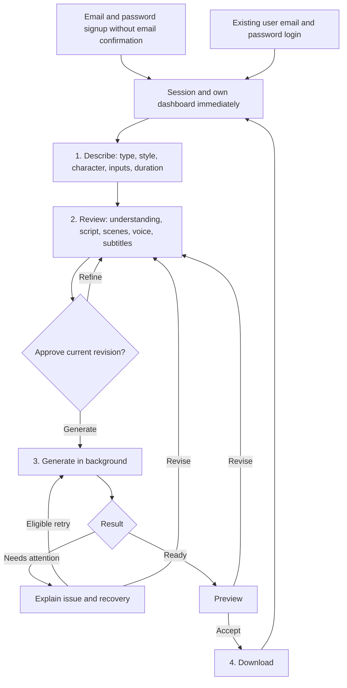
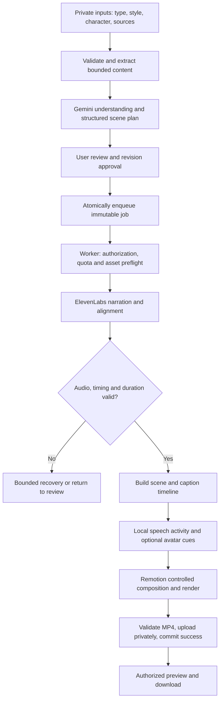

# Product Requirements Document — AI Video Creator V1

## 1. Document overview and status

| Field | Value |
| --- | --- |
| Working name | AI Video Creator |
| Release / document version | V1 / 2.3, account deletion, configurable limits and release priorities |
| Updated | 17 October 2026, Asia/Colombo |
| Status | Final product scope; technical defaults subject to M0 validation |
| Owner | Project owner |
| Purpose | Requirements for later architecture, database, API, UI/UX and implementation planning |

This document consolidates the existing requirements in place using the latest multi-user SaaS and deployment brief as the source of truth. It corrects the prior single-owner interpretation: local development is the first environment, not a permanent product restriction. Public users can register after the release gates pass. Email/password authentication remains simple, with signup confirmation disabled and separate password recovery. Development is free-first; paid services require explicit approval. This artifact contains requirements only, not application implementation or separate architecture/database/API designs.

Version 2.3 adds confirmed account deletion and minimal backend operational controls, clarifies configurable usage limits, and classifies every acceptance criterion by public-release priority. The approved product, authentication, video pipeline, stack and deployment phases are preserved. Proposed numerical measurements are distinct from hard correctness gates under sections 23 and 29.

**Confirmed** requirements are finalized product/technology decisions. **Proposed** defaults are numerical limits, thresholds and operational settings to validate in M0, not measured guarantees. **Future** capabilities are outside V1. Material changes must update this document.

Navigation: [scope](#6-v1-scope-and-boundaries), [styles](#8-video-presentation-styles), [account screens](#11-information-architecture-and-application-screens), [user flow](#12-user-journeys-and-four-stage-workflow), [pipeline](#18-video-generation-workflow), [acceptance](#23-functional-acceptance-criteria), [edge cases](#24-edge-cases-and-failure-recovery), [feasibility](#28-technical-feasibility-and-testing).

## 2. Executive summary

AI Video Creator is a multi-user, web-based AI video-generation SaaS. Each user has an independent account and private workspace for narrated, animated, downloadable MP4 videos made from ideas, photographs, educational topics, application screenshots and supported documents. Users supply content, review and approve the AI's understanding and script, then receive finished videos without manual animation or timeline editing. Develop and validate the complete application locally first, conduct private testing, then deploy publicly so new users can register, generate and download their own results.

V1 has **one dashboard, exactly three video types, exactly three independent presentation styles, and four creation stages**. The types are Product Video, Educational Video and Project Explainer. The styles are Animated Explainer, Cartoon Teacher and Cartoon Presenter, with compatibility defined in section 8.

Videos use English narration, English subtitles and video text by default, a vertical 9:16 composition, and a duration of **62–90 seconds inclusive**, default target **75 seconds**. Prepared 2D cartoon characters with basic speech-reactive mouth movement are included; realistic human avatars and guaranteed phoneme-accurate lip synchronization are excluded.

Gemini plans content; ElevenLabs produces narration and speech timing; Remotion renders reusable React components. Next.js and the Node.js worker run locally during development against a development Supabase environment. Public deployment uses Vercel for the web/lightweight API layer, production Supabase for accounts/data/private storage, and a separately hosted Node.js video worker independent of browsers and the development computer. Prefer eligible free resources during development; commercial rights and operating costs are release checks, not a promise of free production operation.

## 3. Product vision and problem statement

Users can describe what they want to explain, but scripting, recording narration, making graphics and synchronizing videos require multiple tools and production skills. Developers also need a short public explanation of a project without expecting viewers to read a long PRD.

The product should let a person supply a small amount of useful information, approve a reviewable plan and receive an understandable video. Scripts, storyboards and images alone do not constitute completion. Keep useful defaults and a polished, responsive interface; additional capabilities fit the existing four stages.

Multiple independent users must be supported from the first implementation, including local tests with separate accounts. Local development delays public hosting until quality and reliability are proven; it does not replace multi-user authorization with a configured-owner allowlist.

## 4. Product goals and success metrics

### 4.1 Confirmed goals

- Complete the account-to-download journey with no required manual video editing or animation.
- Support all three content types and compatible styles through one workflow.
- Coordinate narration, visual events, captions and basic cartoon speech activity.
- Preserve drafts and previous successful outputs across revisions and failures.
- Enforce ownership, private files, resource limits and recoverable processing.
- Build and test multi-user accounts, isolated workspaces and shared resource safeguards locally before public deployment.
- Use free-first development without unnecessary services, mandatory monthly budget forms or financial dashboards; paid activation requires explicit approval.

### 4.2 Proposed pilot and release-validation targets

| Measure | Target or hard requirement |
| --- | --- |
| Output validity | Every Ready export passes duration, format, audio and availability checks |
| Authorization | All owned resources reject cross-user access |
| Access | Any eligible new user can register with email/password and immediately access their own dashboard without signup verification |
| Completion | At least 95% of valid measured jobs complete while providers are healthy |
| First script | P95 below 60 seconds for text/small-image input, excluding uploads/outages |
| Complete generation | Initial P95 target below 10 minutes on the selected worker, including cartoon scenes; benchmark first |
| Caption/visual anchors | Sampled intended anchors within 250 ms of their speech cue |
| Cartoon speech activity | Proposed pause/onset thresholds and viewing review in section 9 pass |
| Comprehension | Proposed pilot target: 4 of 5 viewers identify the video subject and main message |
| Usability | Proposed pilot target: 4 of 5 test users complete a first video without developer assistance |
| Multi-user isolation | At least two independent test accounts complete separate project/video journeys; every cross-user access attempt is denied |
| Release sequence | Local validation and private-test critical gates pass before public registration is opened on production |

Record submissions, queue time, stage duration, provider units, retry/revision costs and failure categories. These targets are not public service guarantees. Report queue/provider time separately.

Hard safety/correctness requirements are P0 under section 23. Proposed percentage, latency, reviewer-score and millisecond targets are measured in M0/private testing and tracked as P2 unless explicitly promoted through a documented decision. This does not make working cartoon animation, synchronized understandable output, or other confirmed V1 functionality optional.

## 5. Target users and use cases

| User | Need | Example |
| --- | --- | --- |
| Seller / product owner | Present a physical product using confirmed facts | “Make an elegant video about this necklace.” |
| Educator / general creator | Explain one concept to beginners or a chosen audience | “Explain how electricity is generated.” |
| Software engineer / project owner | Explain an application to the public | “Explain this prototype using landing-page screenshots.” |

These are supported user audiences, all using the same standard account role. Every registered user has a private workspace; team accounts, organization administration and invitation-management features are outside V1. Operators configure credentials, voice presets, templates, service allowances and simple character assets through deployment configuration. No administration product, payment system or mandatory monthly budget-setting screen is included.

An operator is a narrowly authorized backend maintainer, not a new end-user role or organization-management feature. Secure backend configuration/commands may pause generation and restrict an abusive account as defined in section 20.5; no admin dashboard is required.

## 6. V1 scope and boundaries

### 6.1 Confirmed scope

Independent email/password signup/login/logout/recovery; immediate post-signup dashboard access without email verification; per-user private workspaces/projects/files; autosaving; duplication/deletion; three video types; three compatible presentation styles; simple preset 2D characters; basic automatic mouth animation, blinking, subtle head movement and limited supported gestures; AI understanding/ideas/scripts/plans/revisions; three English voices and samples; optional subtitles; durable background processing/progress/recovery; private preview/download; per-user quotas and shared provider safeguards. Public signup is included at the public release phase; invitation/team-management features are excluded.

Also included: a simple confirmed Delete Account action, configurable generation/script/sample/concurrency limits, and backend-only pause/restriction controls with audit records. These additions fit existing account settings and infrastructure; they add no video stage, admin product or payment functionality.

Four stages: **Describe → Review Script → Generate and Preview → Download**. Style/character selection fits these stages. No mandatory avatar editor, account activation wizard, brand onboarding or timeline editor.

### 6.2 Confirmed output and language

- English narration only; three English voices; English subtitles and video text by default.
- Requested duration 62–90 seconds; default 75; actual duration policy in section 17.
- Vertical 9:16 MP4 with H.264 video and AAC audio; authorized private access.
- Subtitles enabled by default; one readable style; on/off switch.
- Approved narration cannot be silently rewritten to fit duration.

Non-English source material may be understood where supported, but review must show its English interpretation. Proper names may remain as supplied. Non-English narration requests must be corrected or declined before approval; multilingual generation is outside V1.

### 6.3 Proposed defaults preserved from the original PRD

| Setting | Proposed V1 default |
| --- | --- |
| Export | 1080 × 1920, 30 fps, H.264/AAC MP4 |
| Duration target | Integer seconds; ±3-second tolerance within hard 62–90 bounds |
| Images | Up to 5 JPEG/PNG/WebP; 10 MB and 25 megapixels each |
| Document | One text-based PDF or DOCX, up to 10 MB; PDF up to 100 pages |
| Source text | Up to 60,000 extracted/pasted characters per project |
| Description / refinement | Up to 2,000 / 1,000 characters respectively |
| Scenes | Usually 6–10; validated range 4–12 |
| Concurrent work | Proposed initial cap of one queued/running video job per account and one render per worker; both backend-configurable and validated after M0 measurements |
| Retries | Up to 2 automatic retries after the initial eligible stage attempt |
| Autosave | After 1 second of inactivity; Saved only after server acknowledgement |
| Download links | Proposed 10-minute expiry |
| Voice sample | One short script sentence; maximum 15 seconds |

Password length, character library size, lip-cue thresholds, retention and performance targets are proposed separately. Revise defaults only with a documented reason and updated acceptance checks. No guaranteed number of free videos is promised.

Per-user generation totals, script/idea/refinement request counts, voice-sample allowances, simultaneous-job caps and global service ceilings are configurable backend settings. Determine their numerical values and reset periods after measuring Gemini, ElevenLabs, rendering, storage and bandwidth during M0/private testing; no fixed free-video entitlement is established here.

## 7. Video types

### 7.1 Product Video

Require at least one product photo and a short description/goal. Product name is supplied or extracted and confirmed. Optional details: confirmed features, buyer, material, dimensions, price/currency, availability and call to action. Keep these lightweight inputs, not a branding form.

Output presents supplied photos, image-based close-ups, feature highlights, narration and optional subtitles. Select a primary product/photo when multiple items appear; preserve an uncropped fallback. Do not invent material, certifications, discounts, prices, durability, health effects or availability. Omit unknown claims or ask for confirmation. A spoken price requires a currency. No invented viewpoints or realistic footage of someone using the product.

### 7.2 Educational Video

Require a topic/description; optionally accept audience, objectives, supporting images and key points. Default to beginners/general public. Explain one central concept with limited supporting points using icons, predefined diagrams and callouts. The chosen style can include a teacher/presenter.

Simplify accurately, distinguish examples from facts and surface uncertainty for review. No independent browsing or factual-verification service is included. Approval is a user content review, not proof of independent fact-checking.

### 7.3 Project Explainer

Support readable application/landing-page screenshots with an optional explanation, or a PRD/document/pasted description. Screenshot plus short description is the recommended fast path. Screenshot-only is accepted when sufficient; otherwise ask for clarification.

Confirm project name and status: **Concept**, **Prototype** or **Available**. Default audience is the general public. Optional inputs identify emphasis and closing action. Explain purpose, intended users, two or three features and a simple journey.

Stage 2 displays a correctable “Here is what I understand” summary with source limitations/conflicts. Do not infer hidden functionality, portray planned features as available or imply static screenshots are working software recordings. Without screenshots use illustrative diagrams/text. Summarize long documents; do not narrate every requirement in 90 seconds.

## 8. Video presentation styles

Presentation style is independent of video type. Exactly these three style choices exist; content templates are not additional styles.

| Video type | Animated Explainer | Cartoon Teacher | Cartoon Presenter | Default |
| --- | --- | --- | --- | --- |
| Product Video | Supported | Not supported in V1 | Supported | Animated Explainer |
| Educational Video | Supported | Supported | Supported | Cartoon Teacher |
| Project Explainer | Supported | Not supported in V1 | Supported | Animated Explainer |

This matrix is the V1 compatibility policy. Enforce it in the UI and backend. Teacher is education-specific; Presenter supports all three types. Matrix expansion requires an explicit requirements change.

### 8.1 Animated Explainer

Narration drives text, icons, shapes, predefined diagrams, uploaded images/screenshots and transitions. No speaking character appears; clear any stale character selection from the active plan.

### 8.2 Cartoon Teacher

A prepared 2D teacher introduces and concludes an educational video. Intermediate scenes may show the teacher addressing the audience, beside graphics, or omit the character for a full-screen explanation. The approved plan determines visibility and actions. Mouth activity, blinking and head motion run automatically.

### 8.3 Cartoon Presenter

A prepared 2D presenter introduces/concludes the video and may remain beside product images, diagrams, screenshots or feature cards through much of the narration. Full-screen visual-only scenes remain permitted; not every scene needs a character.

### 8.4 Selection and fallbacks

Select style in Describe with a sensible default. Proposed initial defaults are one prepared teacher and one prepared presenter, automatically assigned by style. With one preset per role, no separate selection/customization step is required. Keep a versioned extensible registry so additional predefined characters can be introduced later without redesigning planning, approval, cue generation or rendering. A large library and character editor are not required. Validate initial artwork in M0.

Style/character changes require scene-plan review and invalidate affected approval/cue/render artifacts. Preserve compatible content/audio where safe. Reject stale incompatible client requests server-side.

Unsupported visuals get a supported, reviewable alternative. An unsupported decorative gesture can be normalized to an allowed idle action and displayed before approval. Switching a requested character style to Animated Explainer requires user selection and reapproval; never silently change presentation style after approval.

## 9. Cartoon avatar and basic lip-sync requirements

### 9.1 Prepared assets and actions

Maintain a small versioned library of teacher/presenter assets with appropriate usage rights. Registry entries specify role, scene placements, layers, neutral pose, mouth-closed/open states and allowed actions. Additional mouth shapes are optional. Validate essential assets before paid synthesis.

Required behavior: mouth-open/mouth-closed activity tied to narration, closure in pauses, automatic blinking, subtle head motion and limited predefined gestures. Proposed initial assets support neutral/idle and at least one simple wave or point gesture per character. Additional mouth shapes/actions are not required. Users never rig characters or animate manually.

### 9.2 Cue generation

Gemini plans visibility, placement and supported gesture intentions linked to narration spans. It does not produce authoritative phonemes. After ElevenLabs synthesis, application-side local audio-envelope analysis and validated speech intervals create deterministic speech-activity cues. Remotion renders prepared mouth states on the audio master clock.

Close the mouth during silence, outside visible speaking intervals and after narration. Smooth energy thresholds/hysteresis to avoid jitter and test quiet syllables across voices. Do not continuously alternate mouth states irrespective of speech. Blink/movement schedules must be deterministic for frame-parallel rendering and retries. Only visible characters animate; offscreen narration can continue over a full-screen diagram.

Persist cue tracks and character/template versions with the job snapshot. Avoid overlapping mouths/gestures with subtitles or essential graphics. This is basic speech-reactive animation, not guaranteed phoneme-accurate lip-sync.

### 9.3 Proposed M0 quality thresholds

- In measured pauses at least 300 ms long, the mouth closes within 150 ms of onset and remains closed through the central silent interval.
- Sampled speech-onset response targets at most 250 ms deviation. Inspect at least 10 onsets and 5 pauses in the full teacher prototype, plus samples of the other voices.
- No sustained speaking-mouth movement during silent intro/outro holds.
- During feasibility/private testing, the project owner and a tester review the complete prototype for speech correspondence, readability and distraction on a 1–5 scale; proposed pass target is at least 4 for each dimension. This does not require an invitation-management feature.
- Verify closed/open states, blinking, head movement and at least one supported gesture for each initial character.

These are proposed activity thresholds, not demonstrated precision. Record measurements and any explicit revisions to the targets.

The numeric timing/reviewer targets are nonblocking P2 measurement targets; functioning speech-reactive animation, mouth closure in clear pauses, and the confirmed preset cartoon experience remain required V1 checks. A P1 quality exception cannot waive P0 output correctness, core readability or safety.

### 9.4 Dependency constraints

No mandatory Rhubarb Lip Sync, HeyGen, D-ID, paid avatar API, realistic-human service or complex 3D system. Use the existing stack/local utilities. Realistic avatars, arbitrary character generation/rigging, uploaded avatar animation, advanced gestures/full-body performance and phoneme accuracy are excluded. If M0 fails, document limitations and review options with the owner rather than silently adding services or removing character functionality.

## 10. Complete feature inventory

| ID | Feature | V1 behavior |
| --- | --- | --- |
| F01 | Account access | Independent email/password signup with immediate dashboard access and no verification; login/logout and separate recovery link |
| F02 | Dashboard | Each user's private workspace, projects, thumbnails, statuses and actions |
| F03 | Video types | Exactly Product, Educational and Project Explainer |
| F04 | Inputs | Descriptions, photos, screenshots, pasted text, text PDF and DOCX |
| F05 | Ideas | Three optional distinct concepts |
| F06 | Understanding | Correctable purpose/audience/key points, unresolved facts/source limitations |
| F07 | Script/scenes | Narration, visual plan, character appearances/actions, estimated timing |
| F08 | Revisions | Direct editing, regeneration with previous-draft recovery, instruction refinement |
| F09 | Voices | Three configured English presets, default, cached short samples |
| F10 | Graphics | Controlled reusable component/template library |
| F11 | Synchronization | Audio-based scene, visual, caption and character activity timing |
| F12 | Subtitles | English, one style, default on, optional off |
| F13 | Preview/revision | Watch completed output; update content/settings; regenerate affected work |
| F14 | Saving | Autosave, revision control and resume |
| F15 | Duplicate | Independent editable project with copied content/safe asset references |
| F16 | Jobs | Durable execution, progress, idempotency and bounded recovery |
| F17 | Export | Validated private vertical MP4 and authorized preview/download |
| F18 | Project deletion | Confirm project deletion, prevent publication and clean unreferenced assets; account-wide deletion is F23 |
| F19 | Presentation | Three styles with server-enforced compatibility |
| F20 | Characters | Proposed one preset per teacher/presenter style, extensible versioned registry; no manual character customization |
| F21 | Speaking animation | Basic mouth activity, pauses, blinking, head motion and gestures |
| F22 | Usage safeguards | Server-enforced per-user job/request allowances, shared provider limits, bounded attempts and resource tracking; no mandatory financial dashboard |
| F23 | Delete Account | Authenticated explicit confirmation, immediate work/access restrictions, durable cleanup and authorized Supabase Auth deletion with retry/status handling |
| F24 | Minimal operations | Backend-authorized generation pause/resume and account restriction/restoration, controlled job handling and content-free audit records; no admin dashboard |

## 11. Information architecture and application screens

### 11.1 Minimal authentication — final V1 decision

**Supabase Auth, email and password only, supporting multiple independent accounts.** Provide Sign Up and enable account creation in the intended environment. Disable mandatory email confirmation for registration in local, test and production Supabase configurations. Successful signup creates a session and opens that user's dashboard immediately. Do not send a signup confirmation link, gate access on `email_confirmed_at`, or restrict valid users to a preconfigured owner ID. Production signup becomes publicly reachable only after release gates pass.

Screens: Sign Up, Log In, Forgot Password and Reset Password; provide Log Out from the authenticated interface. Sign Up collects email and password only. Explicitly excluded: mandatory registration email verification, confirmation before first login, signup OTP, MFA, Google/Apple/other social authentication, phone authentication, magic-link login, account activation, invitation-management and complex onboarding. Password recovery remains supported and separate from signup verification. No additional authentication provider.

Signup/reset passwords follow a proposed minimum of 8 characters, consistently enforced by Supabase/server validation. Allow password-manager paste/autofill and show the configured policy. Never silently trim/change passwords or store them in application data/logs. Stronger password settings, if chosen, are technical settings rather than another verification flow.

If signup succeeds but session establishment fails, offer safe login/session retry without creating duplicate accounts or requesting email verification. The normal success path opens the dashboard immediately. A new account initially sees only its own empty workspace. A missing optional profile row must be provisioned idempotently, never by assigning another user's data.

Forgot Password sends a Supabase email-based recovery link with a generic existing/nonexisting-address acknowledgement, throttling and allowed redirect configuration. Reset Password requires valid recovery context, validates/saves the new password, ends the recovery context and directs the user to ordinary email/password login. Expired/invalid/used links offer another recovery request. Recovery is independent of signup and first login.

Validate sessions server-side on protected pages and Route Handlers; client guards are insufficient. Use supported Supabase SSR session storage/refresh with appropriately secured cookies and HTTPS. Logout clears local session/protected cached content. Back navigation/refresh must not reveal protected data without authorization. Avoid shared caching of personalized responses. Do not promise stronger immediate token revocation than the chosen Supabase configuration supports.

Basic rate limiting covers signup, login, recovery and expensive authenticated actions. Configure provider controls and server-side account/IP limits, including direct provider paths where applicable. No OTP, MFA, social login or other added verification challenge is introduced. Because email ownership is unverified, address-based identity claims are not trusted; public-release abuse controls must consider disposable/multiple accounts and mailbox squatting, as detailed in section 22.1. No mandatory monthly budget form.

### 11.2 Dashboard

Primary action: Create Video. Each authenticated user's dashboard lists only their own projects. Show title, type, modified date, status and thumbnail where available. Actions: Continue Editing, View Progress, Preview, Download, Duplicate, Delete. Paginate owner-filtered lists; do not download all video files. Empty state explains types. Private workspace means isolated user resources, not a team/collaboration workspace.

Statuses: Draft, Generating, Ready, Needs Attention. A prior successful video remains accessible and labeled Previous Version while a newer revision processes/fails. Failures explain whether input changes, retry or operator action is needed.

### 11.3 Creation workspace

Four-stage indicator, visible saving state, primary stage action and Back navigation preserving content. Describe holds type/style/character defaults and duration. Review holds understanding, scene cards, voices, subtitles and approval. Generate and Preview holds progress/error/playback. Download offers MP4, dashboard and another video.

Provider names, lip thresholds, queue internals and frame settings are not ordinary user controls. Use plain errors; operator diagnostics remain separate.

### 11.4 Minimal account settings and deletion

Provide Account Settings from the authenticated interface with a clearly labeled Delete Account action. Do not add a full profile-management system. Show a confirmation dialog stating that account/project/source/video deletion is permanent, work will stop, downloaded copies cannot be recalled and issued signed links may last until expiry. Require an explicit final confirmation; dismissing it makes no change. Do not introduce email verification, OTP, MFA or a new provider.

Authenticate and authorize the request against the signed-in user's ID; ignore any supplied target owner ID. After acceptance, show Deleting Account and a non-sensitive request reference, close ordinary workspace access and block new jobs/AI requests/uploads immediately. A narrowly authorized deletion-status/retry view may remain accessible while the Auth account exists; it cannot read projects or create work. A refresh or login during partial deletion returns to that restricted status, not a restored dashboard. Completed deletion ends normal sessions/access and shows Account Deleted. Do not report success until both required cleanup and Auth deletion are verified. If cleanup is delayed/failed, explain that deletion is incomplete, access stays restricted, and safe retry/operator recovery will continue. Section 22.4 defines the durable workflow.

### 11.5 Limit and availability messages

Use simple messages such as “You have reached your current generation limit,” “A video is already being generated,” “Video generation is temporarily paused,” or “Generation is restricted for this account.” Include a reset time only if configured/known, otherwise retry/support guidance. Ordinary limits, pauses and restrictions do not delete drafts or completed videos. Availability checks cover direct API requests, not just disabled buttons.

## 12. User journeys and four-stage workflow



1. **Describe:** select type and compatible style, use its automatic character preset when applicable, and supply duration/inputs. Suggest Ideas is optional. Validate uploads/source limits.
2. **Review Script:** show correctable understanding and scene cards with narration, visuals, avatar visibility/placement/actions and estimated duration. Edit/regenerate/refine, choose/sample voice, set subtitles, approve content/settings.
3. **Generate and Preview:** submit durable job, validate assets/approval/quotas, create narration/timing, caption/avatar cues, compose/render, validate/save and preview. Show real stages, not invented percentages/ETAs. Leaving the page does not stop accepted work.
4. **Download:** authorize a temporary MP4 link and retain output in the project. Enabled subtitles are burned into the export; toggling them requires re-rendering.

A local development worker advances jobs only while its process is running; stopped workers leave jobs queued. Show that work is waiting rather than implying it is processing.

Return: login → dashboard → Continue Editing restores acknowledged content/resume stage. Expired sessions require login but do not cancel accepted jobs. Duplicate copies editable content and safe asset references, clears approval/jobs/errors/Ready status and opens Describe; deleting the original must not break its copy.

Password recovery: Forgot Password → generic acknowledgement → valid email recovery link → Reset Password → email/password login → dashboard. This is independent of signup and not another video creation stage.

Account deletion: Account Settings → Delete Account → explicit confirmation → authenticated deletion request → restricted deletion status/cleanup → Account Deleted, or a recoverable incomplete-deletion state. This is outside the four video stages and never runs as a side effect of logout or password recovery.

A global generation pause or account restriction shows the appropriate availability message while preserving permitted read access to existing drafts/videos. The job-state policy in section 20.5 determines whether queued work waits or a running stage can finish; users do not need operational controls in the UI.

## 13. Input and document requirements

Enforce section 6.3 limits server-side using actual file signature, decoding/parsing, dimensions, expanded memory, pages and extracted text. Supported uploads are JPEG/PNG/WebP and text-based PDF/DOCX. Reject SVG, HEIC, GIF, audio/video, ZIP, DOC, slides/spreadsheets, scans needing OCR and handwriting.

Keep originals private; make bounded AI/preview derivatives, correct orientation and remove transmitted metadata. Use suitable transparency backgrounds and contain/framed layouts for unsuitable dimensions. Do not hide products or claim unreadable screenshot content was understood.

Extract text without executing macros, embedded content, scripts or external links; bound DOCX archive expansion, parsing time and memory. Reject encrypted/corrupt/empty files with replacement/paste guidance. Identify unreadable/image-only pages in mixed PDFs, disclose incomplete understanding and show a concise extracted preview/count. Over-limit text requires an excerpt; never silently truncate.

For supported long content, summarize bounded sections then combine while retaining evidence/main-feature coverage. Reserve model tokens for instructions/output; character count is not a token guarantee. Planning/extraction that cannot fit a lightweight request also uses the existing durable worker, within Describe/Review. No new stage or service.

Split long screenshots into readable bounded crops if possible, otherwise ask for clearer images/description. Do not crawl URLs. Show source conflicts; explicit user corrections take precedence after review.

## 14. Gemini AI planning and script requirements

Gemini understands supplied content, suggests concepts, summarizes projects, writes English scripts, selects allowed templates/characters/actions/anchors and revises on request. It is not the renderer or an unrestricted animation engine.

Validate outputs with Zod and versioned schemas/registries: title, type/style, audience, language, target, understanding, confirmed/unresolved facts, scene IDs/order, narration, templates, assets, overlays, estimated timing, avatar configuration, visual anchors and evidence references where available. Final mouth timings come from trusted application-side analysis after synthesis.

Illustrative excerpt: one scene, not a complete renderable 75-second plan. IDs must exist in the actual registry.

```json
{
  "schemaVersion": "1",
  "videoType": "educational",
  "presentationStyle": "cartoon_teacher",
  "language": "en",
  "targetDurationSeconds": 75,
  "understanding": "Explain turbine-based generation to beginners.",
  "confirmedFacts": [],
  "unresolvedFacts": [],
  "scenes": [{
    "id": "scene_02",
    "order": 2,
    "narration": "A spinning turbine drives a generator.",
    "estimatedDurationSeconds": 4,
    "templateId": "diagram_with_character",
    "assetRefs": ["builtin:turbine_generator"],
    "textOverlays": ["Turbine → Generator"],
    "avatar": {
      "id": "teacher_01",
      "visible": true,
      "placement": "left",
      "actions": [{"id": "point", "anchorId": "generator"}],
      "speechCueMode": "audio_activity"
    },
    "syncAnchors": [{
      "id": "generator",
      "narrationSpan": {"start": 28, "endExclusive": 37},
      "visualEvent": "highlight_generator"
    }],
    "evidenceRefs": []
  }]
}
```

Validate exact spans against narration with a documented Unicode offset convention. Empty evidence references do not imply independent factual verification. Validate ownership, lengths, scene counts, compatibility, actions and template versions. AI output is data, never executed JavaScript/HTML/shell, arbitrary paths or unrestricted remote URLs. Documents cannot override application rules or authorize access to secrets.

Separate spoken text from stage directions. Three optional ideas should be meaningfully distinct. Support direct edit, regenerate and instruction refinement; retain the last usable script on failures and restore-previous after full regeneration. Bounded repair may correct invalid schema; unsupported semantic requests require reviewable alternatives.

Approval binds revision and settings hash, including sources, narration, scene plan, style, character/version, voice and duration. Changes invalidate affected approval; Generate can confirm a simple visual/subtitle revision within stage 2 without repeating extraction. Never substitute a new character plan under stale approval.

## 15. ElevenLabs narration requirements

Use ElevenLabs for three configured English voice presets, one default, short samples, narration audio and supported timing. Configure model/voice IDs and verify endpoint availability/rights in M0; do not assume every model supports every operation.

Generate approved narration through speech-with-timing, preferably one continuous request with scene spans. Cache owner-scoped samples by text/voice/model/settings hash within the 15-second proposed limit. Samples, retries and revisions can consume credits.

Retain original/normalized alignment when provided, including expanded numbers/abbreviations. Validate decodable nonempty audio and alignment before composition. Do not narrate stage instructions. Unavailable voices require another selection/reapproval, not a silent substitution. No Kokoro, WhisperX, cloned voices, multilingual narration, user audio uploads or separate avatar provider.

## 16. Motion graphics and Remotion requirements

Controlled React templates cover image fades/reveals, gentle pans/zooms, animated text/keywords, feature cards, icons/shapes/arrows, simple flow/educational diagrams, screenshot callouts, transitions, characters and one subtitle style. Elegant product treatments or clean screenshot layouts are templates, not additional presentation styles.

Remotion renders prepared mouth cues, blinking, head motion and supported gestures on the narration timeline. Reserve space for subtitles and essential visuals. If layout cannot fit, select a validated placement or full-screen visual scene in the reviewable plan; avoid occlusion/unreadably small content.

Do not distort products, imply screenshots are live recordings, invent unsupported diagram capabilities or execute generated components. Semantic fallback changes need review; decorative changes must stay within approved capabilities. Avoid flashing/distraction. Version components/assets for reproducible retries.

Check final dimensions, frame rate, codecs/container, playable video/audio, nonzero file size, duration and stored availability. No silent quality downgrade or Ready status for failed validation.

## 17. Synchronization, subtitles, and duration rules

### 17.1 Shared timeline

Actual narration is the master clock. Character alignment becomes words/phrases/scenes/anchors; local audio analysis and speech intervals produce basic mouth activity. Timestamps do not prove phoneme accuracy. Repeated phrases use explicit stable spans rather than a first-substring match.

Validate finite nonnegative ordered times, array consistency, normalized mapping and coverage. Handle punctuation, whitespace, contractions, number expansion and gaps. Prevent negative/out-of-bounds events and caption overlaps. Missing essential alignment requires bounded recovery or Needs Attention, not fabricated equal scene timing.

### 17.2 Subtitles

Default on; English; one style; proposed at most two lines, about 32 characters per line and at least 0.5 seconds display where practical. Handle long names/words without clipping. Verify contrast/safe margins on actual screens and avoid avatar/product/diagram overlap. Off changes rendering, not narration or mouth cues.

### 17.3 Duration

For requested integer target T, accepted output must satisfy:

`max(62, T - 3) <= actualDurationSeconds <= min(90, T + 3)`

A 75-second request accepts 72–78; 90 accepts 87–90; 62 accepts 62–65. Hard bounds are always 62–90 inclusive. Validate actual media duration rather than rounded display labels; choose a frame count inside that range.

Before approval estimate length and offer expansion/shortening. After synthesis measure audio, fit scenes/captions/character cues and allow purposeful intro/outro holds totaling no more than 3 seconds. No long blank padding, cut-off speech or excessive speed-up. Allow one tested natural delivery adjustment using the same approved wording within the total bounded synthesis-attempt budget. If still outside range, return to review with Shorten/Expand or Change Target. Wording changes require approval before further synthesis. Probe final MP4 duration; failures cannot become Ready.

## 18. Video generation workflow



### 18.1 Sources and planning

Validate/store private inputs, extract text and bounded image derivatives, then request understanding and a plan using only current registries. Preserve evidence and unresolved facts through long-document summarization. Durable planning tasks use the same worker when required by web execution limits, but do not count as full video generation or begin synthesis before approval.

### 18.2 Submission and preflight

Generate creates an immutable snapshot of authenticated user ID, content revision, approval, sources, type/style, character/version, voice/model/settings, subtitles, duration and template versions. Atomically enforce per-user active-job/request allowances and shared provider capacity before accepting work. Scope submission keys to the authenticated user and revision; repeated clicks/tabs return that user's accepted job, never another user's result. No monthly budget input is required. Free-first development and explicitly approved service activation follow section 26.

Before paid calls check ownership, source availability, approved revision, provider configuration, output capacity and all required template/character assets including mouth states. Recheck constraints when a queued job starts; configuration or quotas may have changed since submission.

Admission also checks account-deletion state, account restriction, global pause and applicable configured limits atomically. Recheck account eligibility before later expensive stages and before publishing output. A deleting account cannot acquire a new job through a race with confirmation; worker leases do not override deletion/restriction flags. Deletion cleanup is not blocked by generation pause, suspension or exhausted generation quotas.

### 18.3 Execution and finalization

Claim a durable lease, heartbeat and checkpoint stages. Persist audio/alignment, build the timeline and speech/gesture tracks, render into a temporary directory, probe output and upload privately. Publish Ready only after a verified accessible artifact is committed. Late output belongs only to its own revision; it cannot replace a newer current video.

Stage-based progress is acceptable: Queued, Creating Voiceover, Building Scenes, Rendering Video, Finalizing. Building Scenes includes character cue work. Do not claim precise percentages or an ETA without real measurements.

### 18.4 Revisions and reuse

| Changed content/settings | Required invalidation / reuse |
| --- | --- |
| Narration or voice | New audio/alignment and all dependent timelines/cues/render |
| Source facts or video type | Revisit understanding/plan/approval; reuse audio only when approved spoken text and settings remain identical |
| Style or character | Revalidate compatibility and scene plan, reapprove; rebuild character/scene/render artifacts; reuse identical audio |
| Image or supported visual instruction | Revisit affected visual plan/approval; reuse compatible narration |
| Subtitles only | Confirm settings in Review; render again with existing audio/cues |
| Target duration | Revalidate fit and rebuild timeline; reuse audio only if it fits the new window |

Retain the latest successful output during processing/failure of a new revision. Do not leave a changed project labeled Ready as if its old output matches the new content. Show both current revision status and Previous Version where relevant.

## 19. Technology stack and high-level architecture

These are **confirmed technologies**, unless a documented technical limitation justifies a reviewed change.

| Layer | Technology and role | Boundary |
| --- | --- | --- |
| Frontend | Next.js App Router, React, TypeScript, Tailwind CSS | Reusable responsive design; avoid unnecessary libraries |
| Application API | Node.js/TypeScript Next.js Route Handlers | Lightweight authenticated operations; no separate Express backend without demonstrated necessity |
| Validation | Zod plus server-side file/media validation | Validate requests, settings and structured AI plans |
| Planning | Google Gemini API | Understand content and select supported narration/scenes/actions |
| Narration | ElevenLabs API | English voices/audio/samples and supported timing |
| Composition | Remotion React components | Render controlled graphics, cartoons, captions and final MP4 |
| Authentication | Supabase Auth | Multiple email/password accounts, confirmation disabled, immediate dashboard/recovery; privileged account deletion is backend-only |
| Data | Supabase PostgreSQL | Owner-scoped projects/revisions/assets/jobs/usage with RLS |
| Files | Supabase Storage | Private sources/audio/output; authorized temporary access |
| Queue/worker | PostgreSQL-backed durable jobs and independent Node.js worker | Atomic claims/leases/recovery, persisted pause/restriction checks and independent account-cleanup tasks |
| Local utilities | Bounded document/image/audio/media utilities | Extraction, normalization, audio-envelope cues and media probing |
| Web runtime / hosting | Local Next.js during development; Vercel web/lightweight APIs for public deployment | No production hosting needed during local development; verify commercial hosting eligibility before release |
| Worker runtime / hosting | Local Node.js process during development; independently hosted Node.js worker for production | Production processing cannot depend on a user's browser or the development computer; select host after measurements |

The core AI/video technologies are exactly **Gemini, ElevenLabs and Remotion**. Local utilities do not introduce another AI provider. No mandatory Rhubarb/HeyGen/D-ID/avatar service, separate transcription service, Redis, Kafka, RabbitMQ or microservice estate.

The browser talks to authorized application routes and approved direct storage operations. The web API records durable work in PostgreSQL; the worker claims it independently and contacts providers/storage. Browser closure and Vercel request completion do not kill accepted work. Do not run long rendering, large extraction or long provider orchestration inside a Vercel request, a detached serverless promise, or a Supabase free edge function. Use a queued task when request limits would be exceeded.

During local development, the local worker/computer must be running; durable jobs wait and resume when it restarts. Public deployment requires an independently hosted operational worker, chosen using measured CPU/RAM/render-duration/cost/reliability needs. Large uploads use bounded authorized storage paths rather than assuming all bytes fit a hosted request limit.

### 19.1 Required environments and release phases

| Phase | Configuration and work | Exit condition |
| --- | --- | --- |
| A — Local Development | Local Next.js and Node.js worker; development Supabase project; development API credentials; integrate all three types/styles and account flows | Complete working pipeline, draft/private-file handling, preview/download and core recovery demonstrated locally |
| B — Private Testing | Controlled nonpublic test environment, multiple independent test accounts, full end-to-end/authorization/error/quality/recovery tests; measure provider usage and render resources | Critical private-test gates pass; costs, applicable rights and deployment requirements are documented |
| C — Public SaaS Deployment | Vercel web/lightweight APIs, production Supabase and separately hosted worker; registration enabled for public access | All section 29 release gates pass and deployment/any paid services have explicit authorization |

Private testing does not require a product invitation feature: testers use normal signup in the controlled environment. Keep local/test environments nonpublic without turning the product into a permanent account allowlist.

Development and production must use separate environment variables, Supabase configuration/data/storage and provider credentials. Use a separate test configuration where practical; no test task may consume production jobs or read production user files. Configure the correct site/recovery URLs and redirects per environment. Do not migrate development users/content into production by accident. No production host purchase is required to complete Phase A or B; no public launch occurs before testing passes.

## 20. Background jobs, state management, and persistence

### 20.1 Durable states

Project editing state, generation jobs and output versions are separate records. Planning jobs can use the same queue infrastructure with their own task kind; never start synthesis merely because understanding extraction completed.

| Generation state | Meaning | Dashboard |
| --- | --- | --- |
| queued | Accepted; waiting for active worker/capacity | Generating |
| validating | Check snapshot, approval, quotas and required assets | Generating |
| synthesizing | Create narration and alignment | Generating |
| composing | Build captions, avatar activity/gesture cues and scenes | Generating |
| rendering | Produce MP4 | Generating |
| finalizing | Probe and save artifacts | Generating |
| retry_wait | Bounded eligible retry waiting | Generating |
| succeeded | Valid accessible output committed | Ready |
| needs_attention | User/operator action required | Needs Attention |
| failed | Unrecoverable or attempt budget exhausted | Needs Attention |
| cancelled | Project deleted or operationally stopped | Hidden if deleted |
| held | Queued/retry work waiting for operational pause or account restoration; no automatic paid retries | Generating, with an explicit Paused/Restricted message |

Drafts may have no generation job. An expired lease is detected by a periodic recovery process; only a current lease holder may commit stage results. Atomic claiming and fencing/version checks prevent two workers publishing competing results. A stale job cannot overwrite a later revision, and missing assets cannot disappear silently.

Multiple users can enqueue independent jobs even when the proposed initial worker renders only one video at a time. Queue eligibility and ordering must avoid starvation, preserve each user's quota, and keep status/results private. Use FIFO among eligible jobs initially. Worker claims/retries must preserve the job's user/project/revision association and the current environment; a lease or service credential is not permission to change ownership.

### 20.2 Retry policy

Retry classified temporary network/provider throttling/server/render interruptions with backoff/jitter and provider retry guidance: at most two retries after the initial stage attempt. Duration adjustment is at most one and counts within the same synthesis-attempt limit; it does not create an unlimited extra loop. Internal schema repair is separately bounded and tracked. Manual retries check remaining provider quota and reference the failed attempt to prevent simultaneous retries; they do not require monthly budget settings.

Do not automatically repeat invalid credentials, permissions, exhausted credits, rejected content, invalid input, unavailable character assets or unsupported features. Describe whether the user should revise, retry after a limit reset or wait for operator configuration.

Internal submission idempotency cannot guarantee exactly-once provider billing. If synthesis times out after possible provider completion, reconcile using available request/history information before repeating. If unrecoverable, record an uncertain outcome and stop for operator review, preserving the affected user's project; never assume the attempt was free or charge it against a different user's allowance.

Rendering failures reuse persisted valid audio/alignment/cues. Upload failures reuse valid local output if present. After worker restart, recompute only missing artifacts within the same attempt/quota limits. Record provider request references and usage for every attempt; a budget dashboard is not required.

### 20.3 Saving and concurrency

Autosave reports Saving/Saved/Not Saved accurately. Saved requires server acknowledgement. Use revision checks to reject conflicting multi-tab updates and offer reload/copy-my-edits recovery rather than silent overwrites. Preserve a prior usable script if regeneration fails. Immutable approved snapshots isolate running jobs from later draft edits.

Duplicate projects do not inherit approval, jobs or artifact Ready state. Shared immutable asset bytes need reference tracking; deletion of either project must not break the other. Generation deletion/cancellation is cooperative: stop later expensive stages, reject late publication and clean late artifacts.

### 20.4 Account lifecycle and deletion work

Track a minimal account lifecycle independent of Auth token validity: active, generation-restricted, deletion-in-progress, deletion-failed and deleted. A durable deletion task records stage/completion/error metadata and survives Auth/profile deletion or cascade cleanup; its minimal tombstone is retained only under section 22.4's policy. Deletion takes precedence over a restriction or global pause and cannot be reversed by a Resume command. It is not an undelete feature.

Use the existing database-backed worker for cleanup; no new service or user-facing stage. Delete requests are idempotent: repeated confirmations/status retries reuse the task. Recheck state on job claims, paid calls, uploads and result commits. Stop queued/retry jobs, signal running leases, and prevent new artifacts from being published for a deleting user. An already submitted provider request may finish or consume credits; discard/clean its late result and record minimal usage without restarting generation.

### 20.5 Minimal backend operational controls

Only an authorized operator using secure backend configuration or a small protected operational command may change these controls. Ordinary users cannot promote themselves through profile metadata, request parameters or client flags. Maintain one narrow operator authorization mechanism tied to the deployment; no full admin dashboard, complex role system or organization product. Record actor, action, target internal ID/scope, time, safe reason code and result; exclude user content, email/reset tokens, provider keys and credentials.

| Control | New requests | Queued/retry work | Currently running work | Existing data / recovery |
| --- | --- | --- | --- | --- |
| Global generation pause | Reject new full-video submissions, regenerations and user-triggered generation retries with a temporary-unavailable message | Hold unclaimed queued/retry video jobs; do not start another render after a slot frees | A job already running may finish its current approved execution under quota/account checks; a failed stage's retry waits while paused | Draft editing, existing previews/downloads, account deletion and recovery remain available. Script/idea/sample requests remain subject to their limits unless that account is restricted |
| Account generation restriction / suspension | Block that account's expensive AI actions: ideas/scripts/refinements/samples, video submissions/retries and new source uploads | Hold that account's queued planning/video/retry jobs; other eligible users continue | Stop at the next safe checkpoint before another expensive provider/render stage; save reusable work, hold the job and block new result publication while restricted. An in-flight provider call may finish and consume quota | Allow own completed-video reads/downloads, safe text-draft edits, account deletion, logout and recovery. No automatic content deletion |
| Resume / account restoration | Re-enable only the scope changed, subject to other active controls | Recheck ownership, account state, approval, allowance and global eligibility before resuming existing job IDs | Reuse checkpoints and reconcile prior calls; do not duplicate reservations or retry consumed work blindly | Completed data remains unchanged; deletion-in-progress is never restored |

Check persisted controls at request/claim/stage boundaries rather than relying on browser state or provider sign-in bans. A still-valid token cannot bypass restriction through direct APIs/storage policies. Auth availability need not change: suspension in V1 means restricting generation operations as above, not deleting or locking away the user's retained data. Account deletion has the stronger access policy in section 22.4.

An accepted pause affects submissions/claims after its committed control change; already-running work follows the explicit policy above. If the control update cannot be committed, report failure and do not claim success. If eligibility/control state cannot be checked, fail closed for new expensive work, preserve drafts and retry safely. Resume is explicit, never automatic on quota reset or process restart. Generation pause/hold must not block deletion cleanup or other users' independently eligible work beyond its intended scope.

## 21. Conceptual data model

This is a requirements-level model, not a database schema or migration design.

| Entity | Essential information |
| --- | --- |
| Auth user / profile | Independent Supabase user ID, account status/timestamps and generation allowance; no application password storage or required signup-activation state |
| Project | Owner, title, type, presentation style, selected character, target, resume stage, draft/current revision, latest successful output, deletion state |
| Source asset | Owner, private storage key, checksum, MIME/size/dimensions/pages, processing/extraction status |
| Project-asset reference | Project/revision, asset role/order/primary selection; reference-safe deletion |
| Content revision | Immutable sources/settings/understanding/narration/scenes and schema/template versions |
| Approval | Approving user, revision/settings hash, timestamp |
| Character/template registry | ID/version, role, compatible styles, layer/mouth assets, allowed placements/actions and usage-rights record |
| Generation/planning job | Owner/project/revision, task kind/state/stage, attempts, idempotency key, lease/heartbeat, error and provider references |
| Timing/animation artifact | Original/normalized alignment, scene/caption spans, speech activity and gesture/blink tracks, analysis/version settings |
| Media artifact | Job/revision, private key, kind, duration, format/dimensions, validation result |
| Voice sample | Owner-scoped text/voice/model/settings hash, audio key, duration and expiry |
| Usage event | User/job/provider/stage, estimated/actual units, attempt/outcome/time and estimated cost when available |
| Quota / shared usage reservation | User and service scope, period, allowance, reserved/consumed units, expiry/reconciliation and attempt association; no payments/subscription model required |
| Account lifecycle / deletion task | Account state, confirmed deletion request, authenticated subject, cleanup checkpoints, in-flight work, Auth-deletion status, retry/error reference and bounded minimal-retention expiry; task survives Auth/profile cleanup |
| Operational control / audit | Global generation pause, account generation restriction and versions; authorized actor, safe reason, scope/target, timestamps and outcome without private content |

Changes to style/character must be represented in revision/approval and artifact dependencies. Do not save passwords or reset tokens here. Ownership applies to each referenced asset/job, not just the project URL. Routine logs/usage records exclude raw source content and credentials.

Associate every project, source, revision, approval, generation/planning job, timing/media artifact, sample and usage event with the correct user through validated ownership references. Per-user idempotency, sample caching and asset-reference checks must not reveal or reuse another user's private content. Immutable built-in character/template assets can be shared; private source files remain isolated.

Quota configuration records the configured generation/script/sample/concurrency limits and reset periods separately from usage. Operational/account state is authoritative backend data, never user-editable profile metadata. Keep a cleanup manifest long enough to remove Storage/local/late artifacts before deleting references; an Auth cascade must not erase unfinished deletion work. Shared built-in assets or resources referenced by another user must not be deleted with an account.

## 22. Privacy, security, and authorization

### 22.1 Authentication and access

- Use Supabase email/password with independent user signup. Mandatory email confirmation is disabled; no signup-verification or `email_confirmed_at` access gate.
- Validate each session server-side on protected pages/Route Handlers and authorize that user's resources; no configured-owner allowlist.
- Use supported token refresh/logout behavior, HTTPS and appropriate cookie settings; prevent shared caching of private responses and apply origin/CSRF protections appropriate to cookie-authenticated mutations.
- Derive ownership from the authenticated user, never a client-supplied owner ID. Enforce PostgreSQL/storage RLS plus API authorization for project/asset/revision/job/preview/duplicate/delete/download.
- Privileged service credentials remain server/worker-only; explicit owner checks still apply where elevated credentials bypass RLS. Public Supabase publishable keys are not a substitute for authorization.
- Password recovery is separate from signup, with generic acknowledgements, throttling, allowed redirects and valid recovery-context checks. Do not log passwords, recovery tokens or authentication cookies. No OTP, MFA, social provider or additional verification mechanism.
- Basic provider/application rate limits cover signup/login/recovery, uploads, planning, samples and generation. Enforce per-user quotas and shared service limits server-side, with atomic reservations across tabs/workers. No monthly budget form, pricing or payment workflow.
- Check account-deletion/restriction state on relevant APIs, worker stage boundaries and direct database/storage access policies. Old access tokens must not bypass application restrictions; deleting an Auth user or applying a provider sign-in ban alone is not a substitute for these checks.
- Restrict pause/resume and account restriction/restoration to authorized backend commands/configuration. Ordinary user credentials and editable metadata cannot invoke these operations or read another user's operational details. No privileged credentials are sent to the frontend.

**Unverified email ownership:** Signup does not prove the registrant controls the supplied mailbox. An account may be created with a mistyped or another person's address; possession of its recovery mailbox can later permit a password reset. Do not present email as verified identity or grant access to another user's projects based on a matching address. Keep authorization keyed to the authenticated Supabase user ID. Explain recovery dependence on a correct accessible email without adding a verification gate.

The public-release security review must test mailbox-squatting/duplicate-email behavior, account enumeration responses, automated signup and multi-account quota evasion. Apply basic signup/IP/request throttling, bounded free allowances and shared service ceilings; per-user quotas alone do not prevent account farming. If available safeguards cannot support safe operation, public launch stays blocked pending a documented control decision. Do not silently add OTP, MFA, social login or mandatory email confirmation to solve it.

### 22.2 Content processing

Store sources/outputs privately and issue authorized short-lived access. Keep provider API keys out of clients, generated plans, URLs and logs. Minimize transmitted data and disclose which external providers process content and their actual selected data terms. Do not claim a local-delete action erases provider-retained data.

Treat uploaded documents and model responses as untrusted: cap parsing/decode resources, prevent prompt-instruction overrides, safely render text, disallow executable model code, arbitrary file paths and remote fetch targets/SSRF. Validate built-in assets by registry and user assets by ownership. Ask users to confirm appropriate rights to supplied material without adding a complex onboarding flow.

Uploaded sources may contain keys, personal data or planned/confidential functionality; enable removal/correction, avoid exposing it in the script and never put raw source text, scripts, credentials or files in routine operational logs. V1 outputs are private to the user who owns the project; public signup does not make outputs public. No public gallery/share page.

### 22.3 Proposed retention and deletion

Retain active project sources/drafts/current successful output within storage allowances until project deletion. Keep the previous successful output until replacement is validated; proposed cleanup of superseded outputs after 7 days. V1 is not an unlimited history archive.

Proposed cleanup: temporary render files within 24 hours after completion/failure unless needed for retry; cached voice samples after 7 days; content-free operational metadata after 30 days. Document recovery/backup retention separately in deployment privacy text.

Deleting a project immediately denies new application access/download links, marks running work for cancellation and cleans unreferenced data within 24 hours where dependencies permit. Already issued signed links may remain usable until expiry; downloaded copies cannot be recalled. Shared assets persist while another project of the same user references them; deletion must never affect another user's resources. Orphan uploads and late worker outputs need cleanup. Provider retention follows provider terms; publish accurate data-handling/retention notices before public release.

### 22.4 Permanent user account deletion

Account deletion is confirmed V1, distinct from project deletion, logout, a temporary restriction or an operational pause. Only the authenticated account holder may submit their own explicitly confirmed request. Backend authorization derives the subject from validated identity, protects cookie-authenticated mutations appropriately, and records an idempotent request before destructive work. No additional signup verification or identity-provider workflow is introduced.

Normal profile provisioning, token refresh and background recovery must not recreate a deleting/deleted account's workspace from an old token or missing profile row. The independent lifecycle/deletion record controls this check until safe expiry; a genuinely new signup has a new user ID and no old content.

The workflow must:

1. Atomically mark deletion-in-progress and block new submissions, AI planning/samples, uploads, edits/duplication and new ordinary project/file access. Deny stale-session/direct-API bypasses. Permit only narrowly scoped deletion status/retry, logout and necessary backend cleanup; do not reactivate generation after a partial failure.
2. Cancel queued/retry jobs and safely stop running work at the next boundary. Wait for or fence in-flight uploads/provider/render results; prevent publication and clean temporary/late artifacts. A provider call already sent may complete and consume units; no guarantee of refund or instantaneous remote cancellation.
3. Remove or schedule durable cleanup of all user-owned projects, revisions, approvals, source images/documents/extracted text, samples, audio/timing/cue artifacts, MP4s, local temporary files and nonessential usage/profile records. Retain only a bounded cleanup manifest and justified minimal audit/usage evidence, excluding private content. Preserve shared immutable built-in assets and any data belonging to other users.
4. Clear owned Supabase Storage objects and quiesce late writes before an authorized backend operation permanently deletes the associated Supabase Auth account. Supabase documents Storage-ownership constraints and the continued validity of already issued access tokens; application state/access checks must cover those windows. Keep elevated Auth credentials on the server only. [Supabase user management](https://supabase.com/docs/guides/auth/managing-user-data), [server-only deleteUser](https://supabase.com/docs/reference/javascript/auth-admin-deleteuser).
5. Verify the Auth-deletion outcome and required cleanup checkpoints; remove remaining application records while preserving only the independent minimal task/tombstone needed for safe completion/retention. End normal application sessions/access. A deleted account must not recover old content through password reset or registering the same email again; a later account is a new user ID/workspace.

Proposed service target: required live-data cleanup and Auth removal within 24 hours under healthy dependencies, with bounded retries and alerts for overdue tasks. It is not an unconditional guarantee. A task stays Incomplete/Deletion Failed when storage/Auth/worker cleanup cannot finish, denies normal access and offers a safe status/retry reference where still authenticated. Operators retry the recorded task using backend authorization. Do not falsely show Account Deleted, silently roll back to active, or require the user to recreate an account to finish cleanup. If Auth removal succeeded before a later cleanup step failed, backend recovery uses the surviving task without needing the deleted identity to sign in.

Downloaded videos cannot be recalled. Previously issued signed upload/download links may remain valid until expiry; handle late uploads in cleanup and disclose the limitation. Provider-held copies, backup expiry and justified exceptions follow the actual published retention policy, not a promise of immediate universal erasure.

Proposed minimal deletion/operational audit retention is 30 days after verified completion; keep internal request/subject references only as needed, timestamps, safe outcome/reason and reconciled usage without source content or unnecessary email. A longer legally or operationally required exception must document purpose, retained fields, access restriction and expiry before release; no indefinite generic retention. Unfinished deletion tasks retain only the minimum needed to finish and are monitored. Backup restore procedures must reapply deletion markers before restoring user access. These periods and backup/provider behavior are validated during architecture/deployment planning; no legal retention requirement is assumed here.

## 23. Functional acceptance criteria

### 23.1 Release priorities

- **P0 — Release Blocking:** Every P0 criterion must pass before any public deployment. No P1 exception or P2 target result can waive P0 security, correctness, isolation, core workflow, data preservation or operational safety.
- **P1 — Important:** Required V1 behavior; pass before general release. A narrowly scoped exception requires documented explicit project-owner approval before public deployment, including affected IDs, defect/impact, reason, mitigation, responsible person and follow-up review/target. The feature stays in V1; an exception cannot remove confirmed scope or compromise a P0 dependency.
- **P2 — Improvements / Nonblocking Targets:** Measure and track proposed performance thresholds and nonessential polish without automatically blocking release. P2 does not make a confirmed feature optional and cannot excuse security, usability, correctness or reliability failures.

All original AC01–AC47 identifiers and substantive checks are retained. AC23 now distinguishes the configurable concurrency limit from its proposed initial value. Compound safety aspects of P1/P2 rows remain governed by P0 criteria, especially AC06, AC15, AC19, AC32, AC39, AC61 and AC63. Proposed 250 ms timing, reviewer scores and performance numbers are measurement targets; the actual synchronized video/cartoon functionality remains required. The table's pass conditions apply to the measured test configuration and documented scope.

### 23.2 Acceptance matrix

| ID | Requirement | Priority | Pass condition | Coverage |
| --- | --- | --- | --- | --- |
| AC01 | A new user can sign up with email/password, receive a session and immediately open their own dashboard without email confirmation, OTP or activation | P0 | Register a new address; a session and only that user's dashboard appear without following an email link. | F01 |
| AC02 | Valid login opens dashboard; logout removes app access; unauthenticated pages/APIs reject or redirect appropriately | P0 | Test valid/invalid login, logout and direct protected URL/API requests; no private response after logout. | F01 |
| AC03 | Forgot Password acknowledges generically; a valid recovery link permits password reset and subsequent password login; invalid/expired/used links cannot reset | P0 | Exercise valid, expired, invalid and used recovery links; reset works independently and cannot create/merge accounts. | F01 |
| AC04 | Multiple accounts can register; environment checks show mandatory signup confirmation disabled and no owner allowlist, email-confirmed gate, MFA, social/phone/magic-link login or verification UI | P0 | Inspect environment settings/UI; two accounts register without confirmation and without any excluded auth flow. | F01 |
| AC05 | Password validation and signup/login/recovery throttling are enforced server/provider-side, including bypass attempts and reviewed unverified-email abuse scenarios | P0 | Submit weak passwords and repeated/direct auth requests; configured policy/throttling and unverified-email review pass. | F01, F22 |
| AC06 | User A cannot list/read/edit/preview/download/duplicate/delete User B's project, files, revisions, jobs or artifacts through direct requests | P0 | With two accounts, attempt every listed operation using the other user's IDs; server and RLS deny all access. | All |
| AC07 | Exactly three primary video types and three presentation styles appear; both client/server enforce section 8's matrix | P0 | Inspect exactly the three named types/styles; accept all seven compatible pairs and reject both incompatible pairs. | F03, F19 |
| AC08 | Each video type uses four stages, required inputs and sensible defaults; return navigation restores acknowledged state | P0 | Complete each type's four-stage journey and refresh/return; required inputs, defaults and saved stage restore. | F02–F04, F14 |
| AC09 | Each cartoon style automatically uses its one simple compatible preset, without a customization step; Animated Explainer has none; invalid/stale IDs are rejected | P1 | Render each default preset and Animated Explainer; invalid/stale IDs fail safely. Invalid-asset safety is also P0 under AC32/AC39. | F19, F20 |
| AC10 | Cartoon Teacher has introduction/conclusion with explanatory middle scenes; Presenter can accompany graphics; no character required in every scene | P1 | Preview a teacher introduction/explanation/conclusion and presenter-with-graphics; character-free middle scenes work. | F07, F20 |
| AC11 | Initial character mouth-closed/open assets, blinking, head motion and supported gestures render without manual animation | P1 | Render closed/open mouths, blinking, head movement and a supported gesture without user animation controls. | F20, F21 |
| AC12 | Speech activity closes the mouth in pauses and meets section 9's proposed measurement/viewing checks; no phoneme-accuracy claim | P1 | Basic speech correspondence and pause closure work in full playback; measure proposed section 9 thresholds separately under AC60. | F11, F21 |
| AC13 | Character placement does not cover subtitles, product focal content or important diagram labels in the template review set | P1 | Inspect representative vertical scenes for character/subtitle/graphic overlap; no essential content is hidden. Core legibility remains P0 under AC61. | F10–F12, F20 |
| AC14 | Changing type/style/character invalidates affected plan approval/artifacts and requests review; identical narration may be reused safely | P0 | Change each listed setting after approval; stale approval cannot start work, and only compatible audio is reused. | F08, F13, F19–F21 |
| AC15 | All upload/text limits are enforced server-side; corrupt/encrypted/scanned/oversize content produces recoverable guidance | P0 | Submit boundary, malformed, unsafe and unsupported files/text; server rejects excess/unsafe input before costly processing. | F04 |
| AC16 | Long supported documents are summarized within context limits; skipped/unreadable content and source conflicts are disclosed for review | P1 | Use long, mixed and conflicting sources; summaries stay within limits and disclose gaps. File/context safety remains P0 under AC15/AC19. | F04, F06 |
| AC17 | Suggest Ideas returns three distinct concepts and a selection informs script generation | P1 | Request suggestions, verify three distinct concepts and select one; subsequent script reflects that choice. | F05 |
| AC18 | Understanding/script review supports corrections; project status and unconfirmed product facts are not misrepresented | P0 | Correct understanding and inspect product facts/project status; approved output does not silently invent those claims. | F06, F07 |
| AC19 | Scene cards distinguish narration, visual description, character actions and estimated time; outputs pass schema/registry validation | P0 | Inspect scene cards and submit malformed/unallowlisted plan fields; schema/registry checks reject invalid plans. | F07 |
| AC20 | Edit, regenerate and refine preserve the last successful script on failure; regenerated draft can restore its predecessor | P1 | Edit, regenerate and refine; failures preserve saved content and restore-previous works. Data preservation is separately P0 under AC63. | F08 |
| AC21 | All three configured English voices produce samples and narration; unavailable voices ask for reselection rather than substitution | P1 | Test all three voices' samples/full narration and unavailable-ID handling; no silent voice substitution. | F09 |
| AC22 | Narration excludes stage instructions and approved spoken wording is preserved; generated scripts/subtitles are English | P0 | Compare generated audio/captions to approved English text; stage directions and unapproved wording are absent. | F07, F09, F12 |
| AC23 | Generate requires current revision/settings approval and enforces the backend-configured simultaneous-job cap per user (proposed initial one), including repeated clicks/tabs | P0 | Race Generate calls across tabs; approved requests respect the backend-configured active cap (proposed initial one) and share an existing submission ID. | F16 |
| AC24 | Closing/refreshing the browser does not cancel durable accepted work; return shows accurate progress/result | P0 | Close/refresh during work, return and verify job/result persisted without relying on the browser process. | F14, F16 |
| AC25 | A stopped local worker leaves queued jobs recoverable; restart/expired-lease recovery does not duplicate committed work | P0 | Stop/restart worker mid-stage and expire a lease; work recovers once without competing final publication. | F16 |
| AC26 | Captions/important visual anchors use validated timing and meet the proposed 250 ms sampled target | P2 | Measure sampled anchors against the proposed 250 ms target and record deviations; target alone is nonblocking, while usable synchronization remains P0 under AC61. | F11, F12 |
| AC27 | Missing/malformed essential alignment cannot yield a falsely synchronized Ready export | P0 | Inject missing/malformed essential alignment; no falsely synchronized result is published Ready. | F11, F16 |
| AC28 | Subtitle on/off renders correctly with the same compatible narration and cartoon cues | P1 | Render subtitle-on/off variants using compatible saved audio/cues and verify the exported pixels and unchanged narration. | F12, F13 |
| AC29 | Every Ready output is a playable vertical MP4 with audio, hard 62–90 duration and target-window compliance; proposed resolution/fps/codec checks pass | P0 | Probe every Ready test file for playback, audio, hard/target duration and configured validated output settings; do not waive hard 62–90 bounds. | F17 |
| AC30 | Speech outside permitted fit returns for approved revision after bounded adjustment, without silent wording changes or cutoff | P0 | Force out-of-range narration; bounded adjustment or explicit script review occurs without cutoff/silent rewrite. | F08, F11 |
| AC31 | Failed rendering reuses stored audio/alignment/cues; failed upload reuses valid output when available | P0 | Inject render/upload failures; resume from persisted valid audio/cues/output rather than repeating successful provider work. | F16 |
| AC32 | Unavailable character/mouth assets or unsupported actions/templates follow section 24 recovery and do not trigger silent style changes | P0 | Remove assets or request unsupported actions; preflight/review recovery follows section 24 without hidden style substitution. | F10, F19–F21 |
| AC33 | Provider throttling/timeouts use bounded retries; invalid credentials/credits/content rejection do not loop | P0 | Inject throttling, timeouts, bad keys, exhausted credits and rejection; only eligible attempts retry within configured bounds. | F16, F22 |
| AC34 | Autosave reflects server acknowledgement, resumes drafts and detects conflicting multi-tab edits | P0 | Refresh autosaved drafts and race tab edits; acknowledged content persists and conflicts cannot overwrite silently. | F14 |
| AC35 | Duplicate opens an independent unapproved draft; deleting its original does not break shared assets | P1 | Duplicate a project and delete its original; duplicate opens unapproved and its referenced assets remain usable. Cross-user safety stays P0. | F15, F18 |
| AC36 | Failed or late older jobs cannot replace newer results; the prior successful version remains accessible and correctly labeled | P0 | Finish/fail older jobs after newer revisions; current output is unchanged and prior success remains accurately labeled. | F13, F16 |
| AC37 | Delete blocks new work/access/publication and removes only unreferenced owned assets according to retention policy | P0 | Delete a project mid-job; new access/publication stops and only its unreferenced assets are removed. | F18 |
| AC38 | Preview/download require current ownership; expired links are reissued only after authorization | P0 | Try another user's, expired and stale download links; new issuance requires current ownership and eligibility. | F17 |
| AC39 | Invalid model data cannot execute code, fetch arbitrary URLs or reference unowned assets/actions | P0 | Submit code-like, URL, path, foreign-asset and unsupported-action payloads; none execute or bypass allowlists/ownership. | F07, F10 |
| AC40 | Per-user generation/job limits and shared provider/credit/storage limits are enforced atomically; parallel submissions cannot overspend allowances; exhaustion preserves drafts; samples/retries count; no monthly budget form | P0 | Race per-user/shared reservations through sample/planning/generation endpoints; exhaustion stops expensive work while existing drafts/videos remain. | F22 |
| AC41 | Vercel requests enqueue work rather than doing long rendering; worker continues independently when running | P0 | Inspect web execution and close its request/browser; rendering remains in the independent worker, never a detached serverless promise. | F16 |
| AC42 | The complete section 28 teacher prototype and release gates pass before full feature implementation/release respectively | P0 | Record a complete M0 teacher MP4, resource/recovery findings and prioritized release evidence; P2 measurements alone do not fail this gate. | F03, F07, F09–F12, F19–F21 |
| AC43 | Two independent users create projects and upload/generate/revise/duplicate/delete/download within their own workspaces; one user's operations never alter the other's assets/results/status | P0 | Run complete isolated project/asset/video journeys for two users; all operations remain scoped, including failure/deletion. | F01, F02, F04, F13–F18 |
| AC44 | Two users submit approved jobs to the shared queue; both complete under configured worker capacity with isolated progress/results, per-user keys and no starvation or cross-user retries | P0 | Queue two users' jobs with limited capacity; eligible jobs progress fairly and their status/artifacts/retry accounting do not cross. | F16, F22 |
| AC45 | Complete signup-to-download journeys and required recovery/quality tests work locally before production hosting is required; private testing exercises multiple accounts | P0 | Run all three types locally, then private multi-account journeys and recovery/quality validation before opening production. | All |
| AC46 | Production Vercel web APIs and separately hosted worker communicate through production-only configuration; rendering continues while the development computer is off and browsers are closed | P0 | Validate production web/worker isolation with developer computer off and browsers closed; queued processing still completes. | F16 |
| AC47 | Public signup/deployment is opened only after all critical section 29 gates pass, environments are isolated, applicable licenses/costs are reviewed and activation approval is recorded | P0 | Maintain a release checklist with all P0 passing, approved/documented P1 exceptions if any, P2 evidence and explicit deployment/service approval. | All |
| AC48 | Permanent account deletion is explicitly confirmed, authenticated, authorized to the caller and idempotent | P0 | Cancel confirmation causes no change; accept it for User A, reject foreign target IDs and reuse the same task on repeated requests. | F01, F23 |
| AC49 | Deletion immediately blocks ordinary access/new expensive work and safely stops jobs without affecting others | P0 | Race deletion with submissions/claims/direct stale-token requests; A's new work/publication is denied, in-flight results fenced/cleaned and B's work unaffected. | F16, F23 |
| AC50 | Account cleanup and authorized backend Supabase Auth deletion are durable, ordered and recoverable | P0 | Remove Storage-owned objects before verified Auth deletion; inject cleanup/Auth/restart failures and resume from an independent task with no false success, reactivation or frontend credentials. | F23 |
| AC51 | Account deletion applies minimal retention, shared-asset safety and honest link/download limitations | P0 | Verify all owned data classes are cleaned, other users/built-ins survive, retained fields/purpose/expiry are documented, and UI discloses existing signed-link/download limits. | F18, F23 |
| AC52 | Generation, script/idea/refinement, sample and simultaneous-job limits are backend-configurable and measured before numeric finalization | P0 | Configure small test values/periods for every class; concurrent/direct requests cannot bypass them, and M0 usage evidence informs release settings without a fixed free-video promise. | F22 |
| AC53 | Limits, generation pause and account restriction have clear recoverable user messages | P1 | Exercise each condition; show a simple relevant message and known reset time/guidance, keep permitted drafts/videos available and offer no payments/automatic upgrade. | F16, F22, F24 |
| AC54 | Only authorized backend operators can pause/resume generation or restrict/restore an account, with safe audit records | P0 | Ordinary sessions/metadata cannot invoke changes; authorized actions record actor/scope/time/outcome without content/credentials, and failed writes cannot report success. | F24 |
| AC55 | Global pause enforces the documented submission/queue/running-job policy | P0 | Pause amid queued/running/retry jobs; reject new video submissions/retries, hold unclaimed/retry work, allow already-running approved execution subject to checks, and preserve reads/deletion cleanup. | F16, F24 |
| AC56 | Account restriction stops expensive operations using authoritative state, including still-valid sessions | P0 | Restrict A, test script/sample/upload/video endpoints and worker checkpoints; queued work holds, no later expensive stage/publication starts, and B remains eligible. | F16, F22, F24 |
| AC57 | Restoration and pause recovery preserve data, reservations, eligibility and cross-user isolation | P0 | Restore/resume once; recheck quota/approval/state, reuse checkpoints/job IDs and avoid duplicate provider calls; no restoration of deleting/deleted accounts or automatic deletion of retained data. | F16, F24 |
| AC58 | Operational/deletion controls remain effective during failures and take precedence over generation holds | P0 | Inject unreadable control state, restart and concurrent commands; fail closed for expensive work, keep persisted pause/restrictions, and continue deletion cleanup despite holds/exhausted quotas. | F16, F23, F24 |
| AC59 | Required V1 usability and accessibility are reviewed without changing the workflow | P1 | Check keyboard/focus/labels/contrast, responsive forms, clear recovery and four-stage navigation; document any approved exception without waiving core safety/readability. | F01, F02, F13 |
| AC60 | Provisional cartoon timing/reviewer scores and nonessential visual polish are measured as nonblocking targets | P2 | Record section 9 numerical deviations and polish observations; retain functioning basic cartoon animation and core legibility; no feature is moved to future scope. | F10, F20, F21 |
| AC61 | Core narration, captions, visuals and cartoon speech are coherent, readable and functionally synchronized | P0 | Watch each type/style: no materially wrong scene/phrase pairing, lost/inaudible speech, unreadable essential explanation or persistently speaking mouth in silence; exact millisecond targets remain separate. | F07, F09–F12, F20, F21 |
| AC62 | Proposed performance/completion-rate/pilot-score optimizations are recorded without overriding correctness | P2 | Measure section 4.2 latency, completion and pilot targets on known resources; document misses; P0 functionality/recovery and P1 usability remain required under their rules. | All |
| AC63 | Saved content and prior successful outputs are not lost during revision, duplication or recoverable failures | P0 | Inject refinement/duplicate/autosave/job failures and quota/pause/restriction; acknowledged source/script/draft data and prior valid videos survive unless explicitly deleted. | F08, F13–F16, F18, F24 |

## 24. Edge cases and failure recovery

Each row specifies the user-visible outcome and the recovery behavior. Technical errors are recorded privately; messages must not disclose another account's data or provider credentials.

### 24.1 Accounts, drafts and navigation

| Case | Expected behavior and recovery |
| --- | --- |
| Invalid email or weak signup/reset password | Show field errors/policy; retain safe input; no signup verification step |
| Wrong password or existing-email registration | Give safe login/recovery guidance without unnecessary account disclosure |
| Signup succeeds but session response is lost | Safely retry login/session establishment; no duplicate account or verification requirement |
| New account has no profile/workspace record | Provision idempotently for that user's ID; never assign another user's data |
| User A supplies User B's project/file/job ID | Reject server-side/RLS access without disclosing B's content; keep A's session usable |
| Email is mistyped, unreachable or belongs to someone else | Signup remains unverified; explain recovery depends on the mailbox and do not grant identity-based privileges; review abuse risk before launch |
| Duplicate address / mailbox squatting | Test actual Supabase behavior, give safe recovery guidance, never merge projects or transfer data based on email alone |
| Automated/multiple-account signup | Apply signup/IP throttling and shared provider ceilings; block launch if risk remains uncontrolled rather than silently adding verification |
| Recovery for unknown email | Same acknowledgement, no account data disclosure; allow later normal login |
| Expired/used/invalid recovery link | Prevent reset, offer a new link; do not redirect into signup activation |
| Recovery email delivery unavailable | Show safe retry guidance/cooldown; operator fixes recovery configuration; normal signup/login remain independent |
| Reset submitted twice or interrupted | Validate provider outcome/context, avoid replay; offer password login or a fresh recovery link |
| Auth throttling or repeated failures | Show retry guidance, preserve appropriate form state; no automatic extra authentication mechanism |
| Session expires while editing | Preserve safe recoverable input, require login and return to owned project |
| Session expires or user logs out while generating | Worker continues accepted job; status/download require later authentication |
| Refresh/crash before autosave acknowledgement | Restore last acknowledged content and truthful save state |
| Multiple tabs edit one draft | Detect revision conflict; offer reload/copy-my-edits rather than overwrite |
| Double Generate/Retry click | Return existing submission/attempt; no duplicate chargeable jobs |
| Type/style changes after content entered | Preserve compatible inputs, clear incompatible character/plan, require review |
| Delete while processing | Stop later expensive stages, deny publication/access and clean late artifacts |
| Duplicate shares source asset | Reference-safe cleanup keeps the other project valid |

### 24.2 Inputs and AI interpretation

| Case | Expected behavior and recovery |
| --- | --- |
| Empty, vague or unrelated request | Ask a small clarification or suggest ideas, rather than inventing an application/product |
| Multiple products/variants | Ask for intended product/primary asset in Describe/Review |
| Tiny text, blurry or very long screenshot | Explain unreadable content; bounded crops or clearer image/description |
| Unsuitable aspect ratio or transparency | Use contained/framed contrasting layout; preserve focal content |
| Oversize/decompression-heavy or mislabeled image | Reject using server validation before expensive processing; request replacement |
| Corrupt, empty or encrypted document | Explain extraction failure; request another file or pasted text |
| Scanned PDF | Explain OCR exclusion; offer readable screenshots/text PDF/paste |
| Mixed text/image PDF | Identify skipped pages and incomplete coverage before approval |
| Document over file/page/text limits | Request excerpt; never silently truncate a supposed complete summary |
| Content fits file limit but exceeds model context | Bounded chunk/merge with evidence, or clear limit error |
| Sources disagree | Surface conflict; explicit user corrections govern the reviewed version |
| Planned project features mixed with implemented ones | Respect Concept/Prototype/Available and chosen claims; request clarification |
| Unknown material/certification/price/currency | Omit or request confirmed facts; do not infer from image appearance |
| Source exposes keys/private details | Allow removal/correction; omit from script and logs; disclose provider processing |
| Prompt injection in source | Treat it as untrusted material; protect rules/secrets/asset boundaries |
| Non-English sources or requested narration | Review English interpretation; decline/correct non-English output requests |
| AI returns invalid schema/unavailable template | Bounded repair with registry hints; preserve last draft and offer supported plan |
| Content provider rejection | Explain inability to proceed, allow edits, do not repeat unchanged requests |

### 24.3 Styles, characters and layout

| Case | Expected behavior and recovery |
| --- | --- |
| Incompatible type/style submitted | Block with compatible choices and preserve content; no hidden substitution |
| Selected character unavailable | Show unavailable, offer compatible preset/retry after repair; require reapproval if changed |
| Essential mouth or layer asset missing | Preflight stops before synthesis; operator repairs or user chooses another compatible character |
| Missing decorative gesture | Normalize to supported idle/alternative in the reviewable plan; preserve meaning |
| Unsupported gesture after approval/version drift | Revalidate before rendering; return revised plan for approval if material; do not execute invented action |
| Character hides subtitles/product/diagram | Use validated safe placement; if still impossible revise layout for review |
| Teacher covers essential explanation | Use split/full-screen diagram scene as approved; character need not appear everywhere |
| Mouth noticeably out of sync | Recompute activity cues from saved audio, run quality checks; block invalid output and offer retry/review without adding an avatar API |
| Mouth opens during long pause | Correct threshold/cue track and rerender from saved narration; maintain closure criteria |
| User changes style/character after approval | Invalidate affected plan/approval/cues/render; retain compatible audio and earlier success |
| Requested arbitrary animation cannot be represented | Explain supported alternative before generation, rather than promise invented capability |

### 24.4 Narration and timing

| Case | Expected behavior and recovery |
| --- | --- |
| Script too long/short | Warn before approval and offer AI shortening/expansion |
| Actual speech misses target window | Bounded same-text adjustment, then explicit review; never cut off or silently rewrite |
| Voice removed or access denied | Ask for another preset after operator/user guidance; require changed voice approval |
| Sample consumes remaining credits | Preserve draft; explain quota; stop unsupported full synthesis |
| Name is mispronounced | Let user adjust narration spelling and preview; no mandatory phoneme editor |
| Missing/corrupt/partial audio or alignment | Validate; bounded eligible retry, otherwise Needs Attention; no invented timing |
| Normalized numbers differ from written script | Map spoken normalized spans carefully; show readable equivalent captions |
| Repeated phrase or Unicode offsets | Stable scene/span references and tested convention prevent wrong-scene anchor |
| Caption too fast/long | Re-group readable phrases within speech bounds; require script revision if necessary |
| Subtitle toggle after preview | Render-only revision; reuse compatible audio and character activity |

### 24.5 Jobs, providers, storage and output

| Case | Expected behavior and recovery |
| --- | --- |
| Provider 429 / temporary error | Bounded backoff and truthful waiting state; respect retry guidance |
| Invalid key, permissions or exhausted credits | Stop repeated calls; actionable operator/limit message |
| Provider timeout with ambiguous billing | Reconcile available history, otherwise stop for operator review with affected user's draft intact; no infinite retries |
| Worker off/crashed/lease expired | Queued/recoverable status; restart with checkpoint/lease fencing, no competing finalization |
| Audio succeeds but render fails | Keep narration/alignment/cues; retry rendering only |
| Render succeeds but upload fails | Retry upload from validated output where available; never premature Ready |
| Database/storage unavailable or quota exhausted | Preserve retrievable state; stop wasteful stages; operator fixes capacity |
| Signed asset URL expires during processing | Renew securely when authorized; do not make all source files public |
| User removes an asset referenced by running snapshot | Retain pinned immutable reference or invalidate/cancel safely |
| Older job completes after newer edit | Associate output with its own revision; do not replace current/latest newer success |
| MP4 missing audio/wrong duration/format | Fail probe; recover within bounded attempts/provider quota; no Ready status |
| MP4 exceeds storage upload constraint | Validate early; compatible upload/encoding strategy without silent quality downgrade |
| Expired preview/download link | Re-authorize and issue another short-lived link |
| Multiple users compete for limited worker capacity | Queue eligible jobs without exposing other users' data; use fair ordering and accurate wait state |
| Simultaneous requests exceed remaining service quota | Atomic per-user/shared reservations allow only eligible work; reject or defer the rest with clear limits |
| One user exhausts their allowance | Deny that user's new expensive work; other eligible users continue within shared capacity |
| Shared provider limit exhausted | Preserve all affected drafts/jobs; delay eligible work or show reset/operator guidance; no repeat-call storm |
| User A retries/deletes while User B renders | Apply change only to A's records/artifacts; B's lease/status/output remain unchanged |
| Development worker points at production resources | Configuration/environment checks prevent cross-environment job claiming and file access; deployment gate fails until isolated |
| Production worker offline despite healthy web frontend | Keep jobs durable and show waiting/recovery; alert operator; browser/frontend must not attempt long rendering as a workaround |

### 24.6 Account deletion, limits and operational controls

| Case | Expected behavior and recovery |
| --- | --- |
| Delete Account dialog dismissed or request unauthenticated | No deletion starts; require valid session and explicit final confirmation, without introducing a verification flow |
| User supplies another user's deletion target | Reject; derive target from authenticated subject and preserve all other accounts/data |
| Repeated confirmation or retry after timeout | Return/resume the same durable deletion task; do not repeat completed destructive steps or claim success without verification |
| Delete races with Generate, planning, samples or uploads | Deletion state wins at admission/stage/publication checks; block new work and fence/clean late results |
| Provider/render/upload cannot stop immediately | Finish/discard the in-flight result safely, record consumed units and prevent new work/publication; deletion cannot promise remote cancellation/refund |
| Storage-owned objects prevent Auth removal | Keep deletion incomplete/restricted, clean remaining/late objects then retry authorized Auth deletion; never make files public or expose service credentials |
| Auth deletion succeeds but later cleanup fails | Resume using the independent task/manifest; operator recovery must not require a deleted account to authenticate |
| Storage/Auth/worker cleanup is unavailable | Show Incomplete/Deletion Failed with safe reference/retry where authorized; retain restriction, bounded cleanup retries and overdue alert |
| Browser closes or old JWT is reused during deletion | Continue durable cleanup; backend/RLS state denies ordinary access/new work despite token validity; no automatic reactivation |
| Shared built-in asset or another user's reference exists | Keep immutable shared/foreign assets; delete only the target user's owned references/objects; verify cross-user isolation |
| Downloaded copy or previously issued signed link survives | Explain recall/expiry limits; deny new link issuance and clean late uploads according to the deletion policy |
| Same email is registered after completed deletion | New identity/workspace does not regain deleted content; limited justified audit records do not become a restoration source |
| Script/sample/generation allowance reached | Stop new processing of that class, show simple guidance and preserve drafts/completed videos; concurrent calls cannot evade limits |
| Limit values change during queued work | Recheck effective limits/reservations at the next allowed boundary, reconcile actual consumption and avoid double charging/reserving or silent upgrades |
| Operator pauses with queued and running jobs | Hold unclaimed/retry jobs and reject new video submissions; already-running execution follows section 20.5, not an unspecified emergency kill policy |
| Abusive account is restricted with a still-valid session | Block its expensive APIs/uploads, hold queued work and checkpoint running work; preserve its permitted reads/deletion access and other users' operations |
| Pause/restriction changes cannot be read or persisted | Do not report a successful change; fail closed for new expensive work when state is unknown, preserve data and retry backend recovery safely |
| Resume races with quota reset, restriction or deletion | Recheck all eligibility atomically; only authorized explicit resume changes its scope, never restore a deleting/deleted account |
| User tries to call an operational command or set privileged metadata | Deny backend authorization and log safe outcome; no data/credential disclosure or self-promotion |
| Cleanup is queued while generation is globally paused | Allow authorized deletion cleanup independently; account deletion cannot be stranded by a generation hold or exhausted allowance |

## 25. Nonfunctional requirements

| Area | Requirement |
| --- | --- |
| Simplicity | One dashboard, four creation stages, defaults, no manual timeline/character animation or signup activation |
| Accessibility | Keyboard operation, labels/focus, readable contrast, clear errors, reduced-motion interface support |
| Responsiveness | Usable on desktop/mobile; test current Chrome, Edge and Safari; preview need not autoplay |
| Reliability | Durable accepted jobs, lease recovery, bounded retries and artifact reuse |
| Progress | Proposed visible update within 5 seconds of saved stage changes; no fake ETA |
| Resource caps | Bound decode/extraction/audio analysis/render CPU, RAM, time, disk and concurrency |
| Observability | Correlate revision/job/provider IDs; stage time, retries, usage, errors and simple character-quality diagnostics |
| Configuration | Model/voice IDs, templates/characters, quotas, limits, timeouts and proposed thresholds configurable |
| Reproducibility | Version schemas/assets; deterministic activity/blink/gesture tracks and frame rendering |
| Data integrity | Atomic submission/publication; conflict-safe saving; prior successful output preserved |
| Deployment | Persistent worker lifecycle; not dependent on browser or Vercel response lifetime |
| Multi-user isolation | Independent accounts, private user-scoped queries/caches/files/jobs, no configured-owner restriction |
| Shared capacity | Per-user allowances, global provider limits and fair eligible-job ordering tested under parallel submissions |
| Environment isolation | Separate development/production credentials, data/storage, queues and recovery URLs; private test configuration cannot read production data |
| Account lifecycle | Confirmed deletion blocks new work/access, survives partial failure and cleans user-owned data/Auth without losing other users' resources |
| Minimal operations | Backend-only audited pause/restriction controls, persisted state checks and safe resume/deletion precedence; no admin UI |

Avoid public speed promises until realistic teacher/presenter/product/project benchmarks pass. Use queue waiting states when capacity is limited. Establish stage deadlines and stuck-job alerts from M0 measurements rather than speculative fixed render limits.

## 26. Free-first development and public-operation cost strategy

### 26.1 Separate development, testing and public operation

| Phase | Approach | Constraints |
| --- | --- | --- |
| Local development | Free tools, eligible Gemini/ElevenLabs testing allowances, development Supabase free resources and local Remotion worker | No production hosting needed; local worker stops when its process/computer stops; free allowances are limited |
| Private testing | Controlled access, multiple test accounts, end-to-end tests and measured usage/resource/retry costs | Use eligible local/test hosting; actual activity must comply with provider terms even if access is private |
| Public SaaS deployment | Vercel web/lightweight APIs, production Supabase, separately hosted worker and operational limits | Confirm hosting/voice/API/asset rights, compute/storage/egress costs and generation allowances before launch; not guaranteed free |

Prefer free or low-cost resources where eligible, without replacing the confirmed stack or adding services unnecessarily. No subscriptions, customer payments, monetization, mandatory monthly budget forms or financial dashboards in V1. Before public launch evaluate provider quotas, voice-generation cost, worker compute, storage/bandwidth, abuse controls and per-user allowances. Paid services must not be activated without explicit approval; this PRD authorizes neither purchases nor deployment.

### 26.2 Verified provider constraints

Official sources checked on 17 October 2026; recheck before public release. Avoid hardcoded promotional prices or unlimited allowances. Private testing and application privacy do not automatically confer commercial rights to product-promotional video output.

| Provider | Current relevant constraint | Requirement |
| --- | --- | --- |
| Gemini | Free tier applies to selected models with limits; unpaid-service data treatment differs from paid settings/regions | Validate image/structured-output model, quotas and data disclosure; do not submit confidential development data under unsuitable settings |
| ElevenLabs | Free-plan content lacks commercial rights; paid-plan rights remain subject to applicable terms | Use testing allowances only where permitted; confirm appropriate voice-generation rights and approved plan before public/commercial operation |
| ElevenLabs timing | Speech-with-timing returns audio and character alignment | Application builds captions and basic character cues; do not claim phoneme precision |
| Remotion | Eligible individuals/teams up to three may use free licensing, including automation | Verify organization eligibility and asset rights; compute costs are separate |
| Supabase | Free plan has limited database/storage/egress and inactivity behavior | Monitor capacity; do not assume unlimited video storage or always-on production reliability |
| Vercel | Hobby is restricted to noncommercial personal use | Eligible development/testing only; confirm an appropriate plan for public SaaS operation rather than assuming Hobby is suitable |
| Supabase recovery email | Default development email service has restrictions; production recovery needs validated delivery configuration | Set up reliable recovery delivery without enabling signup confirmation |

### 26.3 Multi-user resource safeguards

Track planning/document chunks, samples, narration, retries/uncertain provider outcomes, rendering, storage and bandwidth by user/job and shared service. Configure server-enforced per-user generation/request/storage allowances and shared provider-rate/usage ceilings before accepting public work. Numerical allowances are proposed operational settings derived from measured costs and available quotas; no arbitrary free-video count is promised.

Explicit backend-configurable classes are full-video generation attempts/totals, AI idea/script/regeneration/refinement requests, voice samples, simultaneous video jobs, and shared provider rate/usage limits. Set actual numeric values and reset periods after M0 measures Gemini, ElevenLabs, rendering, storage and bandwidth; verify them in private testing. The initial one-job proposal is not a fixed free-plan entitlement. Count outstanding queued/running/retry/held video jobs consistently against the configured per-user concurrency cap so a pause or retry cannot free a slot incorrectly.

Reserve active-job and usage capacity atomically so parallel users/tabs/workers cannot exceed remaining allowances. A duplicate submission must not reserve twice. Reconcile consumed versus reserved units; do not automatically release uncertain billed usage as free capacity. Count samples, retries and long-document planning as well as successful exports. Planning/sample endpoints also need limits to prevent bypassing video-job quotas.

Per-user quotas do not multiply the service account's provider allowance or prevent account farming by themselves. Combine signup/request limits with shared ceilings and fair queue admission. Exhausted personal allowance affects that user; exhausted shared capacity delays/rejects new expensive work across users with recoverable guidance. Preserve drafts and completed downloads. Never enable paid overages or upgrade a plan automatically. Limits are deployment configuration, not a customer budget-setting workflow.

Use the plain limit messages in section 11.5; do not offer an automatic purchase or imply unlimited AI credits. A quota configuration change must not erase consumption already recorded for its period. Account restriction/deletion and global pause are separate controls with section 20.5 precedence; exhausted generation quota cannot block account deletion or safe cleanup.

Select model/voice IDs and public worker/hosting plans from M0/private-test measurements. Record unresolved licensing/pricing as needing official confirmation when unavailable. Explicit paid-service approval is required before activation; no speculative price or performance guarantee.

## 27. Explicit V1 exclusions and future enhancements

| Outside V1 | Potential future direction |
| --- | --- |
| Instagram connection/publishing, post captions and social scheduling | Approved video publishing integration |
| Subscriptions/payments, teams, public galleries/share pages | Separate commercial/collaboration scope |
| Invitation/team-management, complex onboarding, customer pricing and monthly budget forms | Future or unnecessary commercial-management features; simple public signup is included in V1 |
| Horizontal/square exports, multilingual narration/subtitles | Additional formats/languages |
| Voice cloning and uploaded voice recordings | Explicit future voice scope |
| Realistic avatars, 3D, arbitrary character generation/rigging, uploaded animated avatars, full-body performances | Evaluated advanced presentation options |
| Guaranteed phoneme lip-sync and advanced gesture generation | Consider tools such as Rhubarb only if a future reviewed need is demonstrated |
| Cinematic text-to-video, unseen product angles, generated people using products | Optional generated footage after V1 |
| Full timeline/keyframe editor, advanced subtitle/font customization, brand libraries/setup | Advanced editing after core workflow is proven |
| Website crawling/URL import, browser recording and screen capture | Future project import modes |
| Scanned/handwritten OCR, slides, spreadsheets, DOC and unsupported office formats | Additional parsers only under revised scope |
| Background music/sound effects | Later audio features |
| Full admin dashboard, complex operator roles and organization-management product | Minimal authorized backend pause/account-restriction commands are included; a separate administration product is not |
| Registration verification/confirmation, signup OTP, MFA, social/phone/magic-link login, activation/onboarding | Not implemented or required by this V1; no provider expansion planned here |

**Included distinction:** prepared 2D teacher/presenter characters with basic speech-reactive mouths, blinking, head movement and limited gestures are V1 features. Their advanced alternatives being excluded must not be interpreted as excluding basic cartoon presentation.

## 28. Technical feasibility and testing

### 28.1 Mandatory M0 proof of concept

Before full feature implementation, generate a complete **75-second-target educational video explaining electricity** using **Cartoon Teacher**, with a teacher introduction, animated turbine/generator/electricity explanation scenes, and a teacher conclusion. Use Gemini, ElevenLabs, application-side cues and Remotion only; no additional paid avatar service.

| Proof | Measurable pass condition |
| --- | --- |
| Complete pipeline | Actual playable MP4 produced from a validated Gemini plan and ElevenLabs narration, not just a storyboard |
| Duration/output | 72–78 seconds for target 75, always inside 62–90; proposed 1080 × 1920, 30 fps, H.264/AAC verified by probe |
| Character composition | Teacher visibly introduces/concludes; at least one explanation with teacher beside graphics and one visual-only explanation scene |
| Basic animation | Functional mouth closure/blinking/head motion/gesture and coherent playback demonstrated; section 9 numeric activity/reviewer targets measured as P2 rather than automatic blockers |
| Narration synchronization | At least 10 sampled anchors measured against the proposed 250 ms target, with deviations recorded; functional synchronization passes P0 AC61; normalization/repeated phrases tested separately |
| Subtitle/layout | Working readable English subtitles; no clipping/occlusion; subtitle-off variant reuses audio |
| Quality review | Project owner/tester review confirms required coherent/readable output and educational accuracy; record proposed section 9 scores and pilot comprehension as P2 evidence |
| Runtime/cost | Record queue/stage/total time, peak CPU/RAM, disk/output size, provider units, retries and estimated cost |
| Recovery | Inject a render failure and prove reuse of saved narration/cues after retry; restart a worker without losing accepted work |

M0 is not complete just because a provider call succeeds. Preserve the measured results and review the rendered prototype before committing to the full build. If thresholds fail, document the exact issue and options for owner review. Do not silently add Rhubarb/paid avatar services, promise phoneme accuracy or remove required cartoons.

M0 must demonstrate the complete functioning teacher workflow and record quality/resource evidence. Missing core functionality, unreadable output, unsafe behavior or failed recovery blocks the feasibility gate. Missing a proposed timing/rating/performance target alone is tracked under P2, not an automatic gate failure. Confirmed V1 features remain P1/P0 as classified; no target exception authorizes a new dependency.

### 28.2 Additional feasibility checks

- Validate current Gemini image understanding, long-document budget behavior and structured output against registries.
- Test all three ElevenLabs voice presets/model endpoint support, samples, normalized timings and intended-use rights.
- Measure targets 62/75/90 and the rate of returning to review for duration fit.
- Validate presenter assets/gestures and all seven compatible type/style combinations from section 8; reject the two incompatible combinations.
- Prove each photo/diagram/screenshot/character template is readable and affordable to render.
- Test PDF/DOCX parsing, unsupported scans, mixed pages, malicious expansion and proposed limits.
- Verify private storage/upload/download size constraints and local/hosted worker lifecycle.
- Confirm multiple accounts can sign up without email confirmation, each reaches its own dashboard immediately, cross-user requests fail and recovery works independently without OTP/social/MFA.

### 28.3 Required implementation validation

Use meaningful schema/duration/cue validation tests, API/RLS ownership integration tests, durable-job recovery tests and full browser journeys. Cover product, education, screenshot project and document project; all three styles/voices; lower/upper duration boundaries; subtitle on/off; narration and visual-only revisions.

Include duplicate requests, cross-account access, multi-tab autosave conflict, logout/session expiry, password recovery expiry, worker crash, provider throttling/credit exhaustion, missing avatar assets, invalid actions, occlusion, render/upload failures and deletion during work. Visually inspect every initial template and character, including silence and quiet narration. Do not equate automated probe success with acceptable visual/lip quality.

In Phase B use at least two independent accounts to test private files, drafts, approvals, jobs, retries, duplicates, deletions and downloads. Submit jobs concurrently, check per-user and global quota races and verify one user's failure cannot alter the other's result. Exercise unverified-email/registration-abuse risks and recovery links in the test configuration. Confirm independent production web/worker configuration in deployment validation without connecting development workers to production jobs. Critical failures block Phase C.

Also test account deletion with explicit confirmation, stale sessions, late artifacts, Storage/Auth failures, restart and post-Auth cleanup; verify shared/foreign assets survive. Test configurable script/sample/video/concurrency limits and plain messages. Pause global admission and restrict one test account during queued/running/retry stages, verify persisted controls and authorized restoration, audit hygiene and deletion cleanup precedence. Execute the section 23 matrix using each row's priority; no P0 failure can be accepted as a P1/P2 exception.

## 29. Release readiness criteria

Public deployment requires completion of Phase A local development, Phase B private testing, M0–M5 validation and M6 preparation under the priorities in section 23. **Every P0 criterion must pass; no P0 waiver is allowed.** P1 criteria are required V1 behavior and should pass before general release; any narrow exception must be documented and explicitly approved by the project owner before deployment, with the affected ID, impact, mitigation, owner and follow-up recorded. P2 targets are measured/tracked and do not independently block release when security, correctness, core usability and reliability pass. Neither exceptions nor P2 classification move confirmed features into future scope. Public signup must not be opened with failed P0 checks or unapproved P1 exceptions. Release requires:

- Complete functional M0 prototype and recorded quality/resource evidence accepted; all P0 section 23 checks pass, P1 outcomes/exceptions are recorded and P2 measurements are visible.
- No unresolved cross-account exposure, content loss, unbounded billing/retry or unsafe-code execution issue.
- All three types/styles and approved compatibility/defaults behave consistently across UI, validation, jobs and rendering.
- New users can sign up with email/password, with mandatory confirmation disabled and immediate own-dashboard access. Login/logout/recovery/rate limits/protected APIs pass across multiple accounts; no configured-owner allowlist exists.
- Audio/timing/character/output validation, previous-version recovery and deletion/cleanup work.
- Confirmed account deletion is authorized/idempotent, blocks new work and stale-session access, stops jobs safely, cleans owned files and deletes Auth with durable partial-failure recovery; retention/backup/link limitations are documented and tested.
- Applicable commercial provider/asset rights, voice/model availability, actual operating costs and data handling confirmed; any paid service activation explicitly approved.
- Vercel web/lightweight APIs, production Supabase and independently hosted Node.js worker are configured and validated. Production processing works without the local development computer or users' browsers; no long rendering inside web requests.
- Development/test/production credentials, databases/storage and queues are separated; production site/recovery URLs are correct; no test worker can claim production jobs.
- Production recovery-email delivery/redirects pass. Per-user allowances, shared provider ceilings, signup-abuse controls and quota-race tests pass; unverified-email limitations are documented/reviewed. No mandatory monthly budget form.
- Numerical generation/script/sample/concurrency settings and reset periods are chosen from M0/private-test usage measurements, configured server-side and checked without an automatic paid upgrade/overage path.
- Backend operator authorization, persisted generation pause/account restriction, queue/running-job handling, safe resume, content-free audit logs and deletion precedence pass P0 checks; no admin dashboard is required.
- Backup/recovery, retention and incident/runbook ownership documented during deployment planning; no speculative performance claims.
- Accessibility, browser playback, video quality and private-test comprehension/usability reviewed. At least two independent accounts pass complete journeys and cross-user isolation/recovery checks.

This PRD does not assert that these gates have passed; they are requirements for subsequent development/release.

## 30. Development milestones

| Milestone | Deliverable / exit condition |
| --- | --- |
| M0 — Technical Feasibility | Complete electricity teacher video; plan/speech/activity/animation/subtitle/render proof; Gemini/ElevenLabs/render/storage/bandwidth measurements to inform configurable limits; record P2 targets separately from functional failures |
| M1 — Application Foundation | Local Next.js/Tailwind, multi-user signup without confirmation, immediate private dashboards, login/logout/recovery, sessions/RLS, minimal Account Settings, lifecycle flags, private uploads/ownership and draft saving |
| M2 — AI Content Planning | Three types/styles, automatic simple character presets, extraction, understanding/ideas/scripts/scenes/refinement and revision approval |
| M3 — Video Generation Pipeline | ElevenLabs/cues/Remotion, durable worker/progress/checkpoints; preflight/stage/publication checks for account lifecycle and operational holds |
| M4 — Application Completion | Preview/download/revisions/duplication/project deletion; permanent account deletion with durable Auth/file cleanup; configurable quotas; minimal backend pause/restriction/restoration and audit controls |
| M5 — Local and Private Testing | Full matrix with P0/P1/P2 results; multi-account isolation, quota races/configuration, deletion/Auth/storage/late-write failures, operational holds/restoration, content/quality and measured usage |
| M6 — Public Deployment Preparation | Production Supabase/Vercel/independent worker, isolated secrets, validated allowances and backend operator access, monitoring/audit/cleanup/backup policy, licensing; all P0 pass and any P1 exceptions explicitly approved |

Do not assign speculative deadlines. Local development/testing does not require production hosting. Prepare and deploy publicly only after critical release conditions pass and deployment/paid-service authorization is given. This PRD task does not begin implementation or activate services.

## 31. Outstanding technical decisions

These resolve implementation details without reopening confirmed scope.

| Decision | Handling | Deadline |
| --- | --- | --- |
| Product name | Keep working name unless the project owner selects another | Before public branding, if needed |
| Gemini model and context budgets | Choose current image-capable structured-output model/tier and configure IDs | M0 |
| ElevenLabs voice/model/plan | Test three English presets/timing; confirm permitted testing/commercial rights and current quotas; paid activation requires explicit approval | M0 / before public use |
| Simple character artwork | One teacher and one presenter, closed/open mouth, blinking and one gesture; no customization | M0 |
| Lip activity algorithm/thresholds | Local envelope + timing; validate proposed quality criteria and deterministic cues | M0 |
| Template coverage/layouts | Map all compatible styles to supported scene library and fallback behavior | M0 / M2 |
| Upload/text limits | Retain section 6.3 defaults unless measured memory/context/storage limits justify revision | M0 / input completion |
| Worker host/resources/deadlines | Local process initially; choose independently hosted production worker from measured CPU/RAM/time/cost/reliability | M0 measurements / M6 selection |
| Signup/password/rate settings | Multiple accounts, confirmation disabled, tested password policy and unverified-email abuse controls; no added verification flow | M1 / security review before launch |
| Per-user/shared allowances | Finalize backend-configured video/script/sample/concurrency limits, periods and provider ceilings from M0/private-test Gemini/ElevenLabs/render/storage/bandwidth evidence; no fixed free-video promise | M0 evidence / M5 settings / M6 gate |
| Vercel/provider plans | Free-first eligible development; confirm production terms, commercial rights and costs; obtain approval before paid activation | Before public deployment |
| Environment configuration | Isolated development/test/production credentials/data/storage/queues and correct URLs | M1 / M6 |
| Recovery email delivery | Validate sender and allowed redirects independently of signup verification in each environment | M5 / M6 |
| Retention/backup settings | Validate user-specific cleanup/recovery and publish accurate data policy | Public-release readiness |
| Account deletion sequencing | Verify in-flight fencing, Storage-before-Auth constraints, independent cleanup manifest, partial failure/status/retry and eventual deletion under the actual environment | M4 / M5 |
| Minimal deletion/audit retention | Validate proposed periods, backup/provider limitations and fields/purpose/expiry of any required exception; no indefinite content retention | M5 / M6 |
| Backend operational authority | Choose a narrow protected configuration/command mechanism, persisted controls, safe audit fields and effective-check timing; no admin product | M4 / M6 |
| Release exception register | Document explicit approval/impact/mitigation/follow-up for any P1 exception; record P2 evidence; no P0 waiver | Before public deployment |

No mandatory paid avatar service, alternative backend or additional auth provider is an unresolved requirement. Any justified change must be documented and reviewed, not added silently.

## 32. Example end-to-end user scenarios

### 32.1 Product promotion

A new user signs up with email/password and immediately reaches their own empty dashboard without verification. They upload a necklace photo, enter confirmed details, leave Animated Explainer/default 75 seconds, review/refine a gifting-oriented script, choose a voice and approve. The worker synchronizes photo close-ups/text/subtitles, renders/validates the MP4, and the user previews/downloads privately. Cartoon Presenter instead uses the prepared simple presenter preset after plan review. Intended use must fit the selected narration service's rights.

### 32.2 Educational teacher

A user selects Educational Video, default Cartoon Teacher, enters “Explain how electricity is generated,” and keeps the preset teacher. Review shows a teacher introduction, turbine/generator diagram scenes, speech-linked highlights and teacher conclusion. The user corrects a sentence, previews a voice and approves. Narration, captions, explanatory graphics, mouth activity, blinking and gestures render automatically. Silent pauses show a closed mouth. The user downloads without arranging animations.

### 32.3 Public project explanation

A developer uploads landing-page screenshots, selects Prototype, leaves Animated Explainer or chooses Cartoon Presenter, and adds two sentences about intended users. They correct an inferred feature in the understanding review, approve a concise English script and generate. The video explains the project using screenshot callouts and simplified workflow diagrams without implying planned features are live. A supported PRD can replace screenshots; the review summarizes relevant content rather than every requirement.

### 32.4 Failure and return

A user leaves during generation. The worker saves audio then encounters a render failure. The dashboard shows Needs Attention and a labeled prior successful version if available. Retry reuses audio/cues, completes rendering and validates upload before Ready. A style/character revision instead returns for scene-plan approval; it is not a retry under the old approval.

### 32.5 Account recovery

A returning user requests a recovery link, sets a new password and logs in to their private projects. This does not activate the account or introduce signup verification. Recovery configuration failures are fixed independently; normal login remains available and recovery never creates or merges accounts.

### 32.6 Multiple users and staged release

During local/private testing, User A creates an educational project while User B creates a product video. Both submit approved jobs; initial single-render capacity processes eligible queued work in order. Each sees only their own status, files and outputs. A cannot download B's video or bypass allowance checks by sending B's ID. A's failed revision does not affect B's completed video. After these and all other critical gates pass, production Vercel/Supabase/worker are configured independently of development; public users can register and use the same isolated workflow while the developer's computer is off.

### 32.7 Limits, operational holds and permanent deletion

A reaches the configured script or sample allowance and receives a simple limit message; saved drafts and completed downloads remain available. An operator pauses generation: queued video jobs wait and existing running work follows the explicit section 20.5 policy. Restricting A additionally holds A's expensive operations while B continues where global controls permit; restoration rechecks eligibility without duplicate calls. Later A explicitly confirms Delete Account, which stops ordinary access/work and runs durable cleanup even during a pause. The user sees deletion status or recoverable incompletion until cleanup/Auth removal is verified. B's projects and shared character assets are unaffected; existing downloaded copies cannot be recalled.

## 33. Official technical references

Provider facts below were checked on **17 October 2026**. Recheck models, supported endpoints, pricing, licensing, email delivery and hosting terms before implementation/release. Numerical product defaults elsewhere are proposed requirements, not provider guarantees.

1. [Supabase password-based authentication, configurable signup confirmation and password recovery](https://supabase.com/docs/guides/auth/passwords)
2. [Supabase SSR client/session handling for Next.js](https://supabase.com/docs/guides/auth/server-side/nextjs)
3. [Gemini API pricing and model-specific free tiers](https://ai.google.dev/gemini-api/docs/pricing)
4. [Gemini API data-use terms](https://ai.google.dev/gemini-api/terms)
5. [ElevenLabs speech with timing](https://elevenlabs.io/docs/api-reference/text-to-speech/convert-with-timestamps)
6. [ElevenLabs commercial-use and publishing terms](https://help.elevenlabs.io/hc/en-us/articles/13313564601361-Can-I-publish-the-content-I-generate-on-the-platform)
7. [ElevenLabs pricing — confirm current selected plan before use](https://elevenlabs.io/pricing)
8. [Remotion licensing and automation eligibility](https://www.remotion.dev/docs/license/faq)
9. [Supabase pricing and capacity limits](https://supabase.com/pricing)
10. [Vercel Hobby noncommercial-use restriction](https://vercel.com/docs/plans/hobby)
11. [Supabase user deletion, Storage ownership and outstanding session/token behavior](https://supabase.com/docs/guides/auth/managing-user-data)
12. [Supabase server-only privileged Auth deleteUser operation](https://supabase.com/docs/reference/javascript/auth-admin-deleteuser)

## 34. Change control and final requirements summary

Confirmed V1: **a multi-user AI video-generation SaaS with independent accounts/private workspaces, three video types, three compatible presentation styles, four creation stages, English narration and 62–90 second vertical MP4s**. Retain the simple prepared 2D teacher/presenter defaults, extensible character registry and basic speech-reactive animation. The confirmed core pipeline is Gemini → ElevenLabs → application synchronization → Remotion; Next.js/React/TypeScript/Tailwind and Route Handlers provide the web/API layer, with Supabase Auth/PostgreSQL/private Storage and a durable independent Node.js worker.

Authentication is **multi-user email/password signup with immediate own-dashboard access, mandatory email confirmation disabled, login/logout and separate email-link password recovery**. No signup verification, OTP, MFA, social/phone authentication, activation workflow or configured-owner restriction. Private projects/files/jobs and generated videos remain isolated by authenticated user ID, server authorization and RLS.

Release sequence: **local development → private multi-account testing → public SaaS deployment after all critical gates pass**. Public hosting uses Vercel for web/lightweight APIs, production Supabase and a separately hosted rendering worker independent of local computers/browsers. Isolate environment configuration/data/credentials. Development is free-first; public-operation costs, rights, abuse controls and per-user/shared limits are reviewed before release. No subscriptions, payment gateways, mandatory monthly budget forms, premature paid activation or new AI/avatar providers.

Final additions: authenticated explicitly confirmed account deletion with recoverable private-data/Auth cleanup; backend-configurable generation/script/sample/concurrency and shared service limits whose actual numbers follow feasibility measurements; minimal audited operator pause/account-restriction controls without an admin dashboard. All original acceptance IDs remain, with explicit priority/pass conditions. Every P0 passes before public deployment, P1 exceptions require documented explicit approval without removing V1 scope, and P2 provisional targets are tracked without overriding safety/correctness.

Changes to these product/technology decisions require an explicit PRD update. Proposed thresholds/limits may change based on M0 evidence with the reason, affected acceptance criteria and tests recorded. Failed feasibility must be reported as a limitation/options decision, not hidden by adding dependencies. Future scope remains separate. This document updates only the product requirements; architecture/database/API design and application development follow as separately authorized work.
