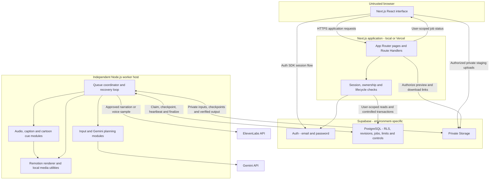
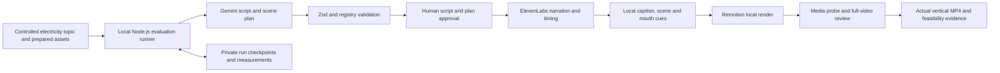
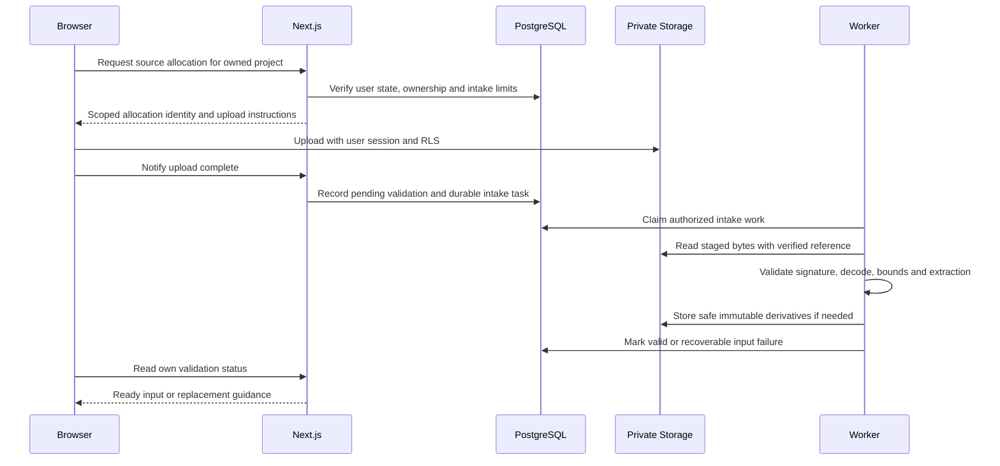
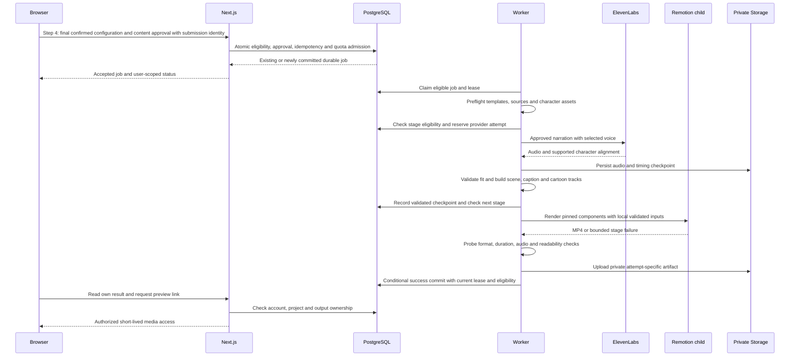
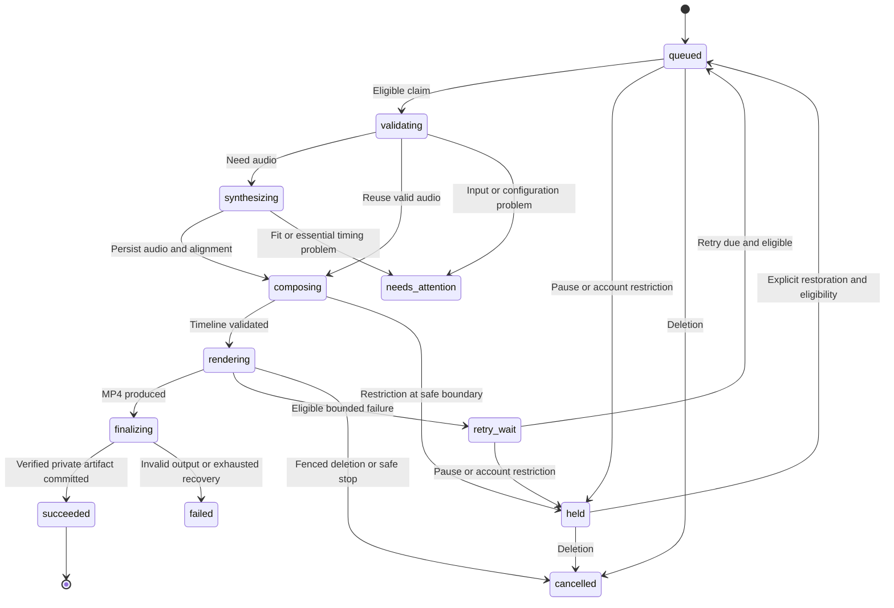
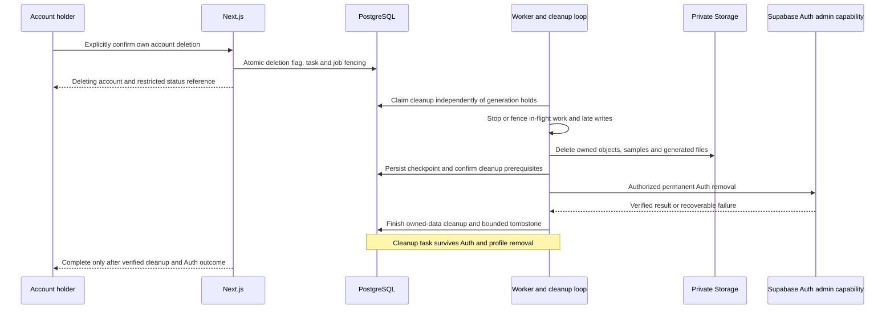
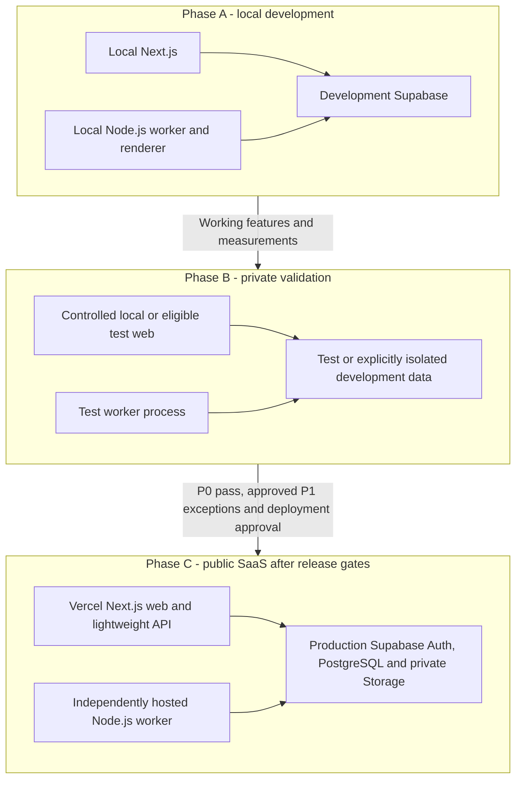

# AI Video Creator V1 — System Architecture

## 1. Status, authority and document boundaries

| Item | Value |
| --- | --- |
| Architecture version | 1.2 (owner-authorized UX/profile/approval alignment) |
| Date | 22 October 2026, Asia/Colombo |
| Requirements authority | [PRD.md](./PRD.md), V1 / document v2.5, owner-approved decisions recorded; revised document pending review |
| Status | Updated architecture document pending owner review; existing technical boundaries preserved |
| Intended use | Guide M0 planning and later multi-user implementation/design |
| Work performed here | Documentation only; no implementation, prototype, schema migrations, API specifications, deployments or service activation |

The PRD is the single source of product requirements. Official technical references explain integration constraints; they do not add product scope. If an implementation constraint conflicts with a confirmed requirement, record it for a decision rather than silently changing the PRD.

Labels used below:

- **Required:** mandated by the PRD, including its release priorities.
- **Architecture decision:** the selected simple design for satisfying those requirements, subject to validation where indicated.
- **Proposed / M0-dependent:** thresholds, exact libraries/models, capacities or operating settings not yet demonstrated.
- **Deferred:** intentionally omitted from M0 or V1, as explicitly distinguished.

This is a system-level design. It describes responsibility boundaries, conceptual records and interactions without defining database tables/columns, SQL migrations, HTTP endpoint contracts or implementation code. No runtime or provider call that generates content has been executed for this document.

## 2. Requirements that shape the architecture

### 2.1 Product invariants

The complete product is a multi-user SaaS, developed locally, tested privately with independent accounts, then deployed publicly after release validation. A private workspace is user isolation, not a single-owner allowlist.

| Dimension | Required scope |
| --- | --- |
| Video types | Product Video, Educational Video, Project Explainer |
| Presentation styles | Animated Explainer, Cartoon Teacher, Cartoon Presenter |
| Studio steps | Video Details → Script & Storyboard → Voice & Subtitles → Generate Video → Preview & Download |
| Language | English narration/subtitles; three English voice presets |
| Output | Vertical 9:16 H.264/AAC MP4, 62–90 seconds inclusive, default requested target 75 seconds |
| Cartoon capability | Prepared 2D teacher/presenter; speech-reactive mouth, pause closure, blinking, subtle head motion and limited gestures |
| Authentication and basic settings | Supabase email/password credentials; full-name/confirmation/legal-acknowledgement signup form, immediate own-dashboard access without email confirmation; login/logout, separate recovery, editable own full name/read-only email and secure authenticated password change |
| Lifecycle/safety | Private files, approvals, recoverable jobs, limits, project/account deletion, backend-only pause/restriction |

Preserve the compatibility matrix exactly:

| Type | Animated Explainer | Cartoon Teacher | Cartoon Presenter | Default |
| --- | --- | --- | --- | --- |
| Product Video | Yes | No | Yes | Animated Explainer |
| Educational Video | Yes | Yes | Yes | Cartoon Teacher |
| Project Explainer | Yes | No | Yes | Animated Explainer |

One teacher and one presenter are proposed initial assets, selected automatically by style. Their registry is extensible; a large library or manual character editor is not needed.

Exactly five user-facing steps share one Studio layout and wizard. Step 2 records explicit approval of the current script/scenes; Step 3 chooses voice/subtitles; Step 4 separately confirms the complete current immutable generation configuration before full narration/rendering. No sixth step is introduced. UI step count does not prescribe backend services, task kinds, project/job states or independently deployed pages. PostgreSQL/worker execution stages below remain unchanged.

### 2.2 System invariants

1. Authentication identifies a user; authorization additionally checks ownership and current account state.
2. Only a currently approved immutable revision may start video synthesis. Editable drafts and generated versions are separate.
3. Submitted work is durable before the web request reports acceptance; browser lifetime does not own a job.
4. Actual narration drives time. Character activity is not phoneme-accurate speech animation.
5. Model output is validated data selecting authored components; it is never executed code.
6. Quota reservations, idempotency and state transitions are authoritative server/database operations.
7. Ready means verified output exists privately and is accessible to its authorized owner; uploaded bytes alone do not mean Ready.
8. Deletion/restriction flags cannot be bypassed by an old JWT, worker lease or privileged storage credential.
9. Recoverable failures, quota limits and operational holds preserve acknowledged drafts and previous successful videos unless explicitly deleted.
10. No automatic paid upgrade, new AI/avatar provider, Redis, Kafka, RabbitMQ, separate Express service or complex microservice topology.

## 3. Complete SaaS topology

**Architecture decision:** one codebase with shared server/domain/render modules and two deployable application processes: Next.js and the independent Node.js worker. Supabase is the existing managed identity/data/file platform. Render/parsing subprocesses are local worker children, not new network services.

No public HTTP callback into the worker is required. The worker polls PostgreSQL for eligible tasks. The browser polls owned task status through Next.js with backoff; no mandatory WebSocket, Realtime service or message broker. Polling intervals and concurrency are configurable, measured later rather than fixed promises.

### 3.1 Responsibilities and communication

| Component | Owns | Communicates with | Does not do |
| --- | --- | --- | --- |
| Browser / React / Tailwind | Five-step Studio UX, inputs, scene cards, previews, save/progress messages, deletion confirmation | Next.js, Supabase Auth, permitted Storage upload/download capabilities | Hold provider/service secrets, decide quota/ownership, execute AI code |
| Next.js server | Verified request identity, workspace access, validated mutations, approval, upload admission, job submission/status, link issuance, deletion acceptance | Auth, user-scoped PostgreSQL operations, Storage | Long rendering or detached background work after responding |
| Supabase Auth | Password identities, sessions, password recovery and privileged Auth deletion | Auth clients and authorized backend | Authorize project ownership or replace application lifecycle flags |
| PostgreSQL | Durable state, RLS, revisions/approvals, transactional admission/reservations, job leases, controls and cleanup metadata | Next.js and worker | Make provider HTTP calls inside long database transactions |
| Storage | Private originals/derivatives, audio/alignment/cues and verified media | Authorized browser, server and worker | Expose a public asset library of users' files or hold executable model output |
| Worker coordinator | Claim/recovery, stage eligibility, provider calls, checkpoints, cleanup and result publication | PostgreSQL, Storage, Gemini, ElevenLabs, local children | Trust queued ownership blindly or expose an ordinary-user admin endpoint |
| Gemini adapter | Understanding, ideas, English scripts and allowlisted scene instructions | Gemini through worker | Write arbitrary runnable Remotion components or verify facts independently |
| ElevenLabs adapter | Three voices, samples, approved narration/audio/timing | ElevenLabs through worker | Choose visual meaning or guarantee phoneme lip-sync |
| Remotion / local utilities | Authored graphics, captions, cartoons, render and media inspection | Local validated materialized assets and coordinator | Fetch arbitrary model URLs, receive service credentials or render inside Vercel |

All application AI operations use durable worker tasks, including short ideas, script refinement and voice samples. This standardizes usage accounting, failure recovery and restriction checks. The UI still shows these tasks within Video Details, Script & Storyboard and Voice & Subtitles; they are not new creation stages. A future short-call optimization is unnecessary for V1.

## 4. Minimal M0 architecture versus the complete SaaS

### 4.1 M0 objective and boundary

M0 proves one complete **75-second-target educational electricity video** with teacher introduction, diagram explanations and teacher conclusion. It validates the riskiest technical path before the full application is implemented. A minimal local harness is an evaluation tool, not the released single-user version of the product.

**Architecture decision:** a local Node.js runner coordinates the same planned adapters, validated scene model, timing logic and Remotion components. A human reviews the generated script before narration. A private run directory holds source/approval metadata, audio/alignment/cue checkpoints, render output and measurements. Those names describe future artifacts; none are created by this architecture task.

| Capability | Minimal M0 | Complete multi-user SaaS |
| --- | --- | --- |
| Interface | Local runner plus manual plan approval and local playback; no mandatory dashboard | Next.js account screens, dashboard and shared five-step Studio |
| Identity | Controlled developer execution with nonconfidential test content | Independent Supabase accounts, RLS and lifecycle-aware access |
| Input | Known electricity topic and prepared teacher/diagram assets | All approved text/image/document sources and understanding review |
| Planning | Gemini script/scene generation and schema validation | All three types/styles, ideas/refinements, immutable revisions and approval |
| Narration/render | Actual ElevenLabs timing and Remotion output | Same pipeline with task ownership, quotas, controls and private media |
| Persistence | Local checkpoint manifest; single active evaluation run | PostgreSQL durable tasks/leases/reservations plus private Storage |
| Recovery evidence | Restart/reuse saved audio and inject a render failure | Crash/lease recovery, multi-user idempotency and in-flight reconciliation |
| Deletion/operations | Local artifact hygiene; no simulated claim of completed SaaS account deletion | Complete project/account cleanup, suspension/pause and audit |
| Supabase | Not needed for the core video proof; separate development integration checks follow | Required Auth/PostgreSQL/Storage platform |
| Hosting | Developer computer only | Local → private test → Vercel + production Supabase + independent hosted worker |

M0 checkpoint writes are atomic, record completed-stage hashes and never overwrite an approved script invisibly. They are sufficient for one supervised run, not multi-worker locks or evidence that SaaS P0 checks passed. Do not build the full durable queue/authentication system just to start the core video proof.

### 4.2 Required M0 evidence

Produce and inspect the real MP4, validated plan, approved narration text, audio/normalized alignment, scene/caption/character tracks, output metadata and stage measurements. Demonstrate a teacher opening/closing, a teacher-plus-diagram scene and a visual-only explanation. Test pause closure, blinking/head motion and a supported gesture. Check subtitle-off rendering reuses audio and a failed render resumes without repeating successful synthesis.

For target 75, the PRD's current fit window is 72–78 seconds inside hard 62–90 bounds. Proposed settings remain 1080 × 1920, 30 fps, H.264/AAC. Record CPU/RAM, elapsed/queue/stage time, disk/output size and Gemini/ElevenLabs units plus rendering/storage/bandwidth estimates. M0 additionally requires an injected failure during local rendering, process restart from saved approved assets without new provider requests, stronger narration/scene/subtitle/visual-anchor checks, subtitle-on/off behavior and offline duration-boundary tests. The three-voice, presenter, seven-combination, source/parser, real 62/90-second output, durable worker, private upload and multiuser checks follow PRD v2.5 §§28.2 and 30 in M1–M5. Local-process recovery does not satisfy durable worker lease recovery.

Functional/unsafe failures block feasibility. Proposed millisecond/reviewer/performance targets are measured as P2, not automatic blockers. If basic cartoon quality fails, record limitations and options; do not silently add Rhubarb or paid avatar services. M0 execution and any paid usage require their own later authorization; this document does not start them.

### 4.3 Reuse and evolution

Keep provider adapters, Zod validation, authored templates, character registry, normalized timing and output checks independent of local-run versus SaaS persistence. The production worker replaces local checkpoint storage/identity with authorized PostgreSQL/Storage operations, not a new AI pipeline. M0 does not establish final public limits or hosting capacity.

## 5. Logical modules and ownership boundaries

These are future code organization boundaries, not new services or files created here.

| Logical module | Responsibility / invariant |
| --- | --- |
| Identity and access | Verify identity, current account eligibility and resource ownership; preserve recovery/deletion-only access |
| Project and revision | Save editable drafts with conflict checks; produce immutable approved snapshots |
| Asset intake | Admit user-scoped upload, validate/quarantine, derive bounded safe inputs, track references |
| Planning | Extract/summarize sources, call Gemini, validate schema/registry/evidence and request review |
| Admission and usage | Atomic idempotency, per-user concurrency, reservations, service ceilings and operational checks |
| Task coordinator | Eligible FIFO, leases/heartbeats, checkpoints, retry/recovery and cancellation fencing |
| Narration and timeline | ElevenLabs audio/alignment, normalization, scene/caption tracks and audio-based duration |
| Character and renderer | Allowed prepared assets/actions, deterministic speech activity/blinking/gestures and Remotion rendering |
| Publication and retrieval | Validate media, upload private artifact and conditionally attach it to its exact revision |
| Lifecycle and operations | Delete project/account, pause/restrict/resume, independent cleanup and minimal audit |

Share compatible domain rules between web/worker, but enforce them again at trust boundaries. Pin build/schema/template/character versions in task snapshots; the worker must reject incompatible plans rather than reinterpret old approvals under new behavior.

## 6. Authentication, authorization and current account state

### 6.1 Signup, login and recovery

Use the supported Supabase SSR integration for Next.js session handling and refresh. Email/password signup has confirmation disabled in development, test and production; a healthy signup returns a session and opens the user's empty dashboard. Email reset links remain a separate recovery path. No OTP, MFA, social/phone login, magic-link login or owner allowlist.

The signup UI collects Full Name, Email Address, Password, matching Confirm Password and Terms/Privacy acknowledgement. Full Name is limited editable profile data anchored to the verified user ID; it never determines ownership or operator authority. Confirm Password is validated before submission and is never persisted; Supabase remains responsible for credentials, and application storage/logs must not contain plaintext passwords. Legal links, a required affirmative interaction and an acknowledgement record are separate: legal content, interaction requirement and recording/retention decisions remain for owner review before affected implementation. No consent schema/API is defined here.

Basic Account Settings permits an authorized eligible user to edit/save their own Full Name, view read-only account email and invoke secure authenticated password change through Supabase, with reauthentication where required by the validated provider flow. Recheck identity/current state, apply password safeguards and verify actual session effects without assuming immediate revocation of every token. Preserve separate Forgot Password/Reset Password. No existing password is retrieved or displayed. M1 aligns these limited profile/auth responsibilities; M4 retains complete lifecycle controls and mandatory deletion. Photos, public profiles, roles, organizations, teams, billing and advanced preferences are excluded.

Validate identity server-side on protected pages and Route Handlers rather than trusting a cookie payload or browser session flag. Session verification and refresh follow the installed compatible Supabase/Next.js versions; version-specific middleware/proxy naming is not fixed here. A valid JWT is not proof that the account is currently allowed to generate or read deleted data. [Supabase SSR guidance](https://supabase.com/docs/guides/auth/server-side/nextjs).

Next.js applies password/request validation and safe auth responses; Supabase performs credential operations. Logout clears browser/application session state and private caches; recovery requires a valid provider recovery context and correct environment redirect. Unverified email is not verified identity. Ownership remains the user ID, never an email match, and abuse/mailbox-squatting limitations from PRD §22.1 remain public-release review items.

### 6.2 Access paths and privilege separation

| Access path | Identity/credential | Mandatory checks |
| --- | --- | --- |
| Ordinary application request | Server-verified user session | Account state, requested operation, owned project/references, validated input |
| User-scoped data read/write | User-context Supabase client plus RLS | User ID ownership and permitted lifecycle operation; mutation scope constrained |
| Controlled admission/publication | Narrow transactional backend operation | User/owner derived from trusted context, expected revision/control version, quota and idempotency |
| Browser Storage upload | User access token and Storage RLS | Own approved staging allocation, permitted account state, size/type constraints; untrusted until worker validation |
| Worker Storage/data work | Protected backend credentials | Job's trusted user/project, lease, lifecycle, controls and immutable asset references; elevated credentials do not grant arbitrary ownership |
| Auth account removal | Backend-only privileged Auth capability | Confirmed deletion task and storage/cleanup prerequisites |
| Operator control | Deployment-authorized backend command | Explicit operator authority, allowed action/target and safe audit; never editable user metadata |

Ordinary browsers cannot insert runnable jobs, alter usage/control records, approve another user's revision, or call privileged Auth operations directly. Database grants/RLS and narrow authorized transactions must close those paths. Privileged credentials stay server/worker-only and are not passed to render subprocesses. Exact policies and transaction interfaces belong to later database/API design, not this document.

### 6.3 Effective lifecycle policy

Keep authoritative state independent of token contents: active, generation-restricted, deletion-in-progress, deletion-failed and deleted. Read current state for sensitive application operations and enforce equivalent rules in direct database/Storage paths. Missing/unknown eligibility fails closed for new expensive work; it must not recreate a deleting profile.

- **Active:** owned workflows allowed subject to limits/controls.
- **Generation-restricted:** expensive AI requests/new uploads/jobs denied; own completed reads/downloads, safe text edits, deletion/logout/recovery remain permitted.
- **Deleting / deletion-failed:** ordinary workspace access and mutations denied; only narrow authorized deletion status/retry/logout and backend cleanup remain.
- **Deleted:** no account/workspace recovery through a stale token or matching email. A later signup gets a new identity/workspace.

Do not rely on provider sign-in bans, logout or Auth deletion alone to revoke already issued access capabilities. Current-state checks enforce the stronger application policy. Operator restoration cannot reverse deletion.

### 6.4 Browser security and private responses

Use HTTPS in deployed environments, supported SSR cookie storage/refresh and appropriate Secure/SameSite/path settings. Do not blindly require an HttpOnly-only storage scheme that breaks the supported browser Auth client; validate the actual SDK integration. Protect cookie-authenticated mutations against cross-site requests, encode untrusted text, and use private/no-store responses for personalized status/settings/media-link issuance. Partition/invalidate client caches on account change/logout. Previously issued signed media capabilities have the explicit expiry limits discussed below.

Signup/login/recovery require both application and available Supabase rate controls. An application-only limiter cannot automatically protect direct calls to a publicly reachable Auth API; test those paths and configured provider protections before public launch. No new CAPTCHA, verification provider or complex onboarding is introduced by this design.

## 7. Private asset intake, storage and retrieval

### 7.1 Source upload flow

**Architecture decision:** upload bytes directly from the authenticated browser to a private, user-scoped Storage staging allocation using the user's session and RLS; avoid proxying all bytes through Vercel. Next.js authorizes the allocation first and records intended ownership. Do not allow arbitrary client-selected destination paths, public buckets or replacement of an approved immutable source.

Use proposed PRD limits, not browser trust: up to five supported images, bounded bytes/pixels, one bounded text PDF/DOCX, extracted text/context limits. A coarse Storage cap prevents gross excess; exact signature/page/decode checks occur before AI processing. Quarantine pending bytes and reject parser expansion, corrupt/encrypted/image-only unsupported documents. Long/mixed documents disclose gaps and use bounded summaries, never silent truncation.

Restrict staging uploads to newly allocated keys; bind finalized assets to checksums/versioned references. A user cannot overwrite a source while the worker reads its approved snapshot. Clean abandoned allocations/orphan bytes. Asset deletion waits while a live snapshot references it, or explicitly cancels dependent work. Duplicate projects may reference immutable assets of the same owner; no cross-user source sharing.

### 7.2 Private outputs and bearer links

Store originals, extracted text, derivatives, samples, narration, timing/cue files, thumbnails and MP4s privately. Built-in character/font/icon/template assets are deployment-controlled shared assets, not a public directory of user content.

For preview/download, Next.js checks the current user/account/project/artifact and issues a short-lived signed link. The proposed PRD download lifetime is ten minutes, to validate later. Playback may refresh an expired link after reauthorization without generating another video. Signed URLs are bearer capabilities: do not log them or claim instant revocation of a link already issued. Already downloaded files cannot be recalled. [Supabase private downloads](https://supabase.com/docs/guides/storage/serving/downloads).

Default browser uploads use live user-session policies rather than long-lived signed upload URLs. If an SDK/transport change later requires signed upload capabilities, preserve account checks at issuance, bounded lifetime, pending-write tracking and late-write cleanup; deletion cannot assume such a capability vanishes instantly. Direct Storage policies must reject new ordinary access/writes for deleting accounts while preserving privileged cleanup. [Storage access control](https://supabase.com/docs/guides/storage/security/access-control).

### 7.3 Worker/render asset boundary

The coordinator resolves authorized object IDs, downloads bounded validated material to a private per-job workspace and supplies only those files/approved built-ins to the renderer. Prefer a loopback-only asset server or equivalent local materialization supported by the render runtime; never expose its filesystem externally. Parser/render children receive a sanitized environment without inherited provider or Supabase service credentials, arbitrary remote URLs or paths outside their workspace. Restrict network/file access and bound process resources; exact OS enforcement is a host feasibility decision. Worker local disk is disposable, not the durable source of truth for accepted SaaS jobs.

## 8. AI understanding and content planning

### 8.1 Planning data flow

1. The user saves a description and optional validated source references within Video Details.
2. Next.js checks state/ownership and reserves the applicable idea/script allowance before recording a durable planning task. Restricted/deleting users cannot create or run it.
3. The worker reads only those owned sources, extracts bounded text/derivatives, and preserves source/page references and incomplete-extraction warnings.
4. For long supported content, it summarizes bounded sections then combines them with sufficient evidence to expose conflicts. It reserves/checks model tokens for input, instructions and output rather than treating 60,000 characters as a context guarantee.
5. Gemini receives minimized content, the chosen type/style, audience/target, confirmed facts and a bounded list of supported templates/actions. It does not receive credentials, unrestricted storage URLs or another user's data.
6. The worker validates the structured response and registry/ownership semantics, then conditionally saves the resulting draft revision. A late planning response cannot overwrite newer user edits.
7. Script & Storyboard displays understanding, unresolved facts, narration, visual descriptions and character appearances. Corrections/refinement repeat planning with new task identity and quota checks; no full narration is synthesized before explicit current script approval and separate final generation confirmation.

Use Gemini schema-constrained responses where supported, followed by server-side Zod and semantic checks. Provider schema support does not establish truth, authorization or compatibility. M0 validated one planning path; source-grounded image/long-document model and schema coverage is an M2 decision. [Gemini structured output](https://ai.google.dev/gemini-api/docs/structured-output).

### 8.2 Controlled scene plan

The plan references authored templates, allowed scene order, narration, owned/built-in assets, overlays, character visibility/placement/action, narration anchors, estimated duration and source evidence. It is a versioned domain artifact, not generated application code. Validate:

- Exactly the selected supported type/style and English narration; valid scene count and bounded text.
- Registry membership, compatible character/action/placement, immutable built-in versions and asset ownership.
- Complete narration, explicit scene IDs, anchor ranges matching the intended text and no executable markup/paths/URLs.
- Product/project factual safeguards: no material/price/certification/availability guesses and no portrayal of planned software as live.
- Unknown/contradictory information is visible to the user, not hidden by a confident summary.

An unsupported decorative gesture can become a displayed supported idle action before approval. A semantic/character-style change requires a reviewable alternative. Bounded schema repair preserves the previous valid draft on failure. No web browsing, OCR, website import, generated unseen product footage or additional AI provider is introduced.

Uploaded instructions are untrusted source material. They cannot change system permissions, ask the worker to execute code or make the renderer fetch data. Text and model outputs remain safely encoded in the interface and components.

## 9. Drafts, approval and revision semantics

Editable drafts use optimistic revision checks; acknowledge Saved only after durable success. A conflicting tab receives reload/copy-my-edits guidance rather than overwriting another acknowledged version. AI regeneration saves a new version only on success and retains a restore-previous path.

Step 2 script/storyboard approval identifies the exact current content and scene plan, but alone authorizes no full narration/rendering. After Step 3 settings selection, Step 4 requires a separate explicit final generation confirmation. Its immutable snapshot includes the current content approval, source identities/checksums, narration/scenes, type/style, character/template/schema versions, voice/model/settings, subtitles and target. The backend checks both decisions, identity/current eligibility and ownership before idempotent admission. An approval hash is an integrity/cache identity, not authorization. Earlier user-initiated planning and eligible short samples keep their existing separate request/usage controls; they are not full generation authorized by preliminary script approval.

| Change | Consequence |
| --- | --- |
| Spoken text | Invalidate affected Step 2 content approval and Step 4 final confirmation; regenerate audio/alignment and dependent work after explicit reapproval |
| Voice/settings | Invalidate final confirmation and affected audio/timeline/render; unchanged script approval may remain valid |
| Source facts/type/semantic scene plan | Review understanding/scenes and final configuration again; reuse audio only when approved spoken content/settings are identical |
| Character/style | Revalidate compatibility, content/scene approval and final confirmation; rebuild scenes/character cues/render, keep compatible audio |
| Subtitle visibility or supported visual treatment | Confirm the updated settings/revision in Steps 3–4; invalidate affected visual approval as needed; render-only reuse if narration/cues stay valid |
| Requested duration | Revalidate fit and affected content approval, then final confirmation; reuse audio only if it satisfies the new target window |

Reuse is scoped to the same user and matching versions/content/settings. Do not cross-user deduplicate private speech/text merely because a hash matches. Newer revisions do not mutate running snapshots; older completion can remain attached to its own revision but cannot become the current result for a different edit. Keep the previous successful video labeled accurately while replacement work fails or waits.

## 10. End-to-end video generation and publication

### 10.1 Orchestration sequence

Gemini planning occurs before this sequence. Reusing already validated audio skips ElevenLabs; it is not a new synthesis request. A duration-fit problem requiring different wording returns to Script & Storyboard and final confirmation rather than rendering an unapproved script.

### 10.2 Checkpoints and final commit

Persist successful narration/alignment before rendering, then the validated timeline/cue manifest and final media identity. Each artifact belongs to a user/job/revision/build and attempt; publish manifests rather than overwriting a shared final filename. Upload/probe success is verified before a short database success transaction records the accessible output.

Storage and PostgreSQL are not a distributed transaction. A crash after upload but before success commit leaves a private orphan, not Ready. Recovery verifies its identity/checksum and can attach it only under the current lease/state rules; otherwise cleanup removes it. A crash after a committed success can be reconciled without another provider call. A late renderer/provider result from an expired lease cannot publish.

The coordinator checks account deletion/restriction before each costly stage and publication. Logical stage authorization and external HTTP dispatch cannot be made one atomic database/network transaction. Record intent immediately before dispatch, recheck cancellation when possible, and treat already-authorized/in-flight calls as potentially consumed if control changes race with the network. Never claim instant remote cancellation, perfect exactly-once billing or the absence of every late byte. Local admission/publication gates and cleanup enforce the PRD's observable guarantees.

### 10.3 Rendering and output gate

Remotion consumes a pinned, application-authored composition and resolved inputs. Package fonts/icons/characters locally with recorded rights; use deterministic tracks and bounded render concurrency. Keep headless browser/media processes behind the coordinator's cancellation/timeout boundary. The server-side renderer is supported by Remotion; exact runtime/browser/codec packaging must be verified on the selected OS/host. [Remotion rendering](https://www.remotion.dev/docs/renderer/render-media).

Probe container/codecs, dimensions/frame rate, actual duration, nonempty audio/video streams, decodability and file availability. Automated checks complement full-video visual review; they do not prove every scene is understandable. No silent downgrade of the proposed export quality, no Ready state for a corrupt/silent/out-of-range output and no unvalidated fallback timing. A user preview is playback of the finished private MP4; an interactive timeline/editor is unnecessary.

## 11. Narration, captions, cartoon activity and duration

### 11.1 Audio and timing normalization

ElevenLabs receives spoken narration only, usually as one continuous request. Three configured English voices and short samples share the same adapter. The speech-with-timing endpoint supplies audio and character-level alignment; it does not supply scene meaning or guaranteed phonemes. [ElevenLabs timing](https://elevenlabs.io/docs/api-reference/text-to-speech/convert-with-timestamps).

Maintain mappings among approved scene narration, concatenated synthesis input and provider-normalized spoken text. Choose one internal Unicode offset convention and explicitly convert JavaScript/provider offsets; validate it with emoji, apostrophes, numbers, abbreviations and repeated phrases in M0. Stable scene spans prevent a later repeated word from triggering the first occurrence's animation. Captions may display a readable approved numeric equivalent without changing spoken meaning.

Validate finite nonnegative ordered times, consistent arrays, text mapping and coverage, and decoded audio length. Missing essential timing cannot be repaired by evenly dividing total duration. Use bounded eligible recovery or Needs Attention. Store mappings so retries/revisions reproduce the same semantic anchors.

### 11.2 Derived timeline

The application maps approved scene spans to actual speech, schedules transitions/callouts and groups readable captions. Use PRD's single English subtitle style and safe margins, with proposed two-line/phrase-duration settings kept configurable. Keep essential product/diagram content clear and avoid a character overlapping captions. Silent intro/outro holds do not produce speaking mouths.

### 11.3 Basic cartoon mouth animation

1. Decode a bounded local copy of narration into amplitude samples for activity analysis; do not transcribe through another AI provider.
2. Combine validated speech intervals with a smoothed audio-energy envelope and hysteresis to distinguish activity from silence without rapid visual chatter.
3. Create a deterministic closed/open cue track only over visible speaking intervals. Close through clear pauses and before/after narration. Additional mouth states are optional, not a phoneme requirement.
4. Create deterministic blink/head/allowed gesture tracks, anchored to reviewed scene/narration events; seed any variation from the pinned revision so parallel frames agree.
5. Remotion samples these tracks on the common timeline. A character-free diagram scene can keep narrating without a visible mouth.

Only the initial prepared teacher/presenter assets and allowed actions are used. Registry entries can grow later without new rendering architecture. Analyze quiet speech, long pauses, short syllables and gesture collisions during M0. Basic functioning activity/pause closure and readable output remain required; proposed 150/250/300 ms and reviewer-score targets from the PRD remain measurement targets under P2. No Rhubarb, HeyGen, D-ID, 3D or paid avatar service is needed by this design.

### 11.4 Duration fit

Preserve the PRD rule for target T:

`max(62, T - 3) <= actualDurationSeconds <= min(90, T + 3)`

The default 75-second target accepts 72–78 seconds. Select an integer frame count inside the window; probe actual output rather than relying on rounded UI labels. Account for media encoder padding/stream lengths when evaluating hard boundaries.

Estimate length before approval, measure it after synthesis, and fit scene holds/transitions to real speech. Purposeful intro/outro holds total at most the proposed three seconds. One tested natural-delivery adjustment with unchanged approved wording may use the same bounded synthesis-attempt allowance. If still unsuitable, request user-approved shortening/expansion or a target change. Never silently rewrite, cut speech, add long empty padding or excessively accelerate narration. If encoding pushes a boundary outside the window, adjust only valid silent/timeline fit or return for review; do not truncate narration to pass a probe.

## 12. Durable queue, leases and worker execution

### 12.1 Persistence and task kinds

**Architecture decision:** PostgreSQL is the durable queue and control/usage authority; no separate broker. Task kinds are source intake/planning, voice sample, video generation and project/account cleanup. They share coordinator infrastructure but have different quota and hold policies. This is one worker application, not several microservices.

Use short transactional claims with row locking/skip-locked behavior or an equivalent validated database-backed mechanism, atomic job admission and a lease/fencing token. PostgreSQL documents skip-locked selection as useful for queue consumers; no long transaction spans rendering or provider HTTP calls. Later database design defines the exact transaction boundaries and privileges. [PostgreSQL locking guidance](https://www.postgresql.org/docs/current/sql-select.html).

A claimed task records an attempt/lease, heartbeat and stage checkpoints. Finalization succeeds only if the lease/version is current, ownership still matches and lifecycle/control policy allows publication. A global coordinator lock is not held throughout video rendering. Recovery claims expired leases with a new fencing identity, verifies existing checkpoints and avoids competing publication.

### 12.2 State and user-visible progress

This diagram shows principal transitions, not every stage-specific failure edge. Any stage can enter bounded retry, Needs Attention, failed or cancelled according to the classified failure/control policy. Restriction is checked at every safe boundary, not only composing. Account deletion has its own durable task/lifecycle; it is not a video job becoming failed.

Dashboard states remain Draft, Generating, Ready and Needs Attention. Friendly UI labels are presentation mappings, not new database enums: Awaiting Review indicates a pending content/final decision on the current revision under its actual project state; Queued reflects a queued job; Processing an active job; Completed means succeeded/verified Ready; Failed describes a failed attempt or Needs Attention without erasing a previous valid output. Held work displays Generating with an explicit Paused/Restricted reason rather than a false active stage. Current draft/revision status and the previous successful video remain distinct. Polling only exposes owned job data, never queue contents or other users' identifiers.

### 12.3 Coordinator and process isolation

The coordinator handles queue polling, heartbeats, state/control checks and cleanup scheduling. CPU-heavy parsing/audio work and Remotion/headless rendering run as bounded local child work so they cannot freeze heartbeat/control handling. The proposed initial capacity is one render per worker, with configurable control/intake handling; no final capacity is assumed before M0.

Run cleanup/control checks fairly even while render capacity is occupied or generation is paused. Deletion can mark/fence a task immediately through PostgreSQL, signal/stop a renderer at a safe boundary and remove late artifacts; it must not wait indefinitely behind held video jobs. Use graceful shutdown to stop claims, preserve/fence checkpoints and let recoverable work resume. Host supervision restarts the process; database leases provide correctness even after an abrupt crash.

Eligible jobs are FIFO initially, with user caps and fair task scheduling preventing starvation. Held/deleting users do not block another eligible user's claim. Queued/running/retry/held video jobs consistently count toward that user's configurable simultaneous-job cap, as required by the PRD.

## 13. Retries, idempotency and uncertain outcomes

| Failure | Architectural response |
| --- | --- |
| Repeated Generate/status retry across tabs | Per-user submission identity resolves to one committed job/reservation; no cross-user response reuse |
| Temporary network error, 429 or provider 5xx | Classified backoff/jitter with provider guidance and proposed maximum two automatic retries after initial eligible stage attempt |
| Invalid credentials, denied content, missing registry asset or exhausted allowance | Needs Attention/held guidance as appropriate; do not repeatedly consume calls |
| Audio saved, renderer fails | Reuse stored audio/alignment/timeline/cues; restart only missing render work |
| MP4 saved locally, upload fails | Retry upload when valid local output survives; otherwise re-render from durable checkpoints without another synthesis |
| Uploaded artifact exists but database success acknowledgement is lost | Reconcile private attempt artifact and current job/lease before attaching; orphan cleanup if invalid/ineligible |
| Provider request times out after potential completion | Persist uncertain intent/outcome, reconcile available provider history/request references; stop for operator review if unresolved |
| Worker loses its lease while provider/render work finishes | Reject stale commit; quarantine/clean late output; never assume that provider billing was undone |
| Missing local files after host restart | Restore owned durable checkpoints; regenerate only missing deterministic work within limits |
| DB/control state unavailable | Fail closed for new expensive stages; do not claim a state change succeeded; preserve work and recover |

Local idempotency is not provider billing idempotency. A model seed does not prove repeat calls are identical or free. Store provider intent/reference and known/estimated usage before/after dispatch; retain uncertain consumption until reconciled. Never call a provider inside an automatic retry of a database transaction.

Manual retries are bounded by configured limits, scope to the failed attempt and cannot run simultaneously. Duration adjustment and schema repair each remain bounded; combining retry mechanisms must not create a hidden multiplication loop. Do not resume held work just because time or quota resets: operational restoration remains explicit. A browser timeout returns to status polling rather than resubmitting uncontrolled provider calls.

## 14. Configurable limits and shared capacity

### 14.1 What is limited

Backend configuration covers per-user video attempts/totals, idea/script/regeneration/refinement requests, voice samples, simultaneous outstanding video jobs, file/storage allowances, and shared provider rate/usage ceilings. Limit periods and numbers follow M0 local/provider evidence and M1–M5 private storage, bandwidth and workload measurements. There is no fixed free-video count, pricing-plan model or customer budget form.

The browser can display a limit message but cannot grant quota. Held/retry jobs retain correct outstanding-slot accounting. Samples and long-document chunks consume their own applicable allowance; they cannot bypass video admission restrictions through a different endpoint.

### 14.2 Admission and reconciliation

```mermaid
flowchart LR
    REQ[Validated user request] --> TX[Short authoritative admission transaction]
    TX --> STATE[Account, ownership, approval and pause policy]
    STATE --> KEY[Existing submission or new request]
    KEY --> RES[Reserve per-user and shared capacity]
    RES --> JOB[Commit durable task and reservation together]
    JOB --> CALL[Eligible worker stage and bounded provider intent]
    CALL --> USE[Reconcile actual or uncertain units]
    USE --> DONE[Complete, hold or recover without double accounting]
```

Use one transactional authority for eligibility, reservation and job identity so simultaneous users/tabs cannot spend the same remaining capacity. Recheck at claims and costly stages; release only demonstrably unused reservations. Account/operation control updates and admission use consistent ordering/versions to avoid races/deadlocks. These are invariants, not a database schema specified here.

Application counters can enforce exact request counts; provider token/character/credit totals may only be estimated until a response/history is available. Reserve conservative bounded units using selected model/input constraints and reconcile when possible. Never treat a timed-out call as free. Distinct API keys do not necessarily create separate provider-account quotas, including across environments; reflect the actual provider scope and any external account usage in release configuration.

When a personal allowance is exhausted, deny that user's new expensive work and preserve their drafts/downloads; other users may continue within shared limits. When shared limits are exhausted, defer/reject eligible new work with known reset guidance or operator review. No automatic plan upgrades/overages. Deletion cleanup is exempt from generation quotas and holds, although infrastructure outages still require recovery.

## 15. Minimal operational control plane

**Architecture decision:** an authorized deployment operator uses a small backend command/configuration operation that persists control changes and minimal audit data in PostgreSQL. This is not a public admin route, admin dashboard, organization system or extra ordinary-user role. Browser metadata or a request's claimed operator flag cannot confer authority.

Persist global pause/account restriction with a control version and safe actor/reason/outcome. All processes read effective state from the same environment authority. Static startup-only environment flags are insufficient for a live pause/restriction because a running worker or direct data path might otherwise ignore them. Configuration can choose defaults, while live changes are durable and auditable.

| Control | New requests | Queued/retry work | Running work | Preserved capabilities |
| --- | --- | --- | --- | --- |
| Global generation pause | Reject new full-video generation/regeneration/user generation retries | Hold unclaimed queued/retry video jobs | Already-running approved execution may finish subject to current account/quota checks; a failed-stage retry waits | Own draft edits, existing preview/download, recovery/deletion; script/idea/sample requests remain within their normal limits unless account restricted |
| Account generation restriction | Block this user's expensive planning/refinement/sample/video operations and new source uploads | Hold this user's planning/video/retry jobs; skip them when serving others | At next safe checkpoint, save reusable work and hold before further expensive stages; prevent new result publication while restricted | Own completed reads/downloads, safe text edits, deletion/logout/recovery; no automatic data deletion |
| Explicit restoration/resume | Remove only the selected hold | Re-evaluate eligibility/approval/quota/control state and reuse original job/checkpoints | Reconcile prior calls/reservations; no blindly repeated provider execution | Previous outputs/drafts intact; deleting/deleted accounts never reactivate |

Account deletion overrides both hold types; generation pause does not freeze cleanup. Paused jobs count correctly toward outstanding limits. Restriction is an application lifecycle policy, not merely a Supabase sign-in ban. An in-flight external call may finish/consume units; a restore cannot erase that usage.

Control changes and admissions have a clear database commit ordering. Reject ordinary-user control writes and report failed operator changes accurately. If authoritative state is unavailable, fail closed for new expensive work, keep persisted holds across restarts and preserve data. A request that was already authorized/in flight observes the documented stage-boundary policy, not an impossible promise of atomic cancellation of remote HTTP work.

Audit only operator identity/reference, action, target internal ID/scope, timestamp, safe reason and success/failure. Do not include private scripts/files, email recovery tokens, signed URLs or provider secrets. Restrict audit visibility and apply PRD retention; audit records are not a backdoor admin interface.

## 16. Project and permanent account deletion

### 16.1 Project deletion

An authenticated owner confirms deletion of their own project. Atomically mark it unavailable, block new job/link issuance, fence ongoing publication and enqueue cleanup. Remove unreferenced project sources/revisions/artifacts while preserving same-owner duplicate-project references. Do not delete another user's files or shared built-in character assets. Existing signed media links may live until expiry and downloaded copies are outside recall.

### 16.2 Account deletion workflow

Account Settings provides a separately placed Delete Account action alongside the limited profile/password controls. It requires explicit destructive confirmation, then truthful accepted/in-progress, completed, or incomplete/recovery states; missing Stitch deletion visuals do not remove this mandatory feature. The backend derives its subject from verified identity; no body-supplied owner ID can delete another account. A confirmed request durably changes lifecycle and creates/reuses an independent cleanup task before acknowledging acceptance.

The final UI response is conditional: while the identity exists, only the narrow deletion-status/retry/logout path is available; after Auth removal, normal authentication/lookup cannot be used to finish cleanup. The backend task continues independently. A lost browser response cannot restore normal access or justify inventing a public unauthenticated account-status endpoint. The client can show its last acknowledged safe reference; unresolved completion is recovered by authorized backend operations without recreating the user.

### 16.3 Ordering and failure guarantees

1. Set deletion-in-progress and deny ordinary project reads/edits/duplication, uploads, samples/planning and new generation. Restriction checks cover old tokens/direct database/Storage requests. Existing bearer links retain their documented expiry limitation.
2. Cancel queued/retry/held jobs, signal running work, invalidate later publication, and track in-flight requests/uploads/render children. Stop at safe boundaries; late results are discarded/cleaned rather than restored.
3. Use a minimal cleanup manifest to remove owned originals/derivatives/extracted text, voice samples/audio/alignment/cues, videos/thumbnails, local temporary files, projects/revisions/approvals and unnecessary usage/profile data. Preserve live references needed to finish cleanup until removal is verified.
4. Quiesce or fence writes and remove owned Storage objects before permanent Auth deletion. Supabase documents a Storage-ownership constraint on user deletion and the fact that previously issued access tokens can outlive account removal. Application lifecycle checks close the ordinary-access window. [Supabase user management](https://supabase.com/docs/guides/auth/managing-user-data).
5. Only protected backend credentials can perform Auth removal. Verify the result; retries use the same task. The durable deletion manifest/tombstone must survive Auth/profile cascade and retain no more information than needed for completion/justified retention. [Supabase privileged deletion](https://supabase.com/docs/reference/javascript/auth-admin-deleteuser).
6. Finish remaining live-data cleanup and record verified completion. Auth failure leaves Deletion Failed/Incomplete with ordinary access blocked; post-Auth cleanup failure continues without requiring a deleted login. No rollback to active and no false success.

An upload already in progress can race with cleanup, including any future signed-upload capability. Keep bounded upload lifetimes/in-flight tracking and rescan late objects before claiming completion; retry Auth removal if ownership blockers remain. Do not reassign private objects to another ordinary user as a cleanup shortcut.

The PRD's healthy-dependency cleanup target is proposed 24 hours, not an unconditional guarantee. Overdue tasks are monitored and retried in a bounded manner with operator recovery. Minimal deletion/operational evidence is proposed for 30 days after verified completion, subject to documented fields, purpose, access and expiry. Other proposed temporary/sample/superseded-output periods remain those in PRD §22.3. Backups/provider-held copies follow actual policies; restores must reapply deletion markers before granting access. No indefinite content archive or legal retention obligation is invented here.

A new signup with the same email receives a new user ID and no old files. Missing-profile provisioning or cached session refresh must never recreate a deleted workspace. Global pause, restriction and exhausted generation quotas cannot block cleanup.

## 17. Persistence and artifact relationships

Keep relational truth in PostgreSQL and private large bytes in Storage; local scratch is replaceable. This is a conceptual responsibility map, not a database design document.

| Record family | Relation and architectural rule |
| --- | --- |
| Identity/profile/lifecycle | Supabase user ID anchors ownership; editable full name/read-only email are limited profile data, never authority; provider owns password changes; lifecycle check independent of JWT; no required signup activation; legal acknowledgement recording unresolved |
| Project/draft | User-owned mutable working content, save version and resume stage; separate from output status |
| Revision/approval | Exact script/scene approval plus separate final immutable content/asset/settings confirmation; reused only under matching ownership and semantics |
| Asset/reference | Immutable owned byte identity and same-user references; built-ins live in a separate trusted registry |
| Task/attempt/lease | User/project/revision association, task kind, current stage, retry/lease history and environment |
| Timing/render artifacts | Versioned audio/alignment/text mappings, captions, scene/character tracks and verified output metadata |
| Usage/reservation | Per-user and shared periods/limits; consumption, reserved units and unresolved provider attempts |
| Operational state/audit | Backend-only persisted holds/control version and minimal safe audit evidence |
| Deletion task/manifest | Exists independently of Auth/profile cascade and ordinary project cleanup; bounded tombstone after completion |

Ordinary API mutations use authenticated user context with RLS wherever possible. Short authoritative admission/claim/publication/usage operations should be encapsulated in narrow backend-authorized PostgreSQL transactions, callable through the Supabase database RPC interface. This avoids dependence on session-affine locks or a dedicated connection per long video. Do not expose unsafe privileged functions to browser callers; exact grants, function shapes, indexes and constraints are later database design work.

Storage writes and database commits need reconciliation, not an assumed distributed transaction. Associate checksums/versions and attempt ownership before publication, sweep abandoned allocations/private orphan outputs and honor reference pinning. Deletion/retention tasks have bounded independent records so cascading user deletion does not destroy unfinished work.

## 18. Local, private-test and production deployment

### 18.1 Staged topology

The inter-phase arrows represent promotion of tested software/configuration, not copying user files or live queues between environments. Development and production have separate Supabase projects/data/storage, credentials and URLs. A third managed test project is optional if allowances are limited; private tests can use the isolated development environment, never production data.

### 18.2 Local development and M0

M0 needs only the controlled local runner, core provider credentials and render runtime. Once full foundation work begins, run Next.js/worker locally against a development Supabase project. The worker must be on for jobs to advance; browser closure does not matter, but computer shutdown pauses local processing. Test two independent accounts, not an owner-only shortcut. No production hosting is needed to complete local/private validation.

### 18.3 Private testing

Keep access nonpublic without implementing a new invitation/role product. Exercise ordinary signup/no-confirmation/recovery and separate users' uploads, approvals, jobs, retries, duplicates and deletions. Test simultaneous admission, leases, quotas, controls, stale sessions and partial account deletion. Record actual compute/provider/storage usage and visual quality. Use a controlled test configuration or appropriately eligible test deployment; no paid activation is implied.

### 18.4 Production

Vercel hosts App Router/React and short Route Handler operations; PostgreSQL holds jobs so no request must outlive a render. Long provider workflows, extraction and media work stay in the separately hosted worker. Production rendering must keep working with the development computer off and users' browsers closed.

Choose the worker host only after CPU/RAM/disk/browser/native-media/deadline measurements. It must support the required Node.js process lifecycle, children, writable bounded scratch, network access, termination handling and supervision. Start with the proposed single render slot and scale configuration only after measurements; multiple workers use the same leases/reservations, not a replacement broker. Co-located hosts do not remove the logical/process boundaries.

Vercel request/runtime/upload limits and Supabase capacity must be checked for the actual selected plans. Large byte uploads bypass web-body limits through private Storage, not public buckets. A production worker is not a scheduled laptop session or background promise in Vercel. Hosting costs/terms and commercial API/asset rights remain release checks with explicit approval before paid use.

### 18.5 Configuration and environment separation

| Configuration family | Location / separation |
| --- | --- |
| Public web configuration | Supabase public project URL/publishable key and intended web origin only; no privileged secrets |
| User-session configuration | Compatible SSR SDK behavior, cookie/security/refresh settings and correct signup/recovery redirects |
| Server/worker secrets | Provider keys and minimum necessary Supabase/backend capabilities; never browser-exposed or passed to render children |
| Worker identity | Explicit environment identity and permitted Supabase project; refuse mismatch, including a local worker pointed at production |
| Domain versions | Pinned schemas/templates/characters/model/voice settings associated with task snapshots |
| Operational configuration | Per-user/shared limits, retry/deadline/resource settings and persisted pause/restriction state |
| Recovery/retention | Correct environment email sender/allowed redirects, cleanup periods and backup/restore handling |

Do not assume separate API keys create independent billing/quotas. No secret values are included in documentation or future screenshots/logs. Rotate credentials deliberately and reconcile queued versions when deploying incompatible template/schema changes; do not execute old approvals with changed semantics.

## 19. Security boundaries and important trade-offs

| Boundary / risk | Design response | Remaining trade-off or validation |
| --- | --- | --- |
| Untrusted browser versus private data | Verified identity, RLS, current lifecycle and operation ownership; no privileged task/control writes | Test direct SDK/data/Storage paths, not just UI |
| Model content versus executed components | Zod, semantic allowlists and authored bundles; no generated code/URLs | Schema-valid text can still be wrong; understanding/user review remains necessary |
| Auth token versus current permissions | Lifecycle checks and deletion tombstones in relevant paths | Bearer links/in-flight calls have bounded residual windows; do not overpromise instant recall |
| Renderer/parser versus secrets/host | Materialized validated assets, no service secrets, bounded child processes and restricted access | Host sandbox/network enforcement must be proven; do not assert a perfect sandbox before testing |
| One tenant versus another | User-scoped queries/cache/reservations/artifact references and service-role owner rechecks | Elevated worker privilege is a risk; keep capabilities narrow and audit execution |
| Provider HTTP versus transaction | Persist intent, bounded attempt reservation, reconciliation and fencing | Exactly-once provider billing is not guaranteed |
| File bytes versus commit | Private attempt objects, probe/checksum, conditional publication and orphan cleanup | More recovery metadata than an overwrite-only final file, necessary for reliability |
| Database queue versus dedicated broker | Existing PostgreSQL transactions/leases and moderate polling | Some polling/DB load; measure before adding infrastructure |
| Prepared cartoons versus generated avatars | Reusable simple assets/activity cues with no extra provider | Limited gesture/character realism; accurate phoneme sync deliberately not promised |
| Local free-first work versus public operation | Use eligible allowances/local render; validate production terms and measured limits | Public hosting, voice usage/storage/egress may require paid services; no activation without approval |

Use safe logs, CSRF/origin protection for authenticated mutations, user-safe errors and bounded source parsing. Rate limiting and shared ceilings address resource abuse; they do not prove email ownership or eliminate multi-account abuse. If available controls cannot meet P0 public safety requirements, block release for a documented decision rather than silently add email verification or another provider.

## 20. Observability, reconciliation and retention

The worker emits structured operational events with environment, internal task/revision/user references, stage/attempt, safe error code, elapsed time and estimated/actual units. Do not log source text, scripts/audio, credentials, signed URLs, reset tokens or response payloads. UI messages are simpler than operator diagnostics and do not reveal other users' queue entries.

Record queue wait separately from provider/render time, worker heartbeat/capacity and counts of retries, uncertain provider outcomes, orphan artifacts, held jobs, deletion failures and resource limits. Persisted controls/audit are authoritative even after process restart. Proposed progress-update/performance targets remain measurements, not a new service-level promise.

**Architecture decision:** an internal scheduled reconciliation loop in the existing worker scans expired leases, incomplete finalizations, orphan/stale uploads, deletion tasks and retention deadlines. It runs independently of ordinary generation admission and holds; no extra cron/microservice provider is necessary. Its frequency/work batches follow measured capacity and cannot starve cleanup or normal users. Database authority prevents duplicate cleanup if more than one worker is later configured.

Backups and restore recovery must include control/lifecycle/usage state along with projects, while restoring required bytes consistently. Reapply deletion markers before restoring user access, do not revive suspended/deleted work accidentally, and account for provider-retained content separately. Exact backup/retention capabilities depend on chosen plans; document and test them before public release instead of assuming free-tier guarantees.

## 21. Architecture decision register

| ID | Decision | Reason / trade-off | Status |
| --- | --- | --- | --- |
| AD01 | One Next.js web deployable and one independent Node.js worker from a shared codebase | Keeps web responsive and rendering durable without microservices | Selected; required process separation |
| AD02 | Existing PostgreSQL-backed queue, short claims/transactions, leases and fencing | Avoid Redis/Kafka/RabbitMQ while preserving recovery and concurrency correctness | Selected; exact database functions are later design |
| AD03 | Queue all AI work, including scripts/samples | One accounting/control/recovery path; small extra polling latency | Selected V1 simplification |
| AD04 | Minimal M0 local runner with private checkpoints; no mandatory SaaS UI/Auth/queue for the core proof | Tests actual video quality before foundation effort | Selected; does not waive later SaaS requirements |
| AD05 | User-scoped direct private staging uploads, no provider/worker secrets in browser | Avoid web-body/render limits; current-state RLS can control ordinary writes | Selected; SDK transport/policy details require validation |
| AD06 | Final playback is a private rendered MP4 | No interactive editor or extra preview system needed | Selected |
| AD07 | Immutable approved revisions and attempt artifacts | Safe reuse, exact-version review, late-result fencing and previous output preservation | Selected |
| AD08 | Gemini chooses authored templates; local audio analysis animates prepared mouths | Controlled quality/cost; limited expressiveness accepted by PRD | Required approach; tuning/assets M0-dependent |
| AD09 | Atomic per-user/shared reservations and persisted lifecycle/controls | Prevent races, stale-token bypass and unbounded consumption | Selected; numeric settings measured later |
| AD10 | Backend-only operational command and durable deletion task | Minimal public-SaaS safety without admin product; survives Auth removal | Selected; operator capability mechanism validated later |
| AD11 | Materialize render inputs and isolate heavy local child work | Keep secrets/remote targets out of renderer and heartbeat loop responsive | Selected; OS-level enforcement/packaging M0-dependent |
| AD12 | Local → private multi-account test → gated public deployment | No premature hosting commitment or replacement of multi-user scope | Required |

Selected architectural decisions describe implementation direction, not evidence of completed code. Any need to add a dependency, change product scope or activate paid services returns to an explicit reviewed decision.

## 22. Unresolved technical questions and validation ownership

| Question | Current position | Resolve when |
| --- | --- | --- |
| Which Gemini model/schema subset handles images, long summaries and plans reliably? | Configurable image-capable model; no unverified model/version pin | M2 source-grounded planning |
| Which three ElevenLabs voices/model provide acceptable English timing and permitted use? | Existing provider only; test samples/normalization/availability | M3 before voice use; rights confirmed before actual commercial use |
| Are closed/open assets and activity cues good enough? | Proven teacher prototype; prepared presenter still requires coverage; no advanced lip-sync dependency | M0 teacher review; M3 presenter and seven-pair rendering |
| Which Node.js/Next.js/Remotion/browser/native-media versions form a compatible package? | Pin together after validating current support on development and candidate production OS | M0 / before implementation baseline is locked |
| What are practical render capacity, memory/disk, deadlines and worker host? | Proposed single render slot; no host chosen | M0 measurement, private tests, M6 selection |
| What exact user/service limits and reset periods are sustainable? | Backend-configurable requests/attempts/storage/reservations; no fixed free-video count | M0 evidence, private tests and release configuration |
| Which upload transport/limits and local asset-serving/sandbox controls are proven? | Authenticated private staging and credential-free local render inputs | Intake/render feasibility and host validation |
| How do normalization and Unicode ranges map reliably? | Stable approved spans with explicit conversions; reject ambiguous essential timing | M0 fixtures and voice samples |
| What recovery/history evidence does the chosen provider API expose after timeout? | Never assume reconciliation or free retry; unresolved consumption may need operator review | M0 integration checks |
| What exact transaction privileges/RLS/record indexes and API request contracts are needed? | System invariants here; no schemas or endpoints defined | Subsequent database/API design tasks |
| What narrow operator credential mechanism and audit expiry fit deployment? | Backend-only authority, persisted controls and minimal audit | Operational design/private tests/M6 |
| How are Storage-owned objects, late writes, Auth removal and post-Auth cleanup reconciled? | Independent manifest, lifecycle deny state, cleanup-before-Auth ordering | Lifecycle implementation/private failure tests |
| Which recovery email, backup, retention and provider-data policies actually apply? | PRD proposed periods plus accurate plan-dependent disclosures | Private tests and release preparation |
| Are public hosting/commercial voice/asset terms and paid activation approved? | Free-first development; no assumed commercial free rights or automatic paid upgrades | Before public deployment or any paid activation |

No unresolved question authorizes another AI/avatar provider, payment system, new authentication mechanism or broker. If an issue makes a confirmed capability infeasible, record the limitation for an explicit product/architecture decision.

## 23. PRD traceability and verification plan

### 23.1 Coverage map

| PRD concern / criteria | Architecture location | Later evidence |
| --- | --- | --- |
| F01–F02; AC01–AC08, AC43 | §§2–3, 6, 18–19 | No-confirmation signup/recovery and two-user protected workspace tests |
| F03–F07, F10, F19–F21; AC09–AC19 | §§2, 4–5, 8–11 | All seven allowed type/style combinations, source understanding, approved safe plans, motion graphics and prepared characters |
| F08–F09; AC20–AC22, AC34 | §§8–11, 13 | Edit/refine/restore, conflict-safe saving, three voices and approved English narration |
| F11–F17; AC23–AC33, AC41–AC42 | §§4, 10–14, 18 | Queue/retry/fit/synchronization/render gates and complete teacher prototype |
| F13–F18; AC35–AC39, AC63 | §§7, 9–10, 13, 16–17 | Duplication/reference safety, old-result fencing, deletion, private links and saved-data preservation |
| F16/F22; AC40, AC44, AC52–AC53 | §§12–15 | Concurrent-user quota races, script/sample limits, fairness and plain messages |
| Deployment; AC45–AC47 | §§4, 18, 20, 24 | Complete local/private validation, isolated production worker and public-release checklist |
| F23; AC48–AC51 | §§6–7, 12, 16–17, 20 | Account deletion confirmation, in-flight fencing, Storage/Auth failures, stale token and post-Auth recovery |
| F24; AC54–AC58 | §§6, 12–16, 20 | Authorized controls, persisted holds/restoration, cross-user preservation and cleanup precedence |
| AC59–AC62 | §§2, 4, 8–11, 19, 24 | Required usability/readability and functional sync, separately recorded P2 timing/polish/performance measurements |

The map is traceability, not a claim that tests have run. Detailed test cases will follow implementation design. No separate database/API design or test implementation is created here.

### 23.2 High-risk architecture tests to plan

- Race Generate against itself, quota exhaustion, pause, account restriction and deletion; inspect commit ordering/reservations and reject stale approvals.
- Crash after provider dispatch, after audio save, during render and between Storage upload and success commit; prove no competing result and reuse of persisted work.
- Attempt direct foreign-ID data/Storage access and old-token use after restriction/deletion; include profile provisioning and signed-link expiry behavior.
- Restrict A while B renders; resume holds without new charges or data loss, and delete A even with generation globally paused.
- Interrupt account cleanup before/after Storage removal and Auth deletion; prove the independent task survives and another user's/built-in assets remain.
- Test malformed/mixed/oversize documents and images, prompt instructions, invalid template/action IDs, remote-URL requests and output clipping.
- Review complete videos for normalized number/repeated-phrase anchors, quiet/paused mouth activity, readable captions, expected product/project claims and duration boundaries.
- Turn off the development computer during production validation; verify the hosted worker still claims/completes production-only tasks.

## 24. Release interpretation and architecture handoff

The approved PRD's P0/P1/P2 model is preserved. Every P0 criterion blocks public deployment until passed. Required P1 functionality stays in V1; a narrow exception requires documented explicit approval with impact, mitigation, owner and follow-up and cannot waive P0 safety/correctness. P2 numerical timing/reviewer/performance/polish targets are measured without independently blocking release when core functioning behavior is sound.

M0 evidence proves the video path, not the entire multi-user release. M1–M4 add accounts/storage/content/job/lifecycle functions; M5 proves local/private isolation/recovery/quality; M6 establishes production configuration/licensing/monitoring and independent worker readiness. No deadlines or hosting subscriptions are committed here.

Architecture consistency review must confirm: exactly three types/styles with the approved matrix; exactly five shared-layout Studio steps; English only; 62–90-second MP4s/default 75; simple cartoons; Gemini/ElevenLabs/Remotion; multi-user signup without confirmation; current-state private access; durable bounded jobs; measured configurable limits; precise pause/restriction semantics; recoverable account deletion; local/private/public separation; no code execution from model output; no broker/admin/payment/provider expansion.

Version 1.1 (21 October 2026) clarified milestone evidence timing under PRD v2.4. Version 1.2 (22 October 2026) records the owner-authorized five-step Studio, two approval decisions and limited signup/profile/password alignment under PRD v2.5. The updated document remains pending owner review; the selected technical topology, RLS/private media, durable jobs, retries and deletion boundaries are preserved. No database/API design, application feature or infrastructure was implemented.

## 25. Official technical references

Technical integration references reviewed on 18 October 2026. They support feasibility/constraints, while current PRD v2.5 records the source requirements and owner-authorized alignment. Recheck selected versions, plans and provider terms at implementation/release; no live service configuration was changed. The v1.1 milestone clarification is retained; v1.2 adds only the authorized UX/profile/approval responsibilities, with selected technologies and process boundaries unchanged.

1. [Supabase SSR session integration with Next.js](https://supabase.com/docs/guides/auth/server-side/nextjs)
2. [Supabase Storage access controls and privileged-access boundaries](https://supabase.com/docs/guides/storage/security/access-control)
3. [Supabase private file downloads](https://supabase.com/docs/guides/storage/serving/downloads)
4. [Supabase user removal, Storage ownership and outstanding tokens](https://supabase.com/docs/guides/auth/managing-user-data)
5. [Supabase privileged server-side Auth deletion](https://supabase.com/docs/reference/javascript/auth-admin-deleteuser)
6. [Gemini structured output and schema support](https://ai.google.dev/gemini-api/docs/structured-output)
7. [ElevenLabs speech with character-level timing](https://elevenlabs.io/docs/api-reference/text-to-speech/convert-with-timestamps)
8. [Remotion server-side media rendering](https://www.remotion.dev/docs/renderer/render-media)
9. [PostgreSQL SELECT and queue-consumer locking semantics](https://www.postgresql.org/docs/current/sql-select.html)

Commercial/pricing/data-policy references remain in PRD §33; this architecture adds no new vendor or plan commitment.
